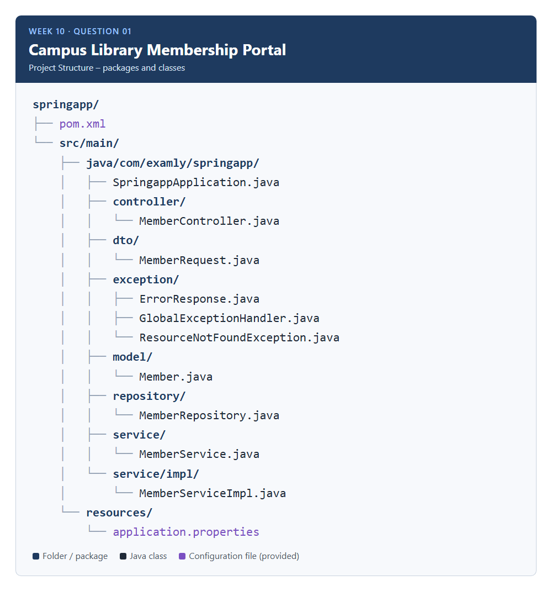
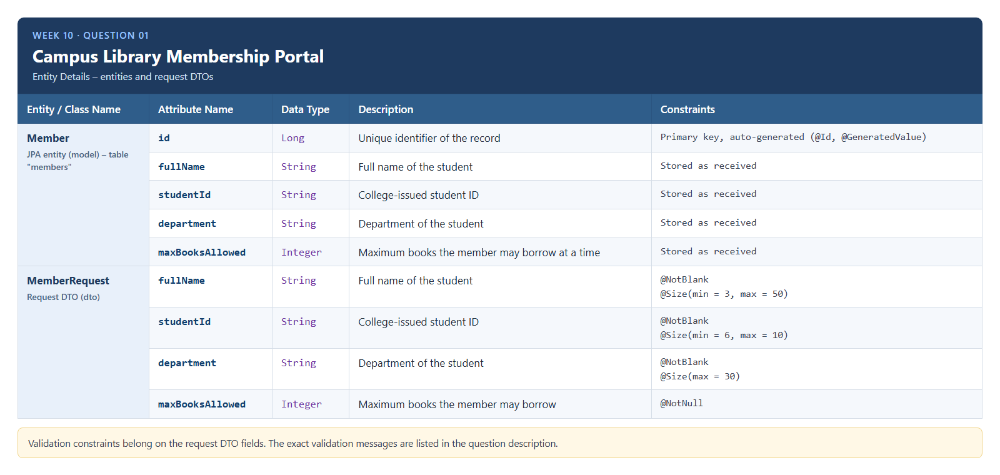
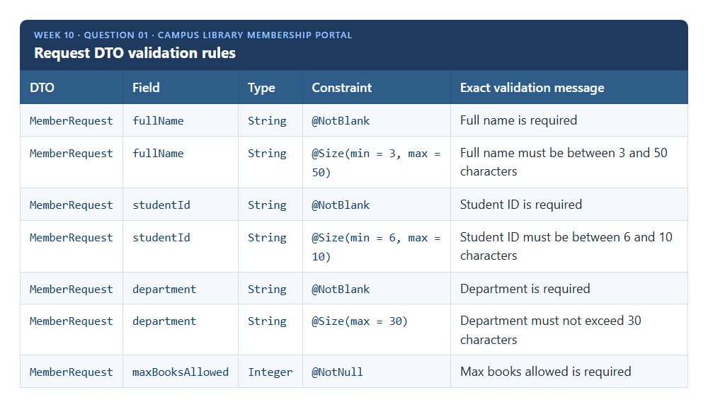
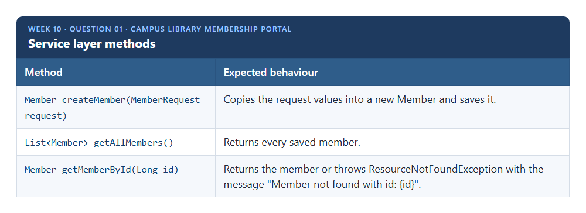
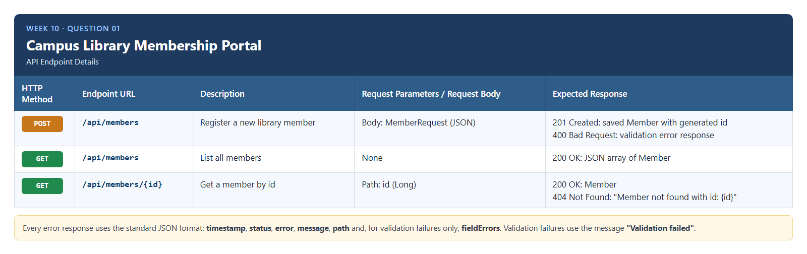
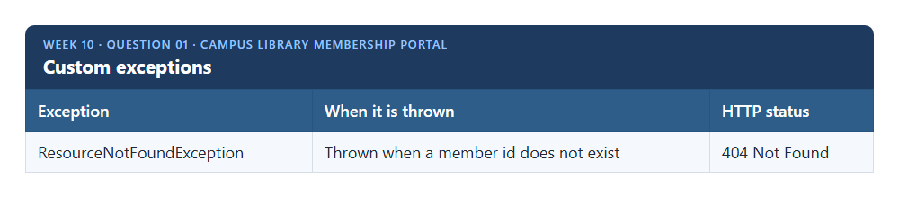
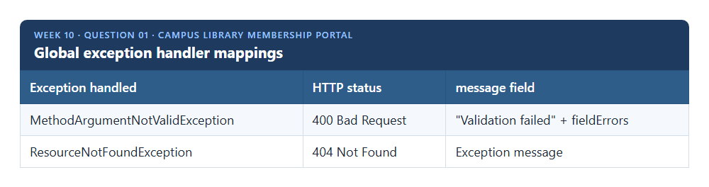
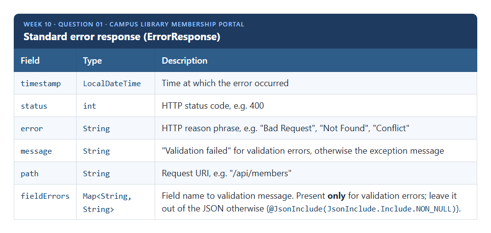

# Question 01: Campus Library Membership Portal

**Week 10: Validation & Exception Handling** · **Focus:** Bean Validation basics: @NotNull, @NotBlank, @Size with @Valid and field-level errors

## 1. Business Scenario

A librarian enters the student's full name, student ID, department and the maximum number of books the student may borrow. If any value is missing or has the wrong length, the system must reject the registration and clearly tell the librarian which field is wrong.

## 2. Problem Statement

Build a Spring Boot REST API that registers library members, lists them and fetches a member by id. Every registration request must be validated with Bean Validation, and every error must be returned in one standard JSON error format.

## 3. Functional Requirements

1. **Register a new library member**: `POST /api/members`
2. **List all members**: `GET /api/members`
3. **Get a member by id**: `GET /api/members/{id}`
4. Validate every request body before it reaches the service layer, and reject invalid data with **400 Bad Request**.
5. Handle every error in **one global exception handler** and return the standard error response described in section 11.

## 4. Project Structure and Required Classes

Create exactly these classes. Class names, package names and field names must match because the automated testcases look them up by name.



## 5. Entity Details



Every entity needs a public no-argument constructor, plus getters and setters for all fields.

## 6. Request DTOs and Validation Rules

Put the validation annotations on the **request DTO** fields and use the **exact messages** below, because the testcases compare them character by character.



## 7. Required Methods and Expected Behaviour

### Repository

The repository only needs the methods inherited from `JpaRepository` (no custom methods).

### Service layer

Declare these methods in the service interface and implement them in the `service/impl` class.



### Controller

- Use constructor injection for the service.
- Validate request bodies with `@Valid` on the `@RequestBody` parameter.
- Return `ResponseEntity` with the status codes shown in section 9.

## 8. Business Logic Requirements

- A new member is saved only when every field of MemberRequest is valid.
- The generated id is returned in the 201 response.

## 9. API Endpoints



## 10. Validation Requirements

- Add `@Valid` before every `@RequestBody` parameter so that the DTO constraints are checked.
- A failed body validation raises `MethodArgumentNotValidException`. Convert it into a 400 response whose `fieldErrors` object maps each invalid field name to its validation message.
- All invalid fields must be reported in one response, not just the first one.
- If a single field breaks more than one rule at the same time (for example an empty string that is both blank and too short), report one message for that field. Either of the field's messages is acceptable.

## 11. Exception Handling Expectations

### Custom exceptions



### Global exception handler (`GlobalExceptionHandler`)

Annotate the class with `@RestControllerAdvice` and add one `@ExceptionHandler` method for each row below.



### Standard error response (`ErrorResponse`)



**Example error response**

```json
{
  "timestamp": "2026-11-19T10:15:30.123",
  "status": 400,
  "error": "Bad Request",
  "message": "Validation failed",
  "path": "/api/members",
  "fieldErrors": {
    "fullName": "Full name is required",
    "maxBooksAllowed": "Max books allowed is required"
  }
}
```
