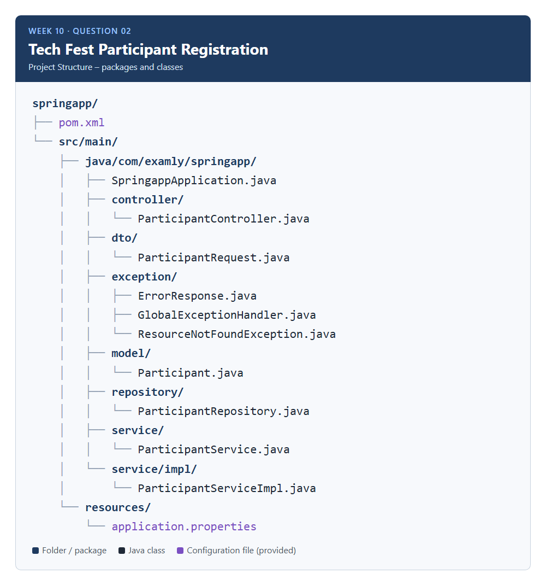
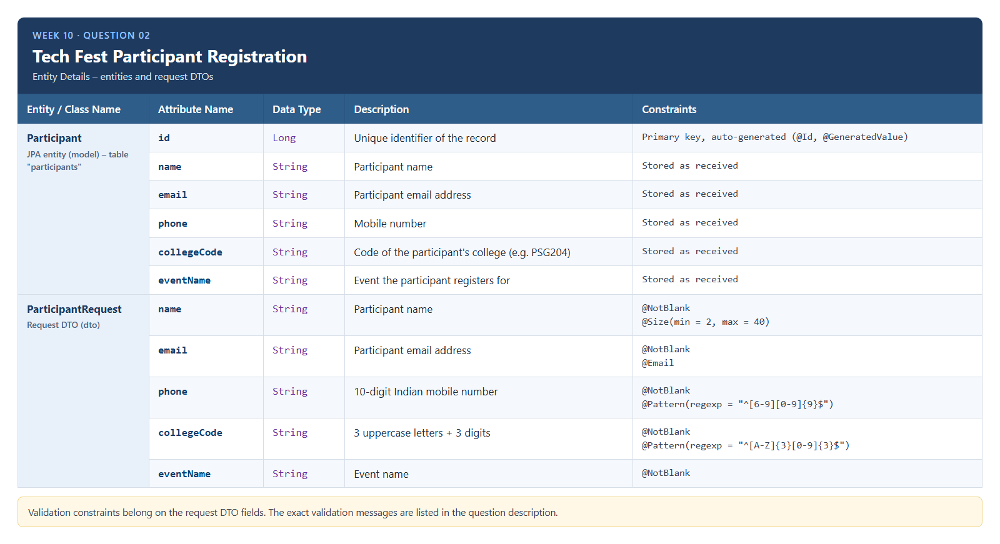
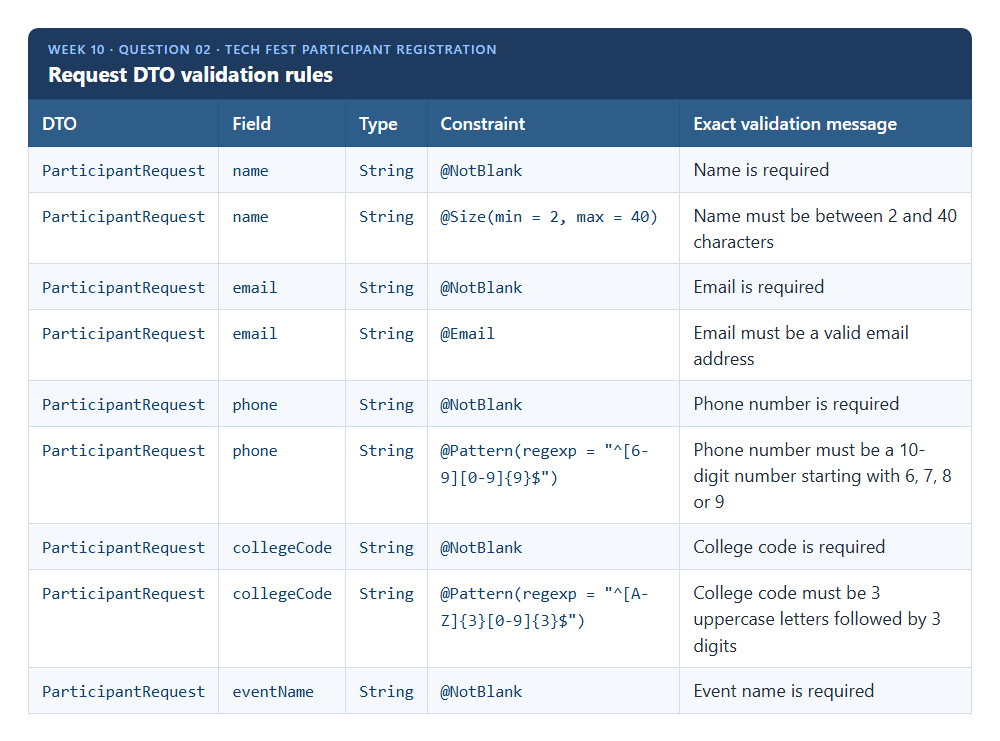
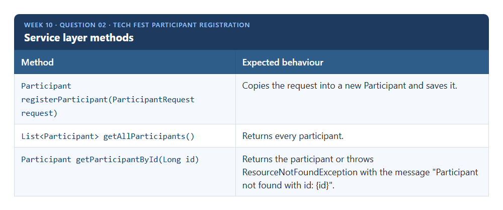
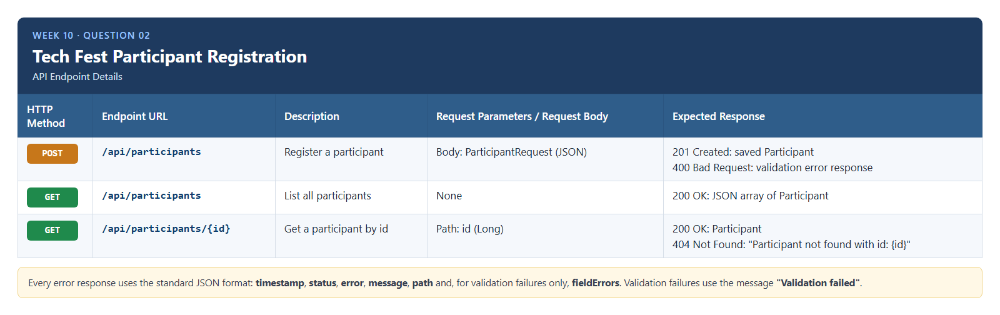
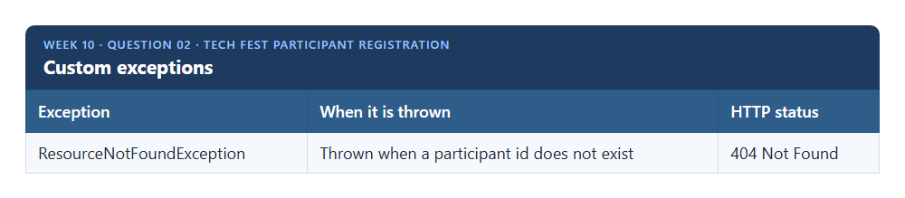
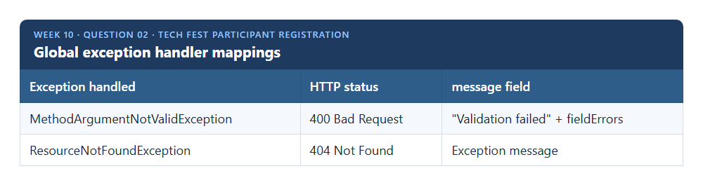
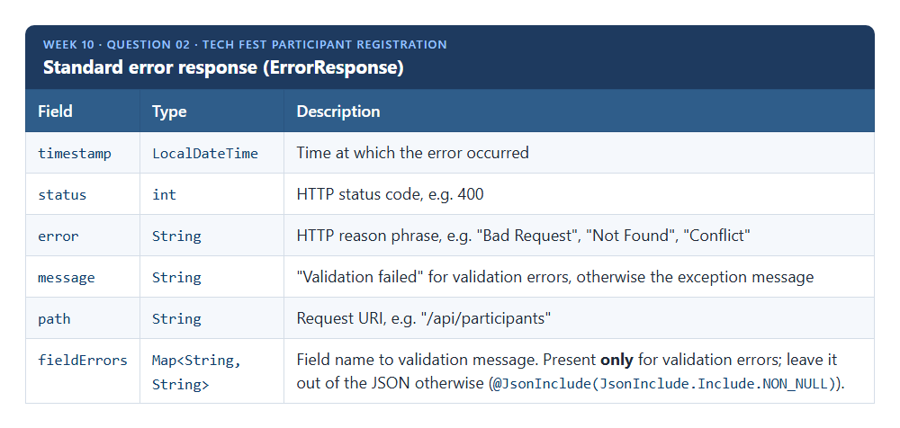

# Question 02: Tech Fest Participant Registration

**Week 10: Validation & Exception Handling** · **Focus:** Format validation with @Email and @Pattern

## 1. Business Scenario

Each participant gives a name, an email address, a mobile number, a college code and the event name. The committee has had bounced emails and wrong phone numbers in the past, so the backend must check the format of the email, phone number and college code before saving a registration.

## 2. Problem Statement

Build a Spring Boot REST API to register participants, list them and fetch one by id. Use @Email and @Pattern to enforce the formats, and return clear field-level messages in the standard error format.

## 3. Functional Requirements

1. **Register a participant**: `POST /api/participants`
2. **List all participants**: `GET /api/participants`
3. **Get a participant by id**: `GET /api/participants/{id}`
4. Validate every request body before it reaches the service layer, and reject invalid data with **400 Bad Request**.
5. Handle every error in **one global exception handler** and return the standard error response described in section 11.

## 4. Project Structure and Required Classes

Create exactly these classes. Class names, package names and field names must match because the automated testcases look them up by name.



## 5. Entity Details



Every entity needs a public no-argument constructor, plus getters and setters for all fields.

## 6. Request DTOs and Validation Rules

Put the validation annotations on the **request DTO** fields and use the **exact messages** below, because the testcases compare them character by character.



## 7. Required Methods and Expected Behaviour

### Repository

The repository only needs the methods inherited from `JpaRepository` (no custom methods).

### Service layer

Declare these methods in the service interface and implement them in the `service/impl` class.



### Controller

- Use constructor injection for the service.
- Validate request bodies with `@Valid` on the `@RequestBody` parameter.
- Return `ResponseEntity` with the status codes shown in section 9.

## 8. Business Logic Requirements

- Valid phone examples: 9876543210, 6012345678. Invalid: 5876543210 (starts with 5), 987654321 (9 digits).
- Valid college code example: KCT101. Invalid: kct101 (lowercase), KC1011 (wrong shape).

## 9. API Endpoints



## 10. Validation Requirements

- Add `@Valid` before every `@RequestBody` parameter so that the DTO constraints are checked.
- A failed body validation raises `MethodArgumentNotValidException`. Convert it into a 400 response whose `fieldErrors` object maps each invalid field name to its validation message.
- All invalid fields must be reported in one response, not just the first one.
- If a single field breaks more than one rule at the same time (for example an empty string that is both blank and too short), report one message for that field. Either of the field's messages is acceptable.

## 11. Exception Handling Expectations

### Custom exceptions



### Global exception handler (`GlobalExceptionHandler`)

Annotate the class with `@RestControllerAdvice` and add one `@ExceptionHandler` method for each row below.



### Standard error response (`ErrorResponse`)



**Example error response**

```json
{
  "timestamp": "2026-11-19T10:15:30.123",
  "status": 400,
  "error": "Bad Request",
  "message": "Validation failed",
  "path": "/api/participants",
  "fieldErrors": {
    "email": "Email must be a valid email address"
  }
}
```
