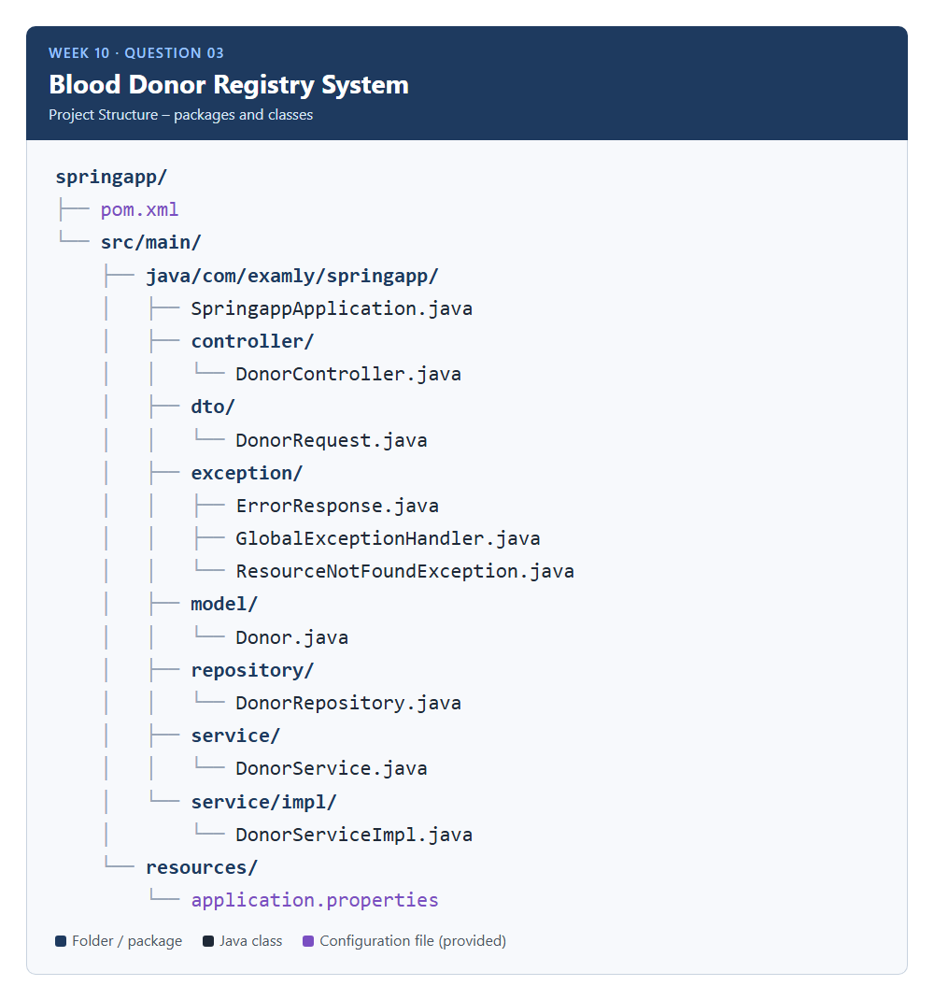
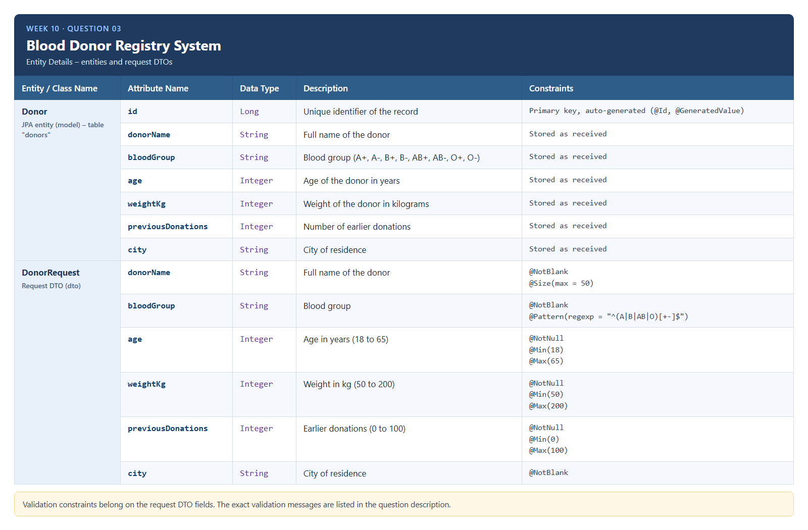
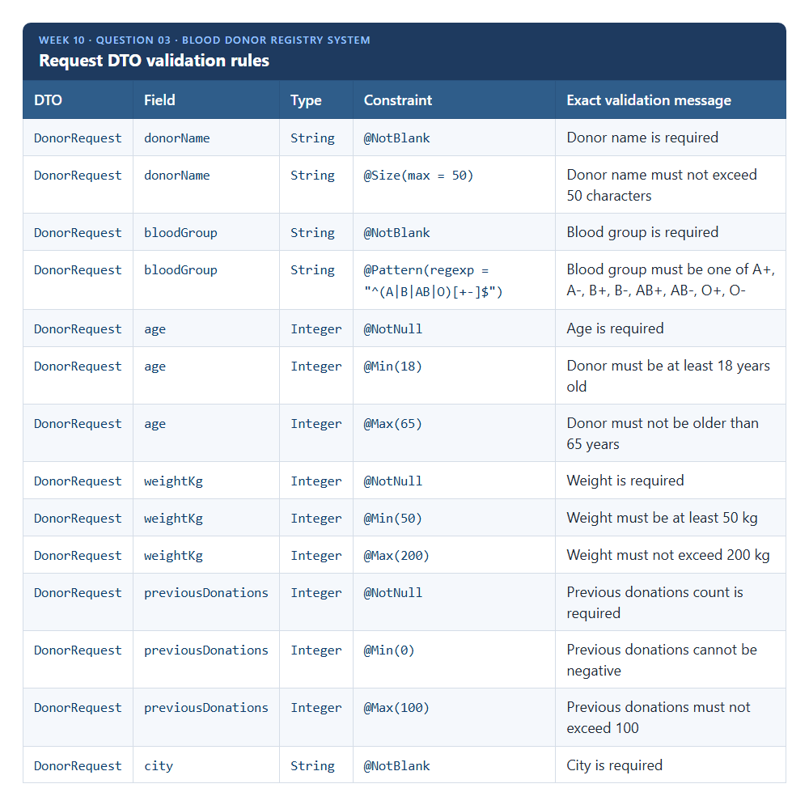
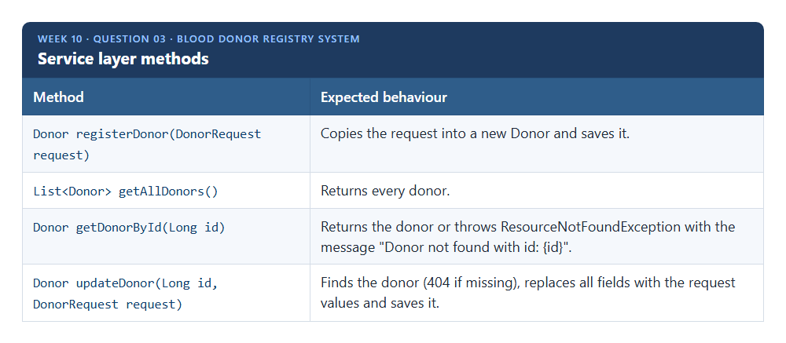
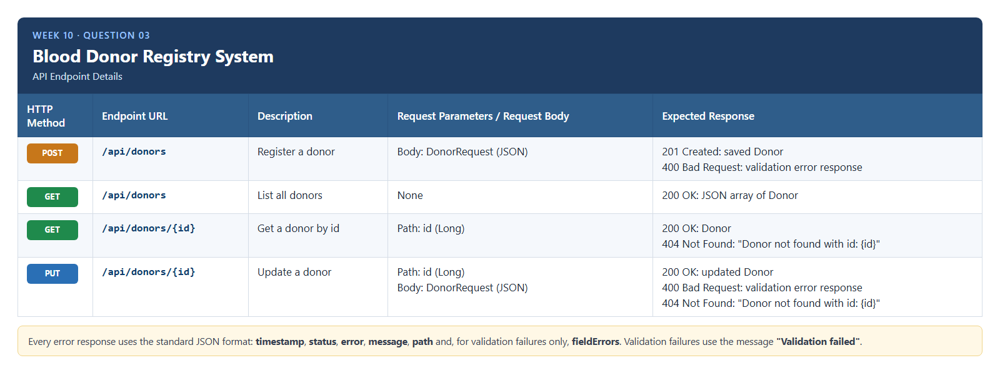
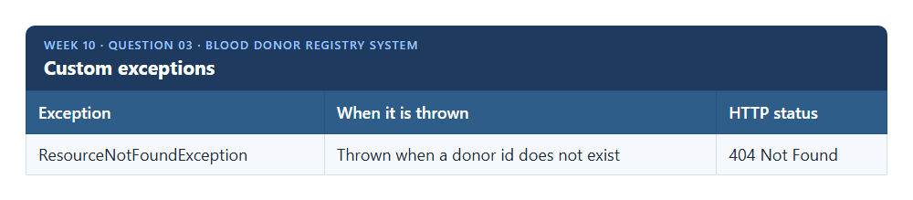
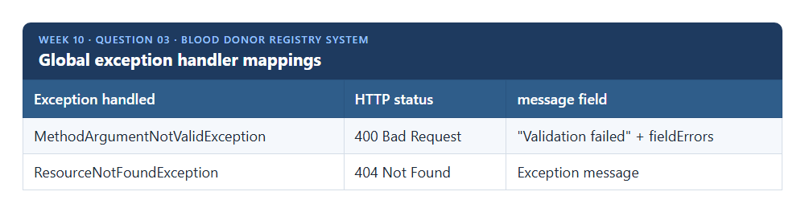
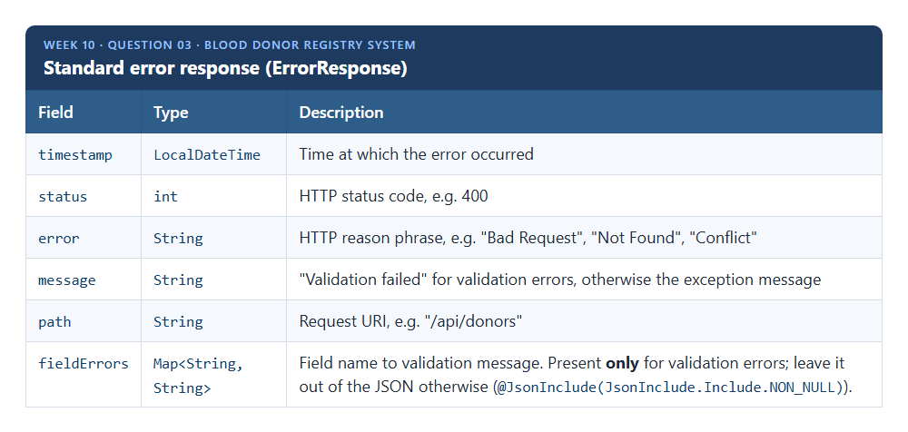

# Question 03: Blood Donor Registry System

**Week 10: Validation & Exception Handling** · **Focus:** Numeric range validation with @Min and @Max (including boundary values)

## 1. Business Scenario

A donor is eligible only if they are between 18 and 65 years old and weigh at least 50 kg. The blood bank also records the blood group and the number of previous donations. Staff can correct a donor's details later, and the same rules apply to updates.

## 2. Problem Statement

Build a Spring Boot REST API to register, list, fetch and update donors. Use @Min and @Max to enforce the eligibility ranges, and use the standard error format for validation and not-found errors.

## 3. Functional Requirements

1. **Register a donor**: `POST /api/donors`
2. **List all donors**: `GET /api/donors`
3. **Get a donor by id**: `GET /api/donors/{id}`
4. **Update a donor**: `PUT /api/donors/{id}`
5. Validate every request body before it reaches the service layer, and reject invalid data with **400 Bad Request**.
6. Handle every error in **one global exception handler** and return the standard error response described in section 11.

## 4. Project Structure and Required Classes

Create exactly these classes. Class names, package names and field names must match because the automated testcases look them up by name.



## 5. Entity Details



Every entity needs a public no-argument constructor, plus getters and setters for all fields.

## 6. Request DTOs and Validation Rules

Put the validation annotations on the **request DTO** fields and use the **exact messages** below, because the testcases compare them character by character.



## 7. Required Methods and Expected Behaviour

### Repository

The repository only needs the methods inherited from `JpaRepository` (no custom methods).

### Service layer

Declare these methods in the service interface and implement them in the `service/impl` class.



### Controller

- Use constructor injection for the service.
- Validate request bodies with `@Valid` on the `@RequestBody` parameter.
- Return `ResponseEntity` with the status codes shown in section 9.

## 8. Business Logic Requirements

- Boundary values are valid: age 18 and 65, weight 50 and 200, previous donations 0 and 100.
- The same validation rules apply to POST and PUT requests.

## 9. API Endpoints



## 10. Validation Requirements

- Add `@Valid` before every `@RequestBody` parameter so that the DTO constraints are checked.
- A failed body validation raises `MethodArgumentNotValidException`. Convert it into a 400 response whose `fieldErrors` object maps each invalid field name to its validation message.
- All invalid fields must be reported in one response, not just the first one.
- If a single field breaks more than one rule at the same time (for example an empty string that is both blank and too short), report one message for that field. Either of the field's messages is acceptable.

## 11. Exception Handling Expectations

### Custom exceptions



### Global exception handler (`GlobalExceptionHandler`)

Annotate the class with `@RestControllerAdvice` and add one `@ExceptionHandler` method for each row below.



### Standard error response (`ErrorResponse`)



**Example error response**

```json
{
  "timestamp": "2026-11-19T10:15:30.123",
  "status": 400,
  "error": "Bad Request",
  "message": "Validation failed",
  "path": "/api/donors",
  "fieldErrors": {
    "age": "Donor must be at least 18 years old"
  }
}
```
