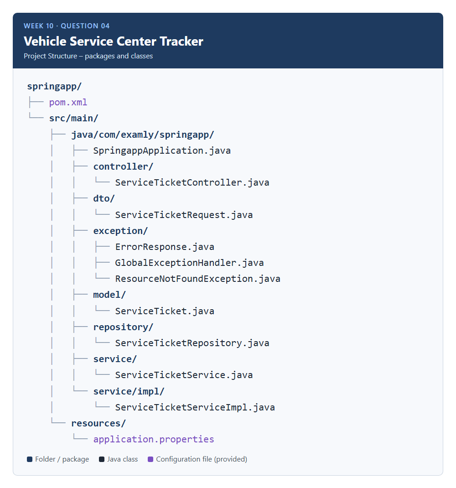
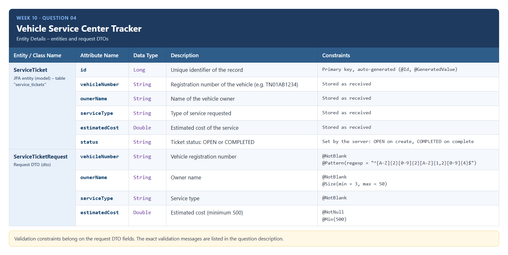
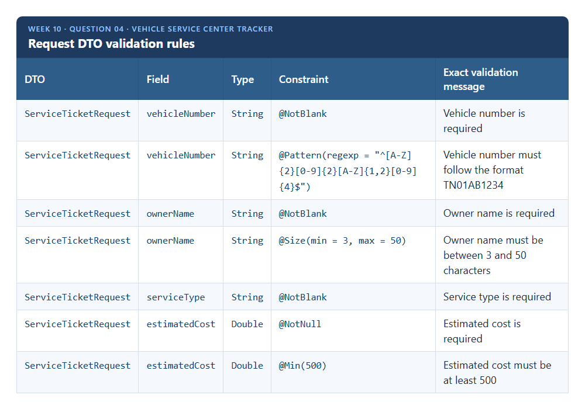
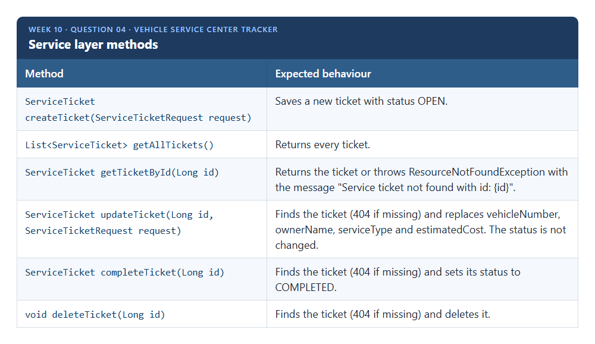
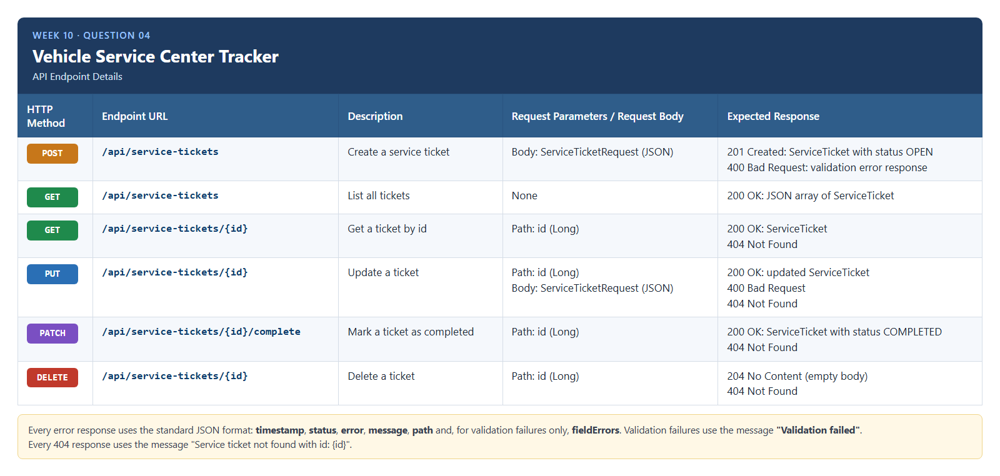
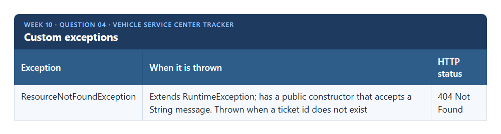
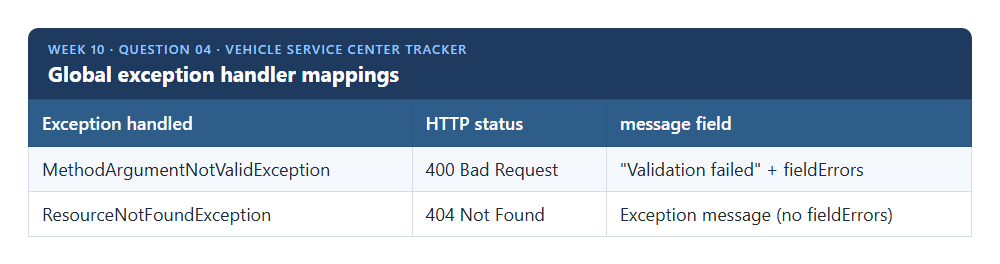
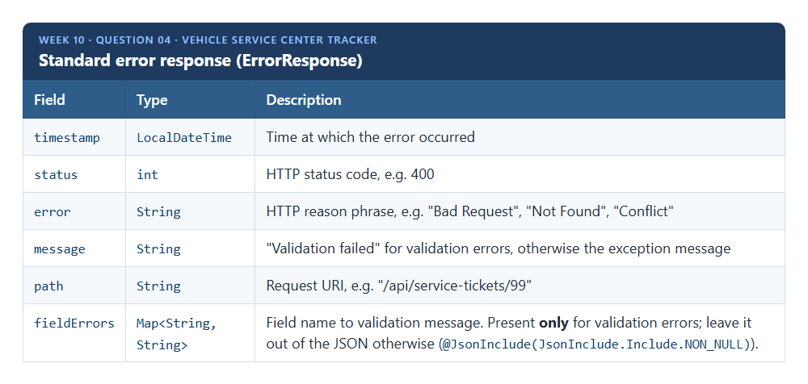

# Question 04: Vehicle Service Center Tracker

**Week 10: Validation & Exception Handling** · **Focus:** Custom ResourceNotFoundException handled globally with @RestControllerAdvice and @ExceptionHandler

## 1. Business Scenario

Staff often type a wrong ticket number. Instead of a confusing default error page, the system must reply with a clear "not found" message in a consistent JSON format, no matter which operation was attempted.

## 2. Problem Statement

Build a Spring Boot REST API for service tickets with create, list, get, update, complete and delete operations. Every missing-ticket case must throw a custom ResourceNotFoundException, which a global exception handler converts into a standard 404 error response.

## 3. Functional Requirements

1. **Create a service ticket**: `POST /api/service-tickets`
2. **List all tickets**: `GET /api/service-tickets`
3. **Get a ticket by id**: `GET /api/service-tickets/{id}`
4. **Update a ticket**: `PUT /api/service-tickets/{id}`
5. **Mark a ticket as completed**: `PATCH /api/service-tickets/{id}/complete`
6. **Delete a ticket**: `DELETE /api/service-tickets/{id}`
7. Validate every request body before it reaches the service layer, and reject invalid data with **400 Bad Request**.
8. Handle every error in **one global exception handler** and return the standard error response described in section 11.

## 4. Project Structure and Required Classes

Create exactly these classes. Class names, package names and field names must match because the automated testcases look them up by name.



## 5. Entity Details



Every entity needs a public no-argument constructor, plus getters and setters for all fields.

## 6. Request DTOs and Validation Rules

Put the validation annotations on the **request DTO** fields and use the **exact messages** below, because the testcases compare them character by character.



## 7. Required Methods and Expected Behaviour

### Repository

The repository only needs the methods inherited from `JpaRepository` (no custom methods).

### Service layer

Declare these methods in the service interface and implement them in the `service/impl` class.



### Controller

- Use constructor injection for the service.
- Validate request bodies with `@Valid` on the `@RequestBody` parameter.
- Return `ResponseEntity` with the status codes shown in section 9.

## 8. Business Logic Requirements

- A new ticket always starts with status OPEN; the client never sends the status.
- All not-found cases go through the global exception handler. Controllers must not build error responses themselves.

## 9. API Endpoints



## 10. Validation Requirements

- Add `@Valid` before every `@RequestBody` parameter so that the DTO constraints are checked.
- A failed body validation raises `MethodArgumentNotValidException`. Convert it into a 400 response whose `fieldErrors` object maps each invalid field name to its validation message.
- All invalid fields must be reported in one response, not just the first one.
- If a single field breaks more than one rule at the same time (for example an empty string that is both blank and too short), report one message for that field. Either of the field's messages is acceptable.

## 11. Exception Handling Expectations

### Custom exceptions



### Global exception handler (`GlobalExceptionHandler`)

Annotate the class with `@RestControllerAdvice` and add one `@ExceptionHandler` method for each row below.



### Standard error response (`ErrorResponse`)



**Example error response**

```json
{
  "timestamp": "2026-11-19T10:15:30.123",
  "status": 404,
  "error": "Not Found",
  "message": "Service ticket not found with id: 99",
  "path": "/api/service-tickets/99"
}
```
