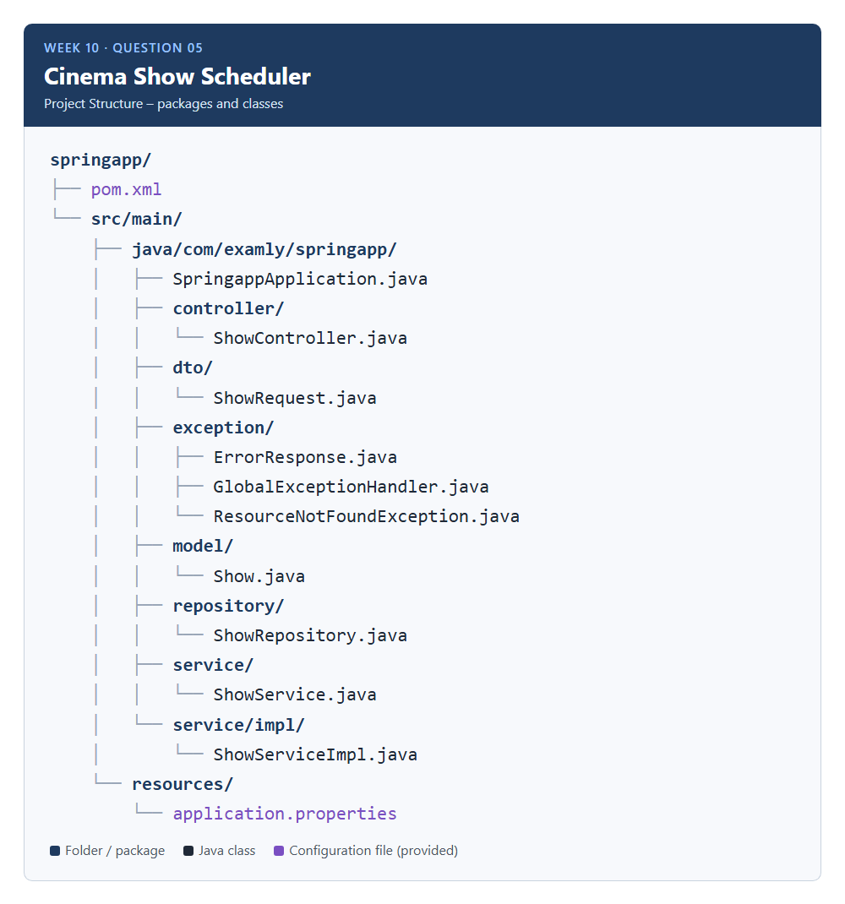
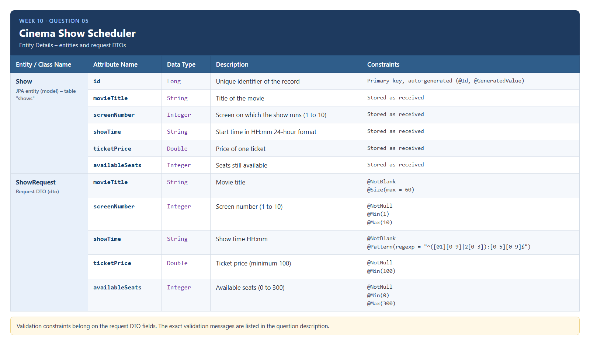
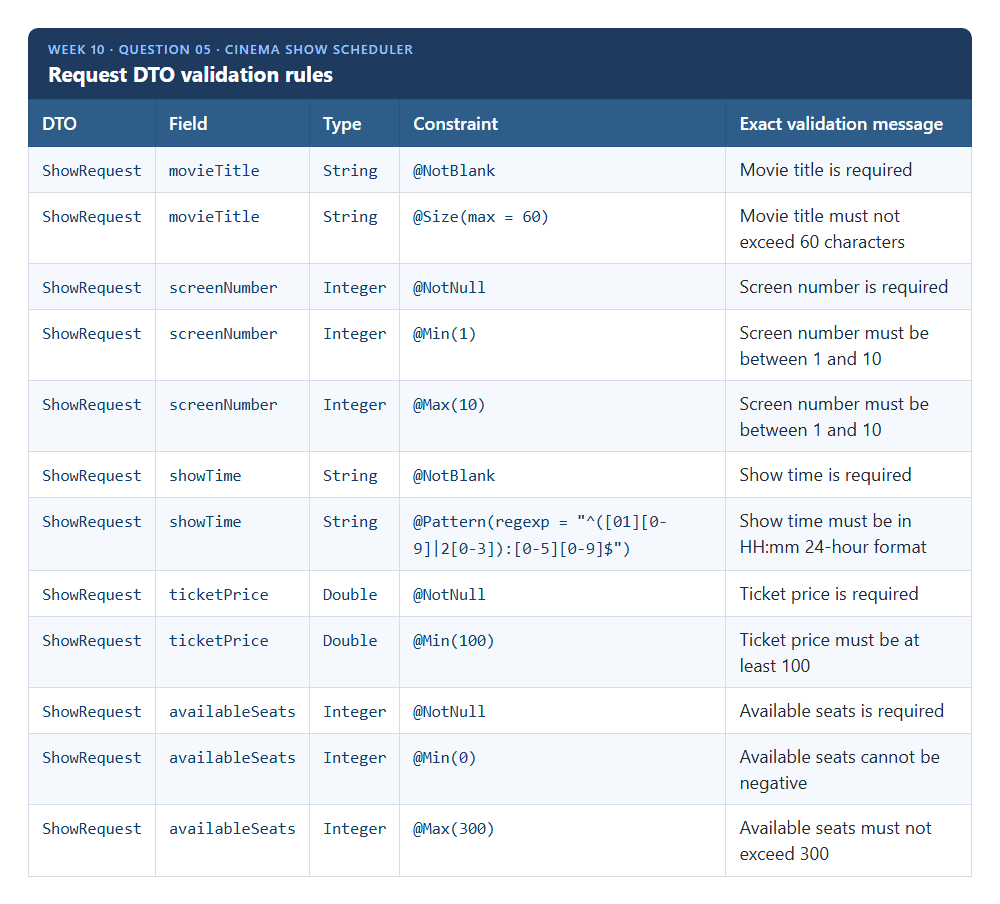
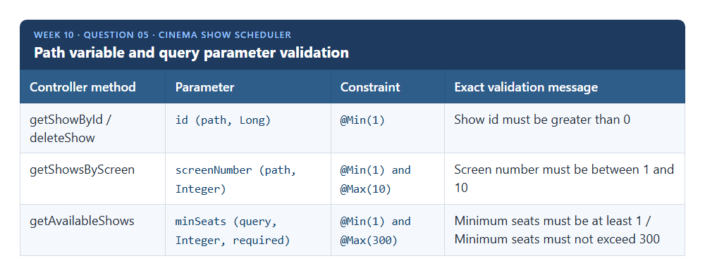
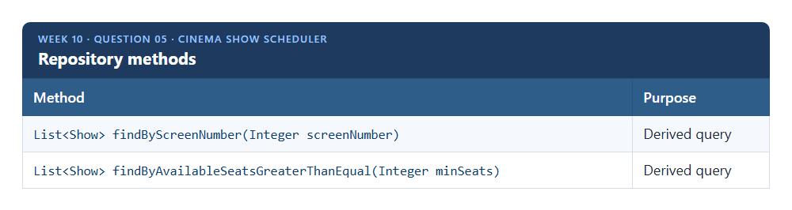
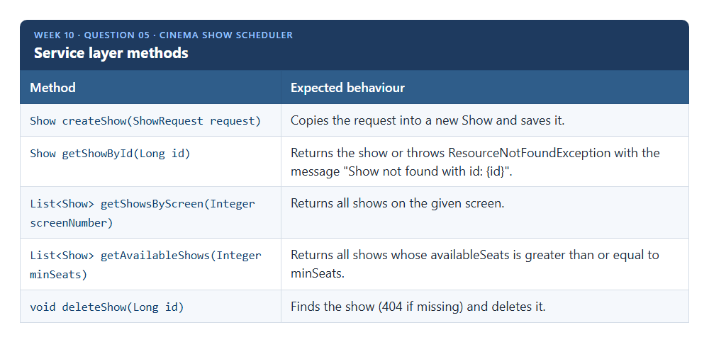
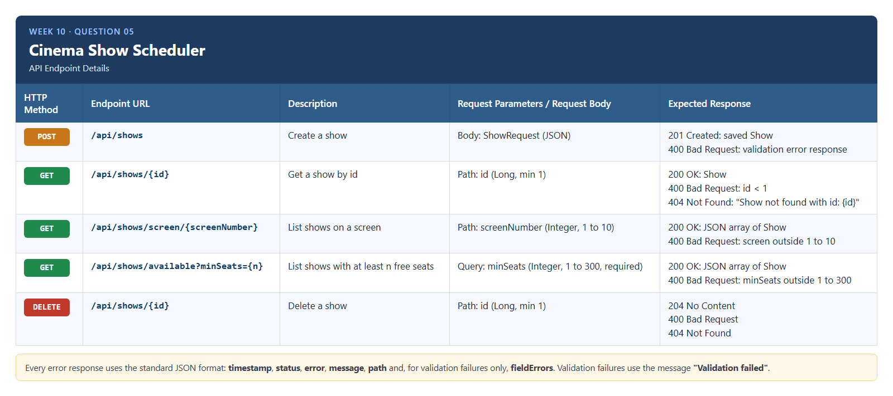
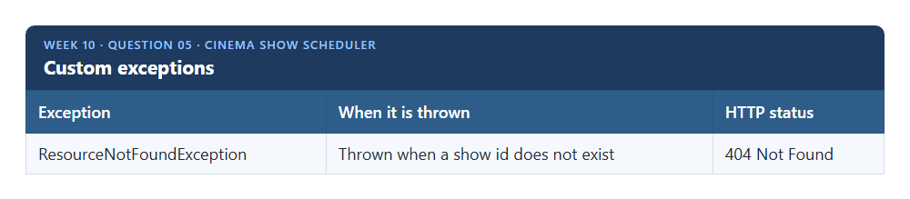
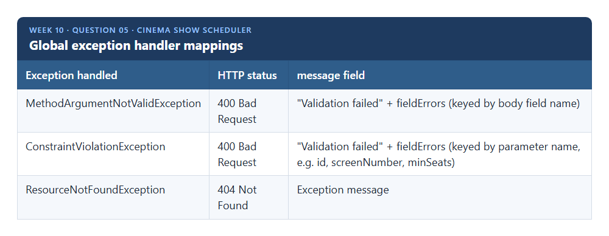
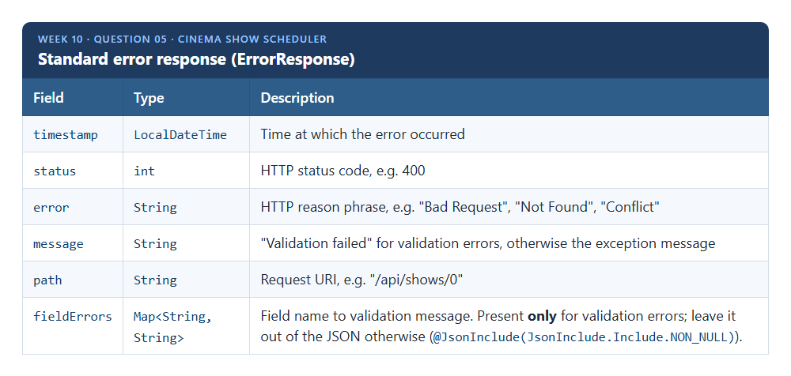

# Question 05: Cinema Show Scheduler

**Week 10: Validation & Exception Handling** · **Focus:** @Validated on path variables and query parameters, handling ConstraintViolationException

## 1. Business Scenario

The box-office app sometimes sends impossible values in the URL, such as screen 11, show id 0 or a minimum seat count of 0. These must be rejected with a 400 response that names the invalid parameter, just as invalid request bodies are rejected.

## 2. Problem Statement

Build a Spring Boot REST API to create, fetch, filter and delete shows. Validate request bodies with @Valid, and validate path variables and query parameters by adding @Validated to the controller and constraint annotations to the method parameters. Return every error in the standard format.

## 3. Functional Requirements

1. **Create a show**: `POST /api/shows`
2. **Get a show by id**: `GET /api/shows/{id}`
3. **List shows on a screen**: `GET /api/shows/screen/{screenNumber}`
4. **List shows with at least n free seats**: `GET /api/shows/available?minSeats={n}`
5. **Delete a show**: `DELETE /api/shows/{id}`
6. Validate every request body before it reaches the service layer, and reject invalid data with **400 Bad Request**.
7. Handle every error in **one global exception handler** and return the standard error response described in section 11.

## 4. Project Structure and Required Classes

Create exactly these classes. Class names, package names and field names must match because the automated testcases look them up by name.



## 5. Entity Details



Every entity needs a public no-argument constructor, plus getters and setters for all fields.

## 6. Request DTOs and Validation Rules

Put the validation annotations on the **request DTO** fields and use the **exact messages** below, because the testcases compare them character by character.



### Path variable and query parameter validation



## 7. Required Methods and Expected Behaviour

### Repository



### Service layer

Declare these methods in the service interface and implement them in the `service/impl` class.



### Controller

- The controller class ShowController must be annotated with @RestController, @RequestMapping("/api/shows") and @Validated.
- The method that serves GET /api/shows/{id} must be named getShowById and take a single Long id parameter annotated with @PathVariable and @Min(1).
- Use constructor injection for the service.
- Validate request bodies with `@Valid` on the `@RequestBody` parameter.
- Return `ResponseEntity` with the status codes shown in section 9.

## 8. Business Logic Requirements

- For a path or query parameter error, the key in fieldErrors is the parameter name (the last part of the constraint violation property path), for example "id", "screenNumber" or "minSeats".
- Show time examples: 09:00 and 23:59 are valid; 24:00 and 25:30 are invalid.

## 9. API Endpoints



## 10. Validation Requirements

- Add `@Valid` before every `@RequestBody` parameter so that the DTO constraints are checked.
- Annotate the controller class with `@Validated` so that constraints on `@PathVariable` and `@RequestParam` parameters are checked. A violation raises `ConstraintViolationException`.
- A failed body validation raises `MethodArgumentNotValidException`. Convert it into a 400 response whose `fieldErrors` object maps each invalid field name to its validation message.
- All invalid fields must be reported in one response, not just the first one.
- If a single field breaks more than one rule at the same time (for example an empty string that is both blank and too short), report one message for that field. Either of the field's messages is acceptable.

## 11. Exception Handling Expectations

### Custom exceptions



### Global exception handler (`GlobalExceptionHandler`)

Annotate the class with `@RestControllerAdvice` and add one `@ExceptionHandler` method for each row below.



### Standard error response (`ErrorResponse`)



**Example error response**

```json
{
  "timestamp": "2026-11-19T10:15:30.123",
  "status": 400,
  "error": "Bad Request",
  "message": "Validation failed",
  "path": "/api/shows/0",
  "fieldErrors": {
    "id": "Show id must be greater than 0"
  }
}
```
