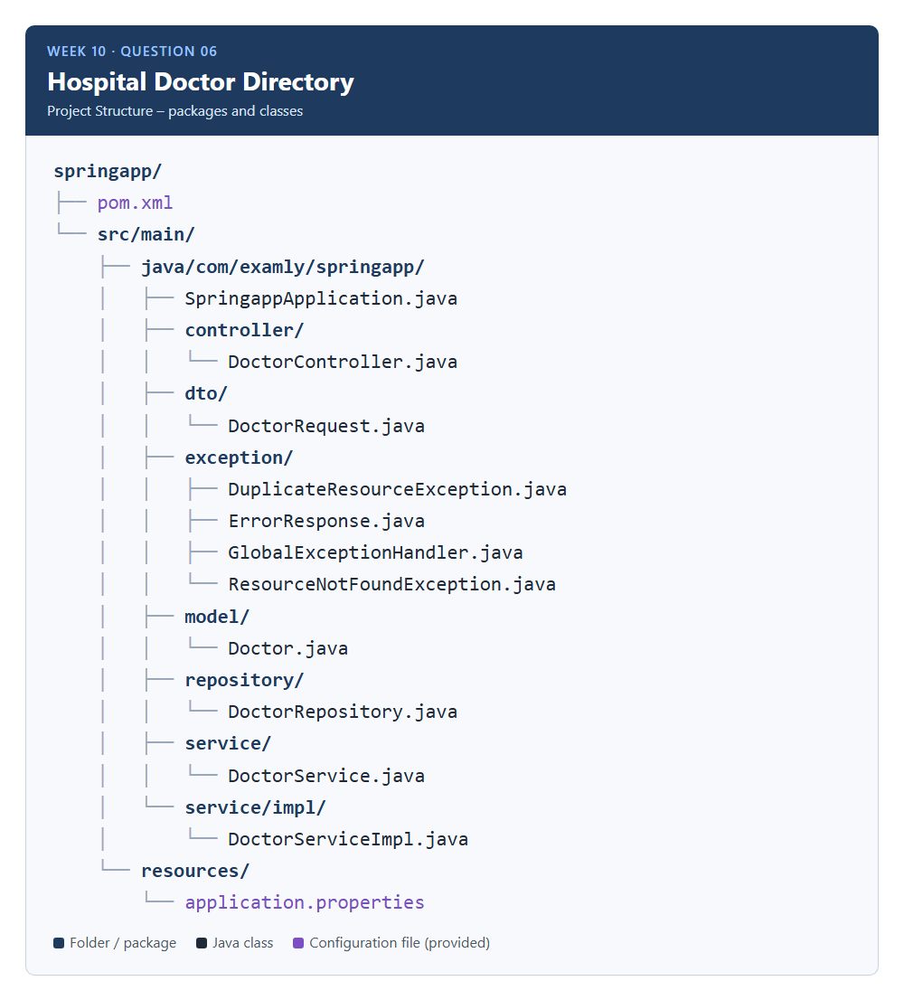
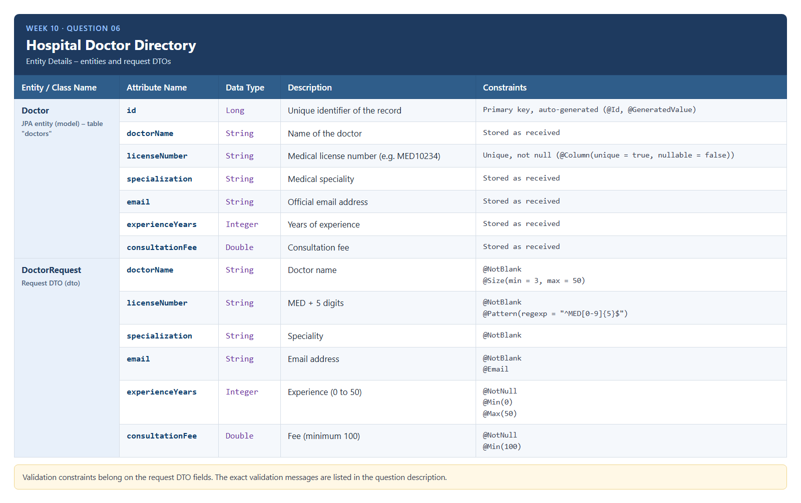
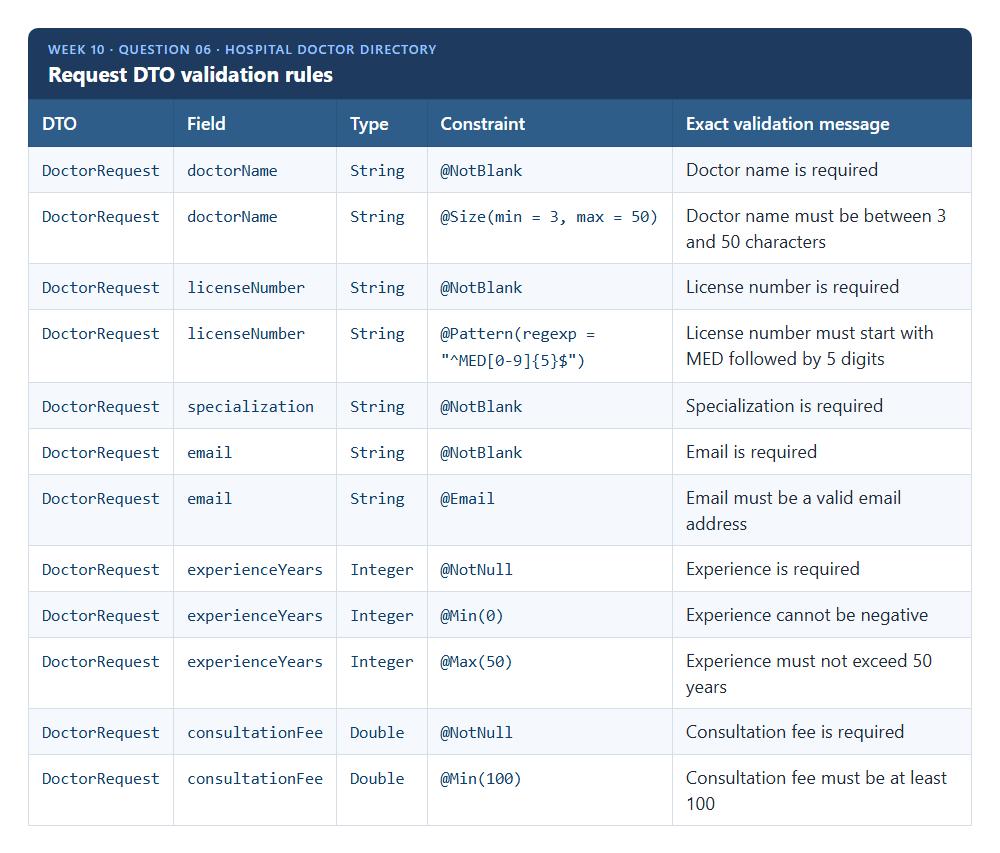
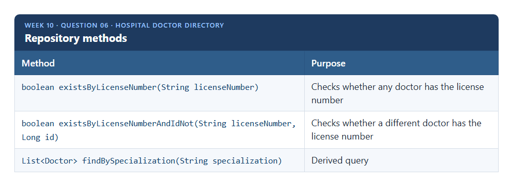
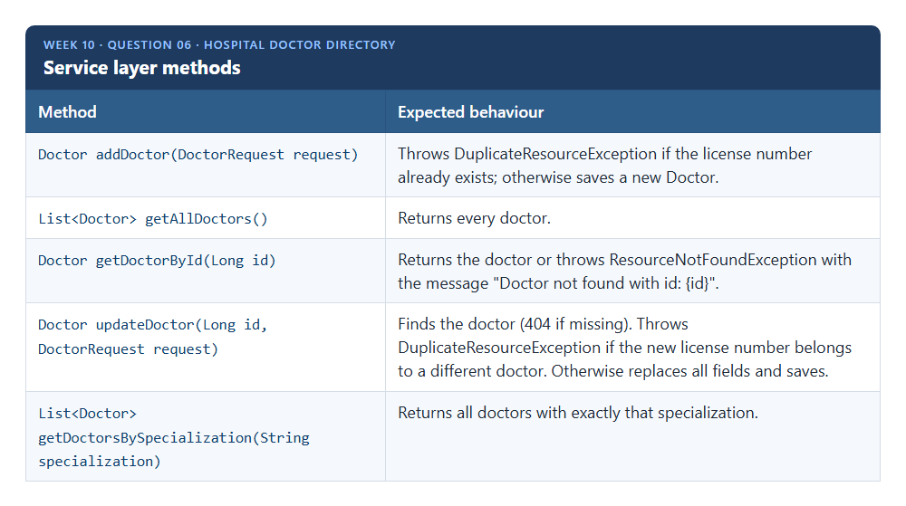
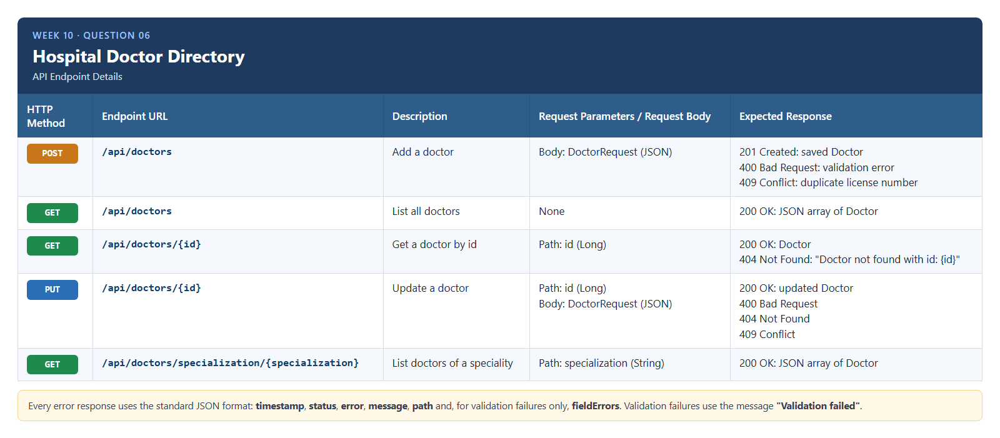
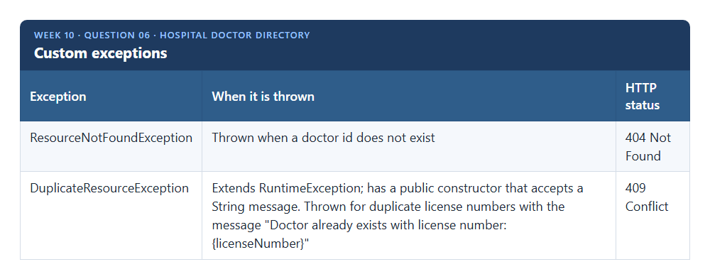
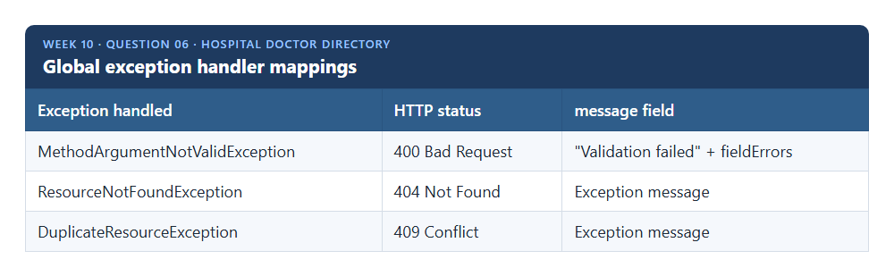
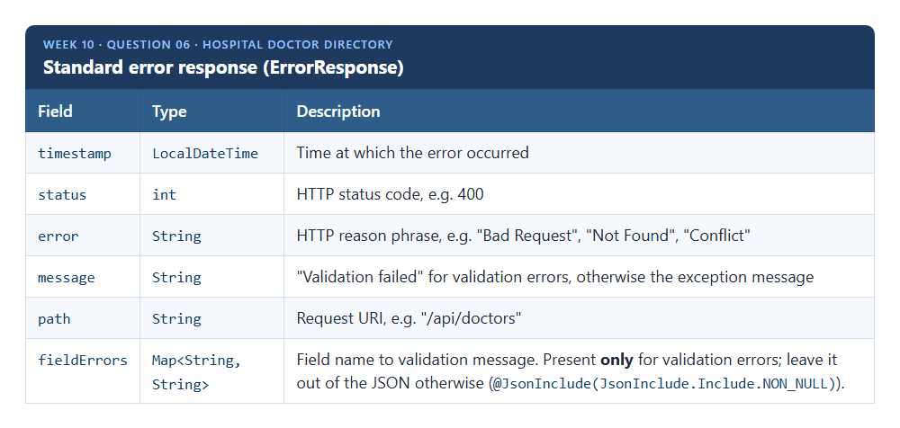

# Question 06: Hospital Doctor Directory

**Week 10: Validation & Exception Handling** · **Focus:** Custom DuplicateResourceException mapped to 409 Conflict, together with validation and 404 handling

## 1. Business Scenario

Every doctor has a medical license number that must be unique across the hospital. When an administrator tries to add a second doctor with an existing license number, or changes a doctor's license number to one that already belongs to someone else, the request must be refused with a 409 Conflict.

## 2. Problem Statement

Build a Spring Boot REST API to add, list, fetch, update and search doctors by speciality. Validate requests, throw a custom DuplicateResourceException for duplicate license numbers, and map every exception to the standard error format in a global handler.

## 3. Functional Requirements

1. **Add a doctor**: `POST /api/doctors`
2. **List all doctors**: `GET /api/doctors`
3. **Get a doctor by id**: `GET /api/doctors/{id}`
4. **Update a doctor**: `PUT /api/doctors/{id}`
5. **List doctors of a speciality**: `GET /api/doctors/specialization/{specialization}`
6. Validate every request body before it reaches the service layer, and reject invalid data with **400 Bad Request**.
7. Handle every error in **one global exception handler** and return the standard error response described in section 11.

## 4. Project Structure and Required Classes

Create exactly these classes. Class names, package names and field names must match because the automated testcases look them up by name.



## 5. Entity Details



Every entity needs a public no-argument constructor, plus getters and setters for all fields.

## 6. Request DTOs and Validation Rules

Put the validation annotations on the **request DTO** fields and use the **exact messages** below, because the testcases compare them character by character.



## 7. Required Methods and Expected Behaviour

### Repository



### Service layer

Declare these methods in the service interface and implement them in the `service/impl` class.



### Controller

- Use constructor injection for the service.
- Validate request bodies with `@Valid` on the `@RequestBody` parameter.
- Return `ResponseEntity` with the status codes shown in section 9.

## 8. Business Logic Requirements

- Updating a doctor while keeping its own license number is allowed and returns 200.
- Changing a doctor's license number to one used by another doctor returns 409.

## 9. API Endpoints



## 10. Validation Requirements

- Add `@Valid` before every `@RequestBody` parameter so that the DTO constraints are checked.
- A failed body validation raises `MethodArgumentNotValidException`. Convert it into a 400 response whose `fieldErrors` object maps each invalid field name to its validation message.
- All invalid fields must be reported in one response, not just the first one.
- If a single field breaks more than one rule at the same time (for example an empty string that is both blank and too short), report one message for that field. Either of the field's messages is acceptable.

## 11. Exception Handling Expectations

### Custom exceptions



### Global exception handler (`GlobalExceptionHandler`)

Annotate the class with `@RestControllerAdvice` and add one `@ExceptionHandler` method for each row below.



### Standard error response (`ErrorResponse`)



**Example error response**

```json
{
  "timestamp": "2026-11-19T10:15:30.123",
  "status": 409,
  "error": "Conflict",
  "message": "Doctor already exists with license number: MED10234",
  "path": "/api/doctors"
}
```
