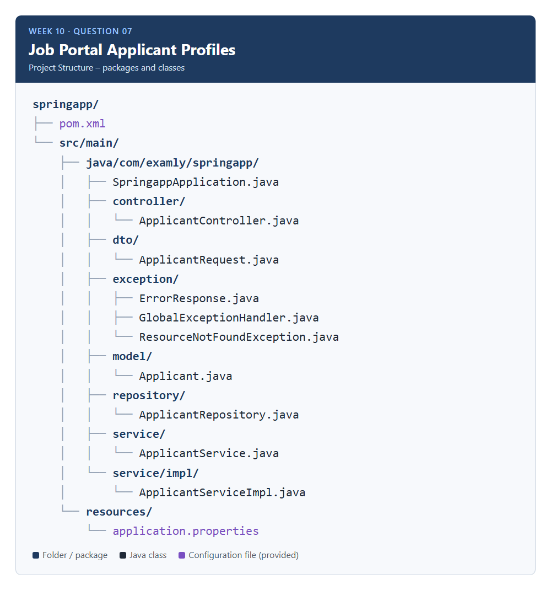
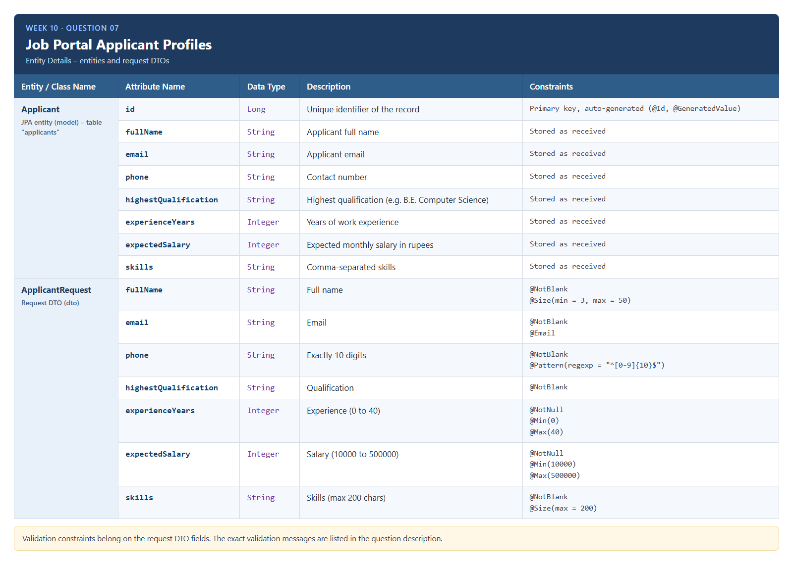
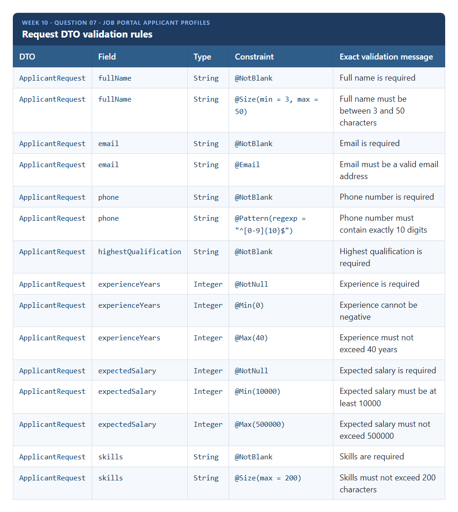
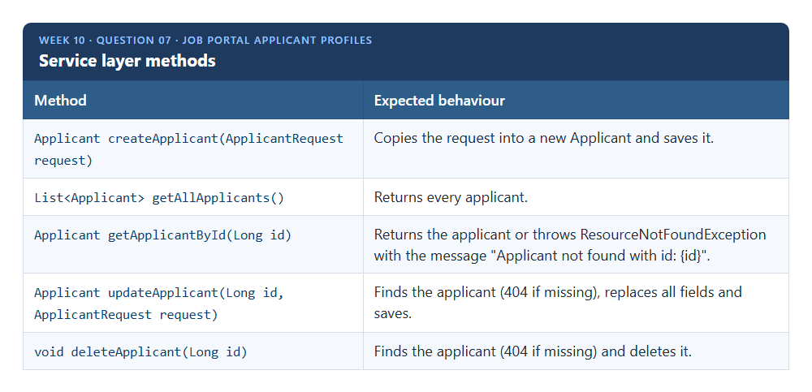
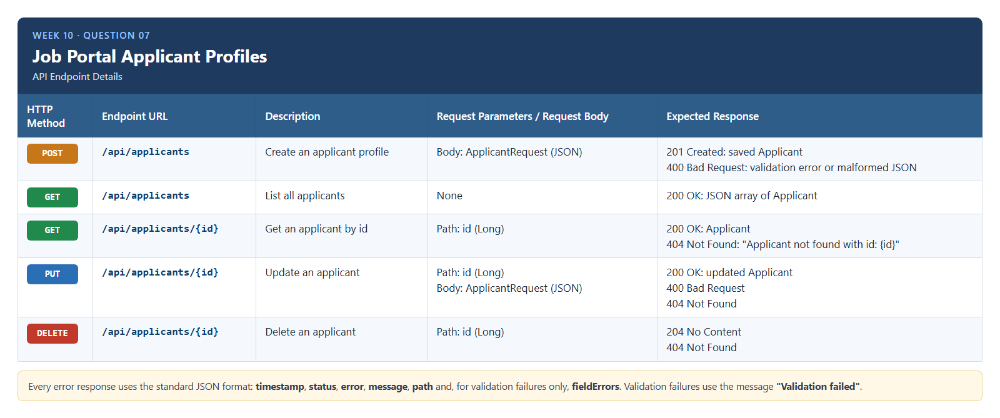
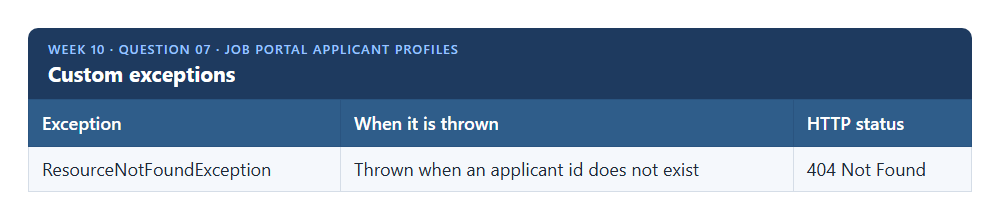
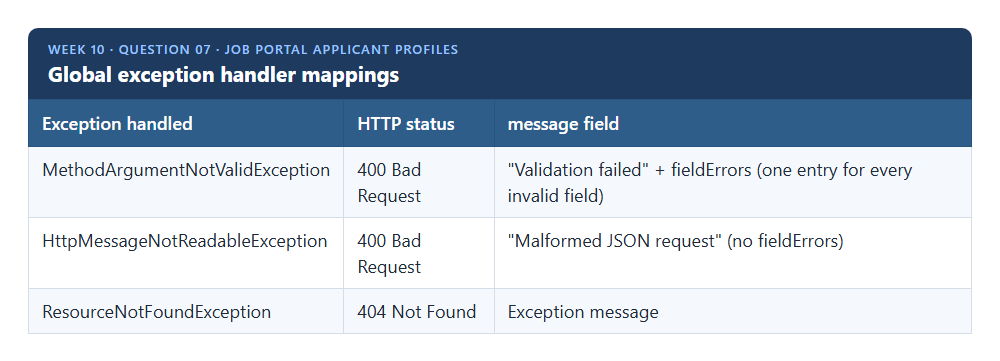
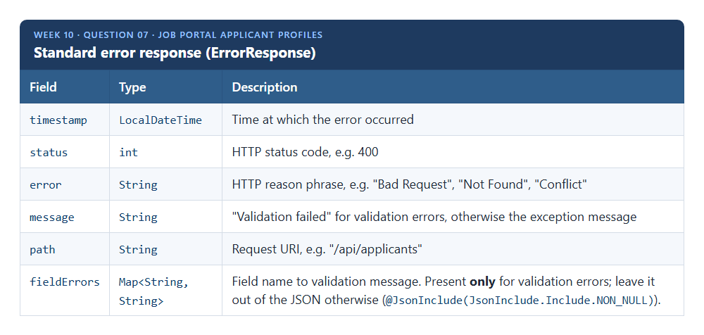

# Question 07: Job Portal Applicant Profiles

**Week 10: Validation & Exception Handling** · **Focus:** All seven constraint annotations on one DTO, reporting every field error at once, and handling malformed JSON

## 1. Business Scenario

Applicants often submit half-filled forms. Instead of fixing one error at a time, the portal must report every invalid field in a single response. When a client sends broken JSON, the portal must still answer with the standard error format and not a default error page.

## 2. Problem Statement

Build a Spring Boot REST API to create, list, fetch, update and delete applicant profiles. The request DTO must use all seven constraints of the week (@NotNull, @NotBlank, @Size, @Email, @Min, @Max, @Pattern). The global handler must also convert malformed JSON into the standard error response.

## 3. Functional Requirements

1. **Create an applicant profile**: `POST /api/applicants`
2. **List all applicants**: `GET /api/applicants`
3. **Get an applicant by id**: `GET /api/applicants/{id}`
4. **Update an applicant**: `PUT /api/applicants/{id}`
5. **Delete an applicant**: `DELETE /api/applicants/{id}`
6. Validate every request body before it reaches the service layer, and reject invalid data with **400 Bad Request**.
7. Handle every error in **one global exception handler** and return the standard error response described in section 11.

## 4. Project Structure and Required Classes

Create exactly these classes. Class names, package names and field names must match because the automated testcases look them up by name.



## 5. Entity Details



Every entity needs a public no-argument constructor, plus getters and setters for all fields.

## 6. Request DTOs and Validation Rules

Put the validation annotations on the **request DTO** fields and use the **exact messages** below, because the testcases compare them character by character.



## 7. Required Methods and Expected Behaviour

### Repository

The repository only needs the methods inherited from `JpaRepository` (no custom methods).

### Service layer

Declare these methods in the service interface and implement them in the `service/impl` class.



### Controller

- Use constructor injection for the service.
- Validate request bodies with `@Valid` on the `@RequestBody` parameter.
- Return `ResponseEntity` with the status codes shown in section 9.

## 8. Business Logic Requirements

- Sending an empty JSON object {} must return 400 with fieldErrors entries for all seven fields.
- Boundary values are valid: experience 0 and 40, expected salary 10000 and 500000, skills of exactly 200 characters.

## 9. API Endpoints



## 10. Validation Requirements

- Add `@Valid` before every `@RequestBody` parameter so that the DTO constraints are checked.
- A failed body validation raises `MethodArgumentNotValidException`. Convert it into a 400 response whose `fieldErrors` object maps each invalid field name to its validation message.
- All invalid fields must be reported in one response, not just the first one.
- If a single field breaks more than one rule at the same time (for example an empty string that is both blank and too short), report one message for that field. Either of the field's messages is acceptable.

## 11. Exception Handling Expectations

### Custom exceptions



### Global exception handler (`GlobalExceptionHandler`)

Annotate the class with `@RestControllerAdvice` and add one `@ExceptionHandler` method for each row below.



### Standard error response (`ErrorResponse`)



**Example error response**

```json
{
  "timestamp": "2026-11-19T10:15:30.123",
  "status": 400,
  "error": "Bad Request",
  "message": "Validation failed",
  "path": "/api/applicants",
  "fieldErrors": {
    "fullName": "Full name is required",
    "email": "Email is required",
    "expectedSalary": "Expected salary is required"
  }
}
```
