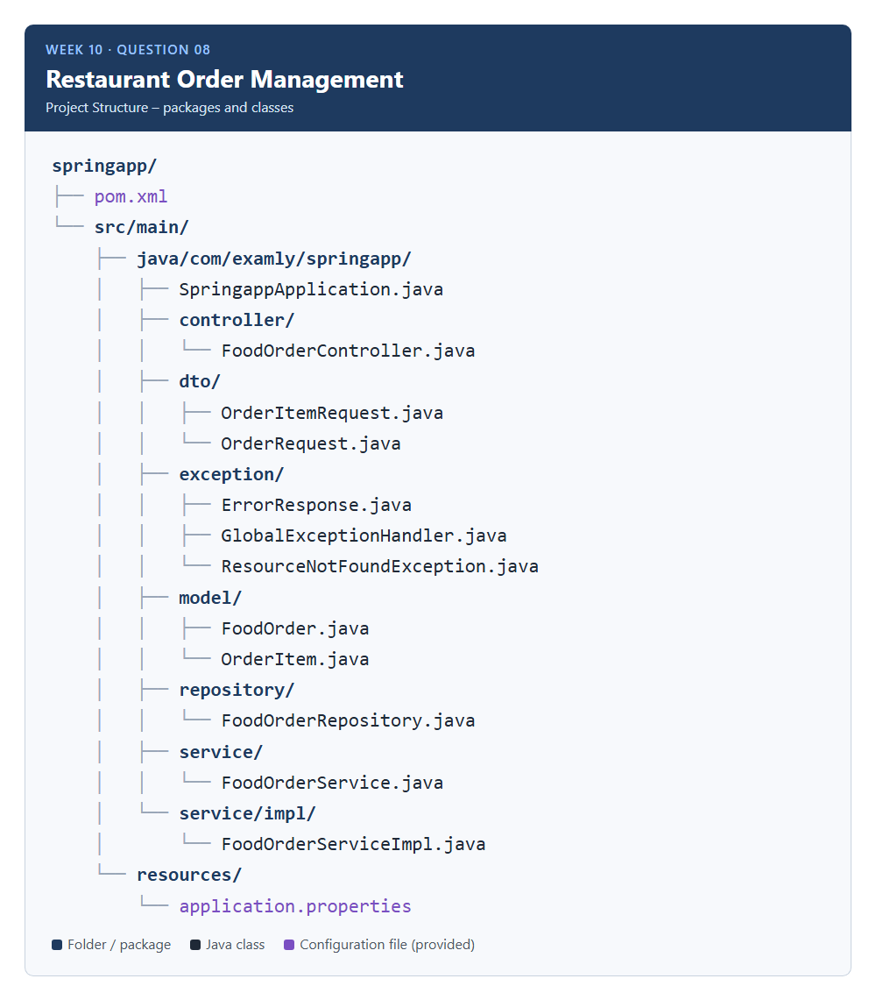
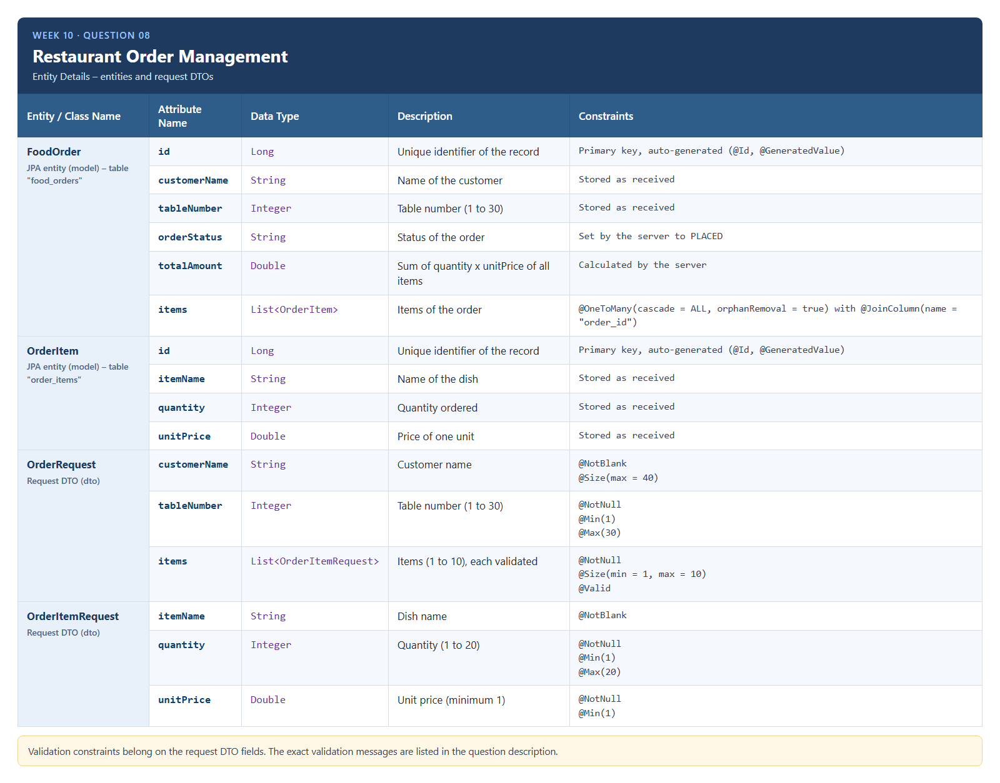
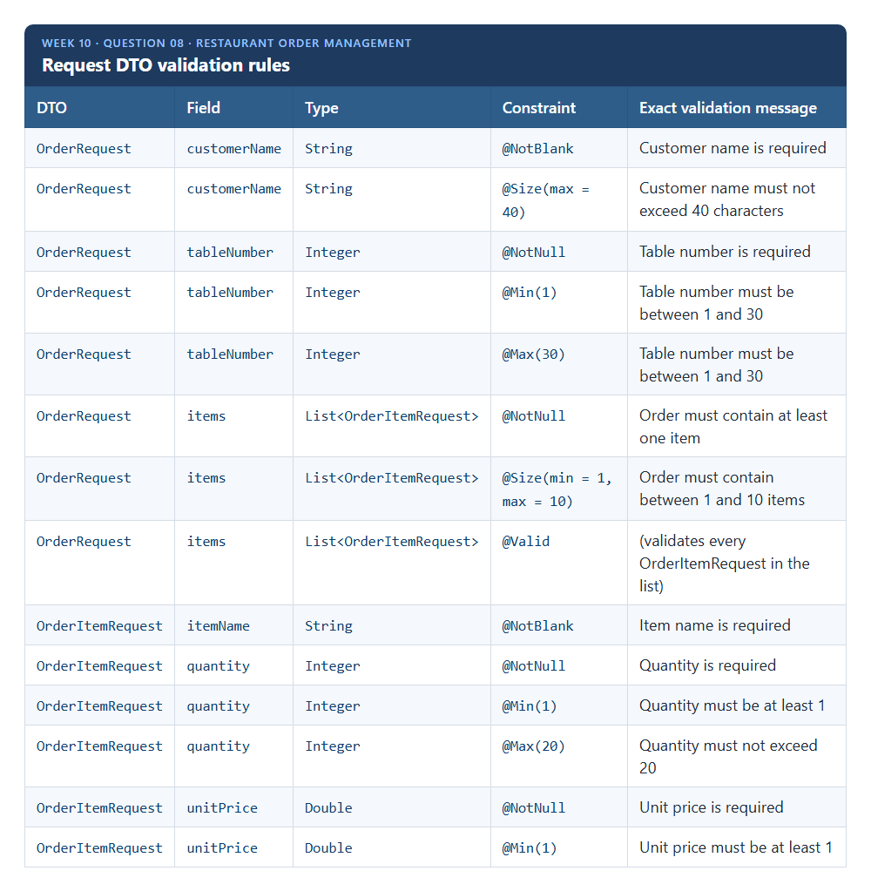
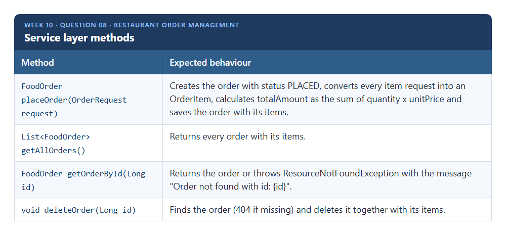
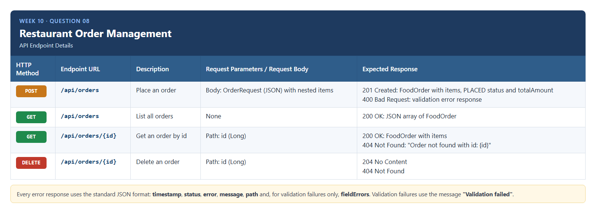
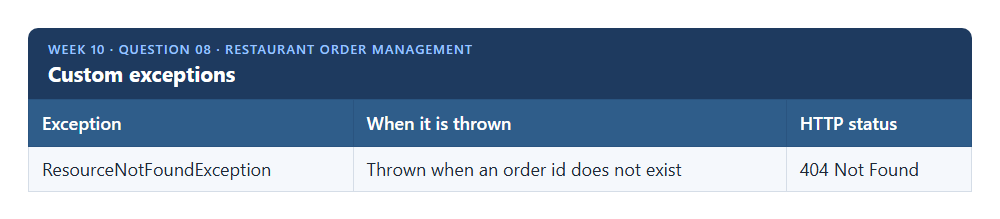
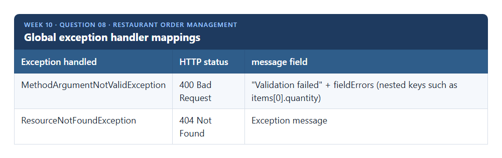
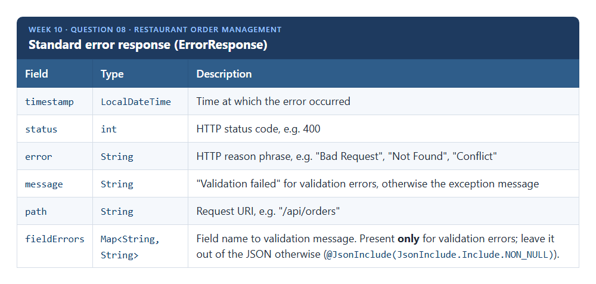

# Question 08: Restaurant Order Management

**Week 10: Validation & Exception Handling** · **Focus:** Nested DTO validation with @Valid on a list of child objects

## 1. Business Scenario

An order belongs to a table and contains one or more food items, each with a quantity and a unit price. The kitchen has received orders with zero quantities and blank item names, so the backend must validate the order and every item inside it, and must point to the exact item that is wrong (for example items[1].itemName).

## 2. Problem Statement

Build a Spring Boot REST API to place, list, fetch and delete orders. The order request contains a nested list of item requests that must be validated with @Valid. The server calculates the order total and saves the order with its items.

## 3. Functional Requirements

1. **Place an order**: `POST /api/orders`
2. **List all orders**: `GET /api/orders`
3. **Get an order by id**: `GET /api/orders/{id}`
4. **Delete an order**: `DELETE /api/orders/{id}`
5. Validate every request body before it reaches the service layer, and reject invalid data with **400 Bad Request**.
6. Handle every error in **one global exception handler** and return the standard error response described in section 11.

## 4. Project Structure and Required Classes

Create exactly these classes. Class names, package names and field names must match because the automated testcases look them up by name.



## 5. Entity Details



Every entity needs a public no-argument constructor, plus getters and setters for all fields.

## 6. Request DTOs and Validation Rules

Put the validation annotations on the **request DTO** fields and use the **exact messages** below, because the testcases compare them character by character.



## 7. Required Methods and Expected Behaviour

### Repository

The repository only needs the methods inherited from `JpaRepository` (no custom methods).

### Service layer

Declare these methods in the service interface and implement them in the `service/impl` class.



### Controller

- Use constructor injection for the service.
- Validate request bodies with `@Valid` on the `@RequestBody` parameter.
- Return `ResponseEntity` with the status codes shown in section 9.

## 8. Business Logic Requirements

- Errors inside the item list use the field path as the key: items[0].quantity, items[1].itemName and so on (index starts at 0).
- Example total: 2 x 120.0 + 3 x 45.5 = 376.5.

## 9. API Endpoints



## 10. Validation Requirements

- Add `@Valid` before every `@RequestBody` parameter so that the DTO constraints are checked.
- A failed body validation raises `MethodArgumentNotValidException`. Convert it into a 400 response whose `fieldErrors` object maps each invalid field name to its validation message.
- All invalid fields must be reported in one response, not just the first one.
- If a single field breaks more than one rule at the same time (for example an empty string that is both blank and too short), report one message for that field. Either of the field's messages is acceptable.

## 11. Exception Handling Expectations

### Custom exceptions



### Global exception handler (`GlobalExceptionHandler`)

Annotate the class with `@RestControllerAdvice` and add one `@ExceptionHandler` method for each row below.



### Standard error response (`ErrorResponse`)



**Example error response**

```json
{
  "timestamp": "2026-11-19T10:15:30.123",
  "status": 400,
  "error": "Bad Request",
  "message": "Validation failed",
  "path": "/api/orders",
  "fieldErrors": {
    "items[0].quantity": "Quantity must be at least 1"
  }
}
```
