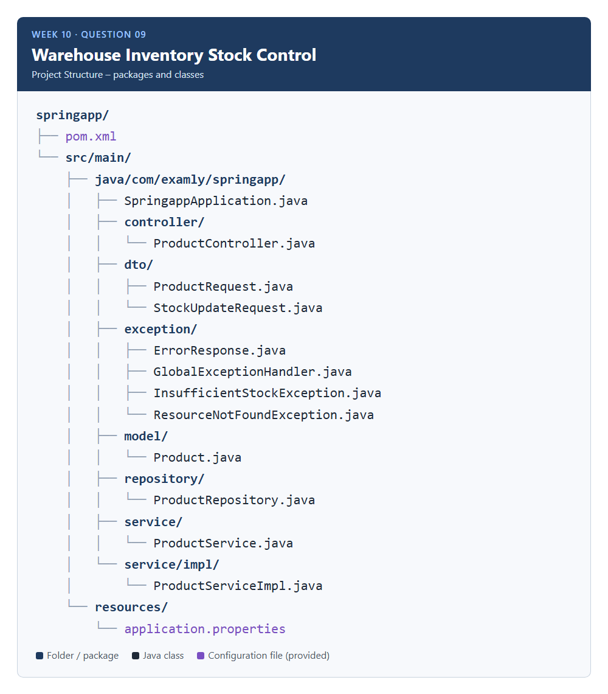
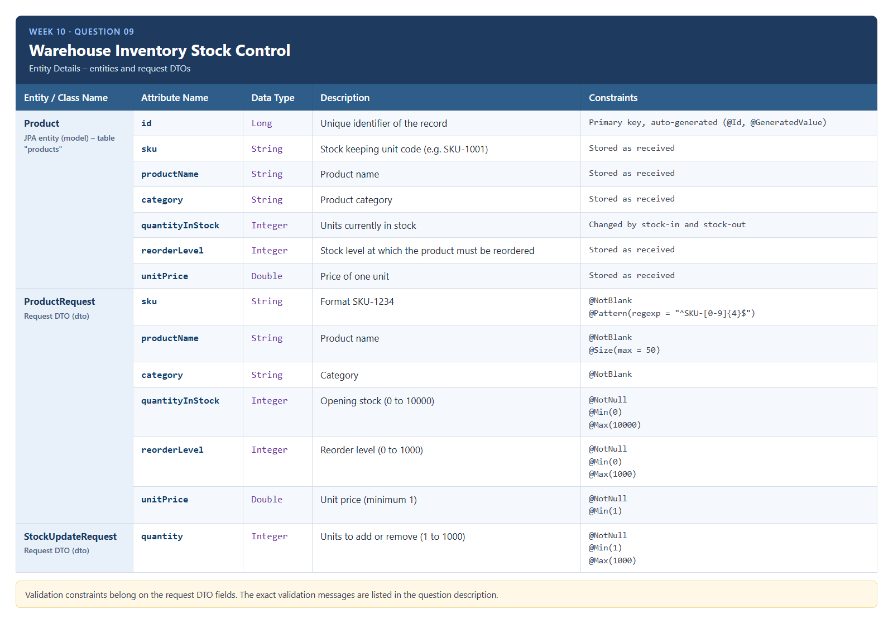
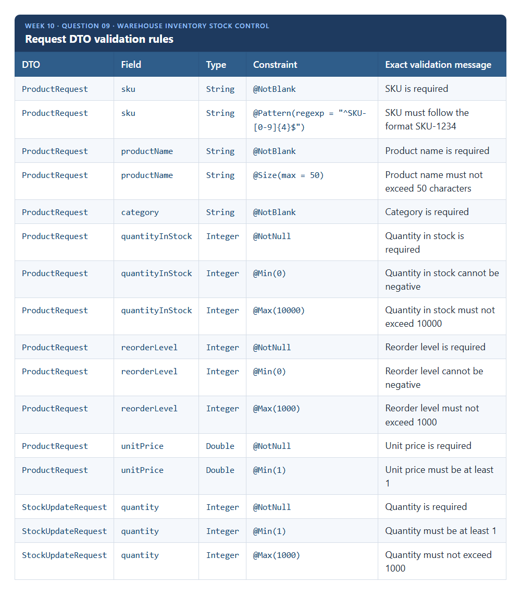
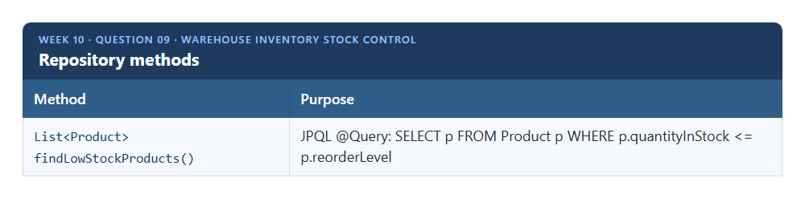
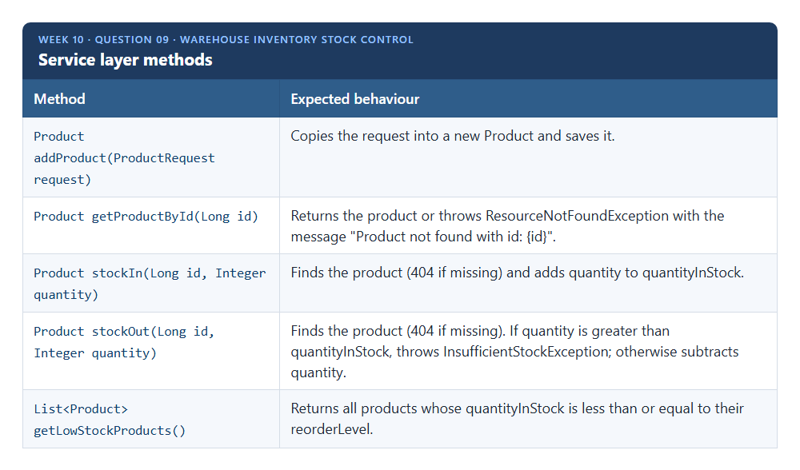
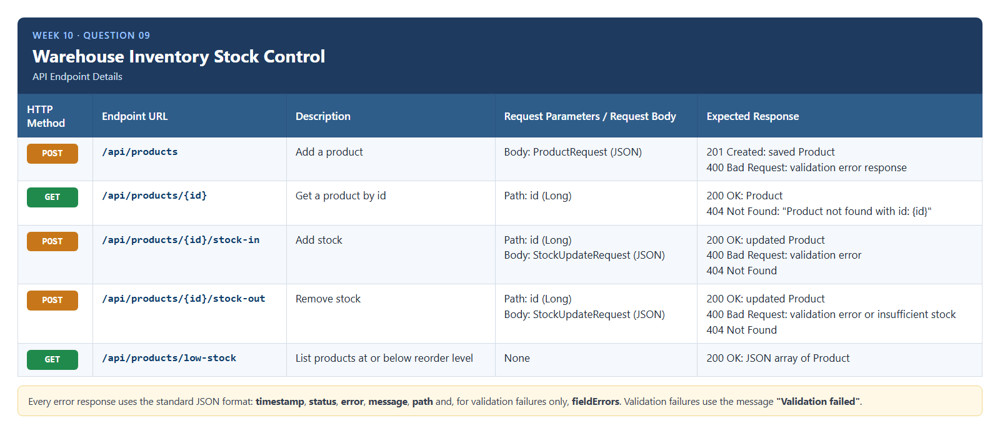
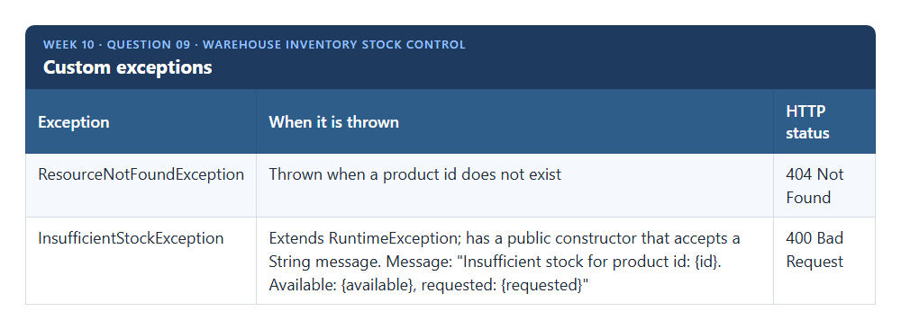
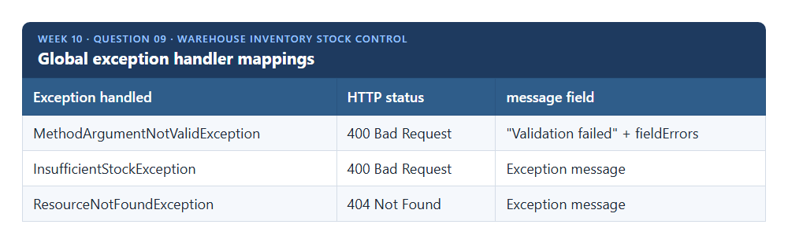
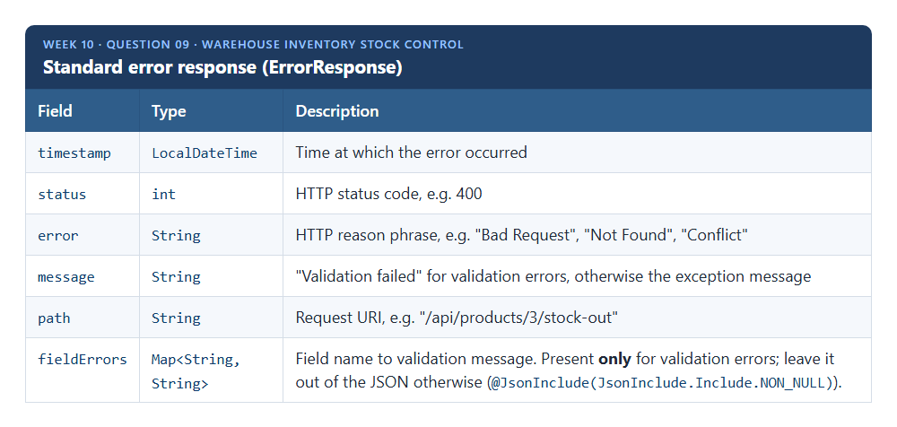

# Question 09: Warehouse Inventory Stock Control

**Week 10: Validation & Exception Handling** · **Focus:** Business-rule exception (InsufficientStockException) combined with validation and 404 handling

## 1. Business Scenario

A store keeper must never be able to issue more units than are physically in stock. If they try, the request must fail with a clear message showing the available and requested quantities, and the stock must stay unchanged. Products at or below their reorder level must be listed for the purchase team.

## 2. Problem Statement

Build a Spring Boot REST API to add products, view a product, record stock-in and stock-out movements and list low-stock products. Validate the requests, throw a custom InsufficientStockException when a business rule is broken, and handle it globally as a 400 error.

## 3. Functional Requirements

1. **Add a product**: `POST /api/products`
2. **Get a product by id**: `GET /api/products/{id}`
3. **Add stock**: `POST /api/products/{id}/stock-in`
4. **Remove stock**: `POST /api/products/{id}/stock-out`
5. **List products at or below reorder level**: `GET /api/products/low-stock`
6. Validate every request body before it reaches the service layer, and reject invalid data with **400 Bad Request**.
7. Handle every error in **one global exception handler** and return the standard error response described in section 11.

## 4. Project Structure and Required Classes

Create exactly these classes. Class names, package names and field names must match because the automated testcases look them up by name.



## 5. Entity Details



Every entity needs a public no-argument constructor, plus getters and setters for all fields.

## 6. Request DTOs and Validation Rules

Put the validation annotations on the **request DTO** fields and use the **exact messages** below, because the testcases compare them character by character.



## 7. Required Methods and Expected Behaviour

### Repository



### Service layer

Declare these methods in the service interface and implement them in the `service/impl` class.



### Controller

- Use constructor injection for the service.
- Validate request bodies with `@Valid` on the `@RequestBody` parameter.
- Return `ResponseEntity` with the status codes shown in section 9.

## 8. Business Logic Requirements

- Removing exactly the available quantity is allowed and leaves quantityInStock at 0.
- A rejected stock-out must not change the stored quantity.
- A product whose quantityInStock equals its reorderLevel counts as low stock.

## 9. API Endpoints



## 10. Validation Requirements

- Add `@Valid` before every `@RequestBody` parameter so that the DTO constraints are checked.
- A failed body validation raises `MethodArgumentNotValidException`. Convert it into a 400 response whose `fieldErrors` object maps each invalid field name to its validation message.
- All invalid fields must be reported in one response, not just the first one.
- If a single field breaks more than one rule at the same time (for example an empty string that is both blank and too short), report one message for that field. Either of the field's messages is acceptable.

## 11. Exception Handling Expectations

### Custom exceptions



### Global exception handler (`GlobalExceptionHandler`)

Annotate the class with `@RestControllerAdvice` and add one `@ExceptionHandler` method for each row below.



### Standard error response (`ErrorResponse`)



**Example error response**

```json
{
  "timestamp": "2026-11-19T10:15:30.123",
  "status": 400,
  "error": "Bad Request",
  "message": "Insufficient stock for product id: 3. Available: 15, requested: 20",
  "path": "/api/products/3/stock-out"
}
```
