# Question 10: Flight Seat Booking System

**Week 10: Validation & Exception Handling** · **Focus:** Full integration: body and parameter validation, 400 / 404 / 409 custom exceptions, malformed JSON and a fallback 500 handler

## 1. Business Scenario

Flights are identified by a unique flight number and must fly between two different airports. A booking can reserve 1 to 6 seats only while seats are still available, and cancelling a booking returns the seats to the flight. Every kind of failure, including unexpected ones, must produce the same standard error JSON so that the counter app can show it to the agent.

## 2. Problem Statement

Build a Spring Boot REST API with flights and bookings. Apply everything from this week: request body validation, path variable validation with @Validated, custom exceptions for not-found (404), duplicate (409) and business-rule (400) cases, malformed JSON handling and a fallback handler for any other exception (500), all through one global exception handler.

## 3. Functional Requirements

1. **Add a flight**: `POST /api/flights`
2. **Get a flight by id**: `GET /api/flights/{id}`
3. **Book seats on a flight**: `POST /api/bookings`
4. **Get a booking by id**: `GET /api/bookings/{id}`
5. **Cancel a booking**: `DELETE /api/bookings/{id}`
6. Validate every request body before it reaches the service layer, and reject invalid data with **400 Bad Request**.
7. Handle every error in **one global exception handler** and return the standard error response described in section 11.

## 4. Project Structure and Required Classes

Create exactly these classes. Class names, package names and field names must match because the automated testcases look them up by name.

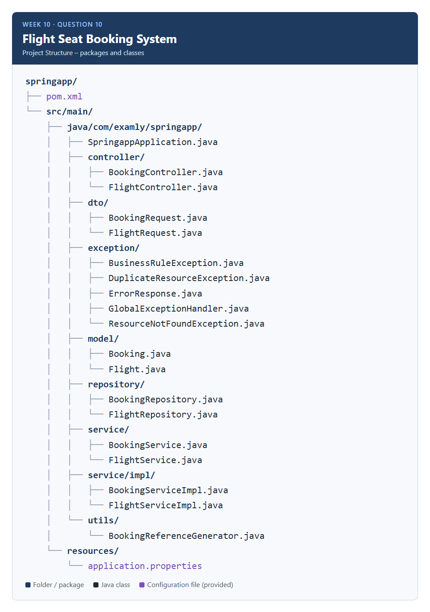

## 5. Entity Details

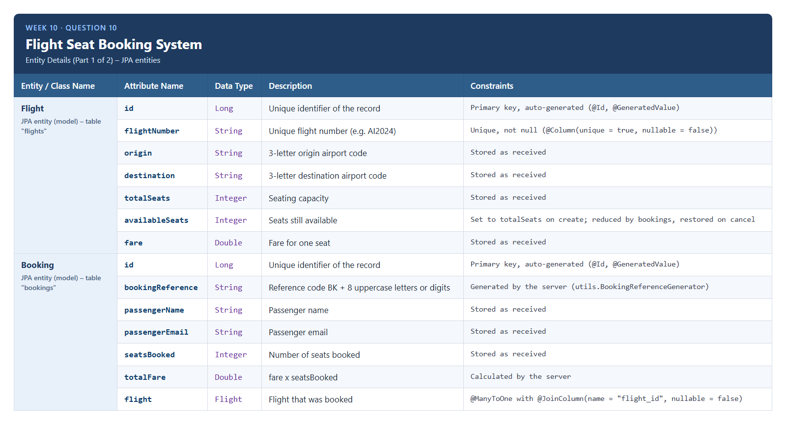
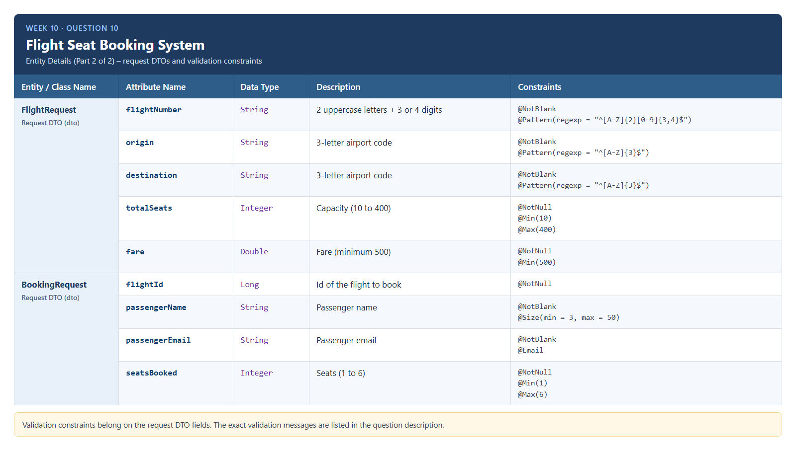

Every entity needs a public no-argument constructor, plus getters and setters for all fields.

## 6. Request DTOs and Validation Rules

Put the validation annotations on the **request DTO** fields and use the **exact messages** below, because the testcases compare them character by character.

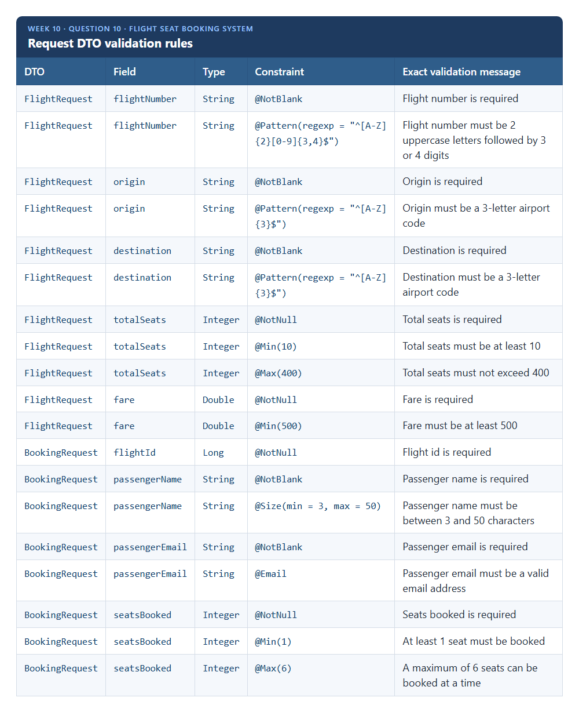

### Path variable and query parameter validation

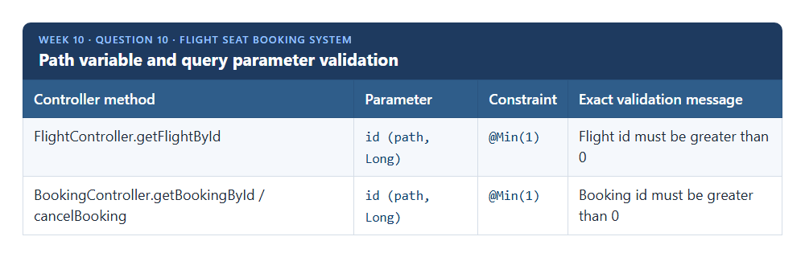

## 7. Required Methods and Expected Behaviour

### Repository

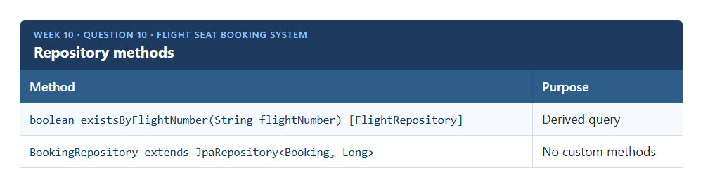

### Service layer

Declare these methods in the service interface and implement them in the `service/impl` class.

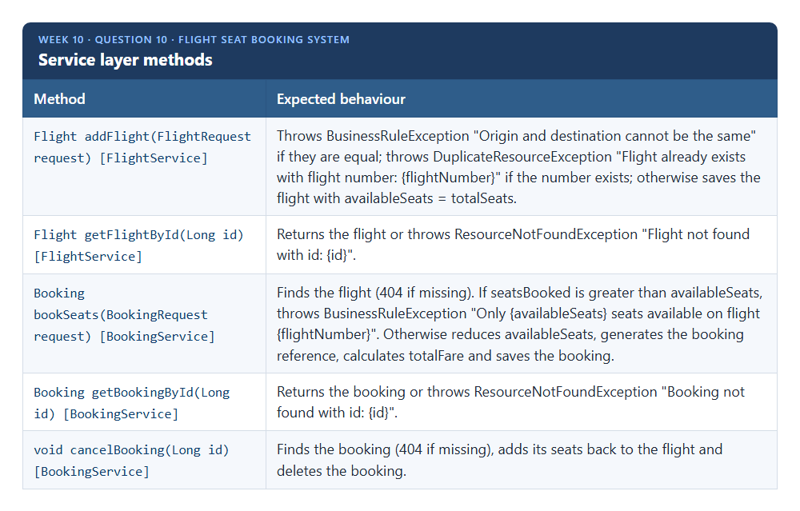

### Utility

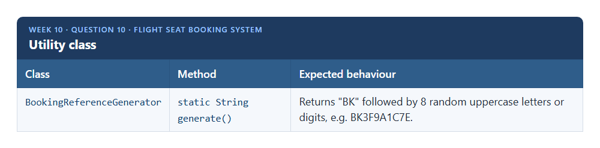

### Controller

- FlightController (@RequestMapping("/api/flights")) and BookingController (@RequestMapping("/api/bookings")) must both be annotated with @RestController and @Validated.
- Use constructor injection for the service.
- Validate request bodies with `@Valid` on the `@RequestBody` parameter.
- Return `ResponseEntity` with the status codes shown in section 9.

## 8. Business Logic Requirements

- totalFare = fare x seatsBooked (e.g. 4500.0 x 3 = 13500.0).
- Booking 6 seats on a 10-seat flight leaves 4 seats; a second request for 6 seats must fail with "Only 4 seats available on flight {flightNumber}".
- Cancelling a booking restores its seats to the flight.

## 9. API Endpoints

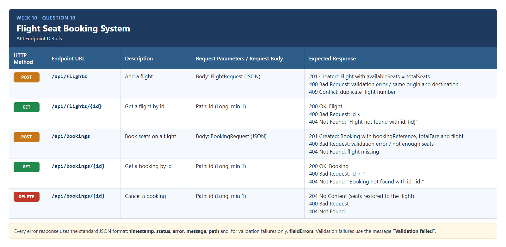

## 10. Validation Requirements

- Add `@Valid` before every `@RequestBody` parameter so that the DTO constraints are checked.
- Annotate the controller class with `@Validated` so that constraints on `@PathVariable` and `@RequestParam` parameters are checked. A violation raises `ConstraintViolationException`.
- A failed body validation raises `MethodArgumentNotValidException`. Convert it into a 400 response whose `fieldErrors` object maps each invalid field name to its validation message.
- All invalid fields must be reported in one response, not just the first one.
- If a single field breaks more than one rule at the same time (for example an empty string that is both blank and too short), report one message for that field. Either of the field's messages is acceptable.

## 11. Exception Handling Expectations

### Custom exceptions

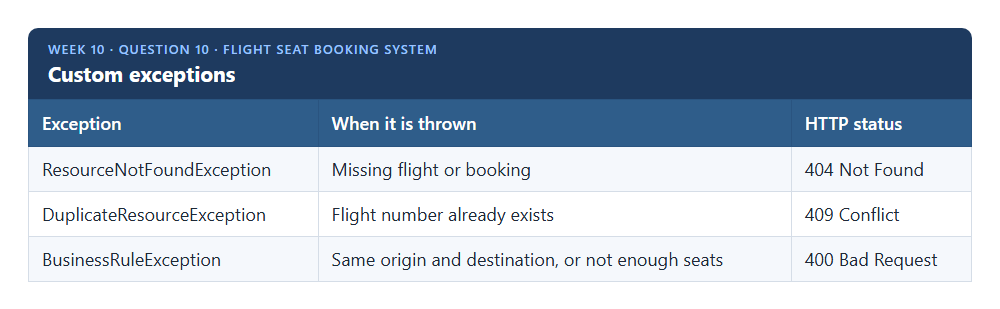

### Global exception handler (`GlobalExceptionHandler`)

Annotate the class with `@RestControllerAdvice` and add one `@ExceptionHandler` method for each row below.

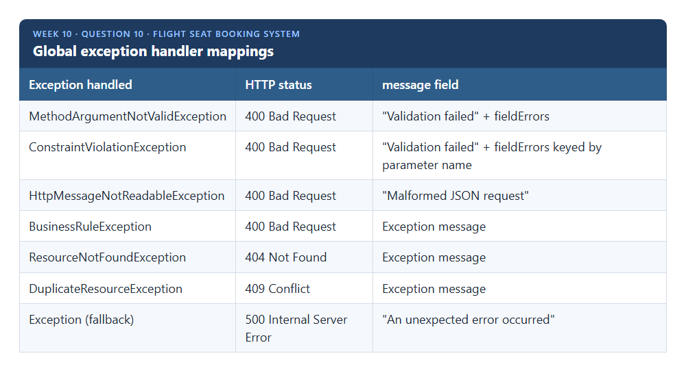

### Standard error response (`ErrorResponse`)

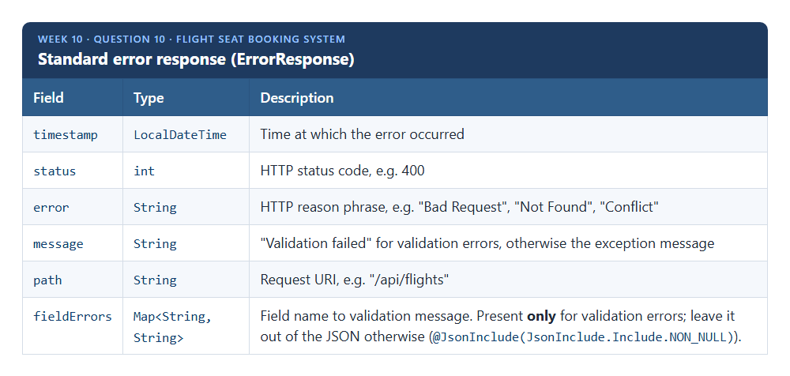

**Example error response**

```json
{
  "timestamp": "2026-11-19T10:15:30.123",
  "status": 409,
  "error": "Conflict",
  "message": "Flight already exists with flight number: AI2024",
  "path": "/api/flights"
}
```
