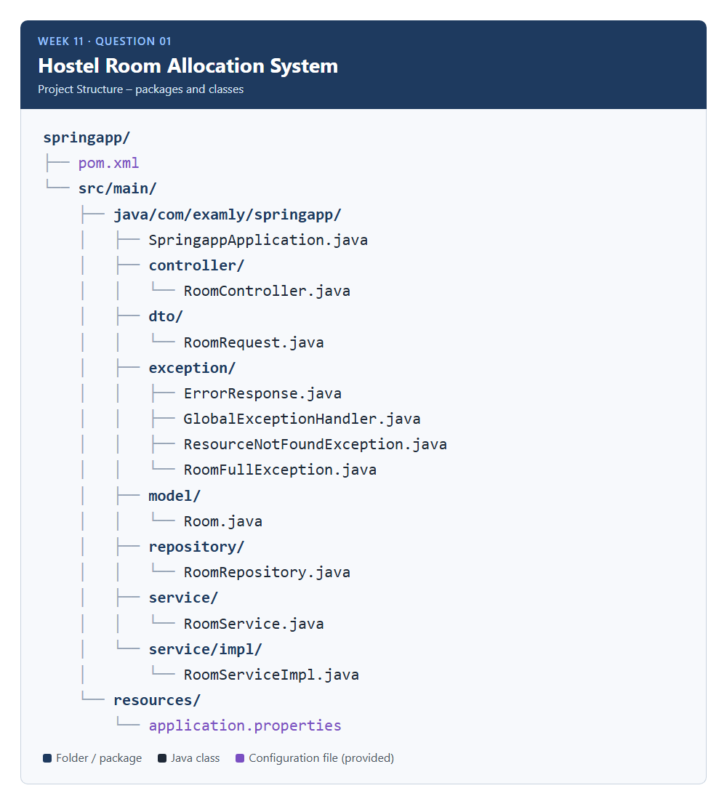
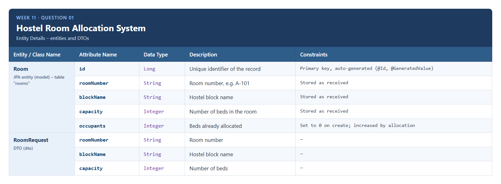
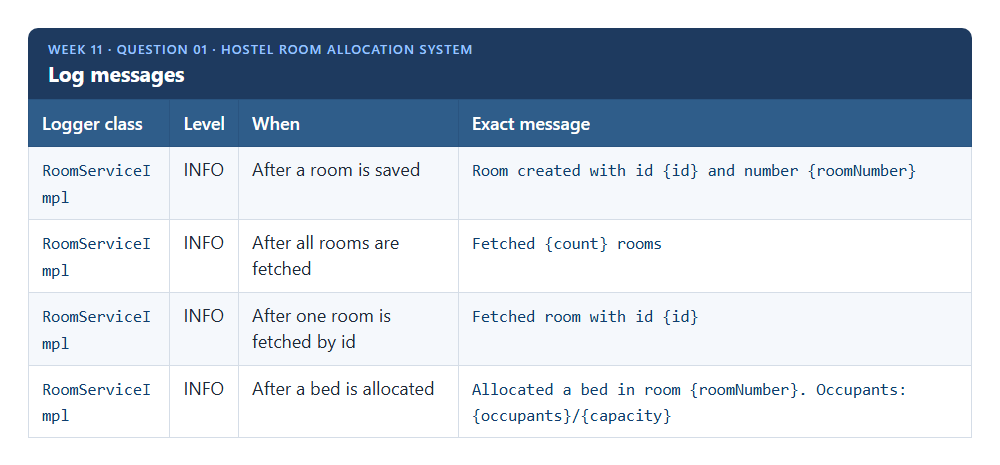
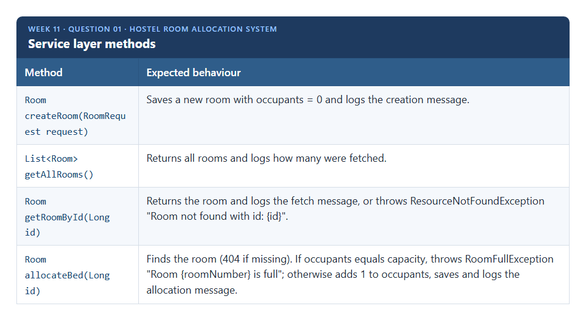
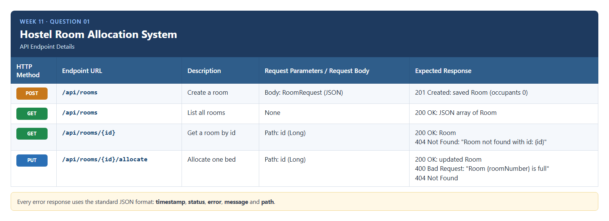
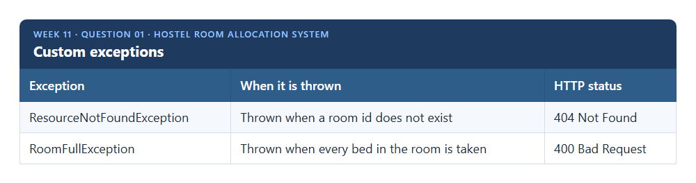
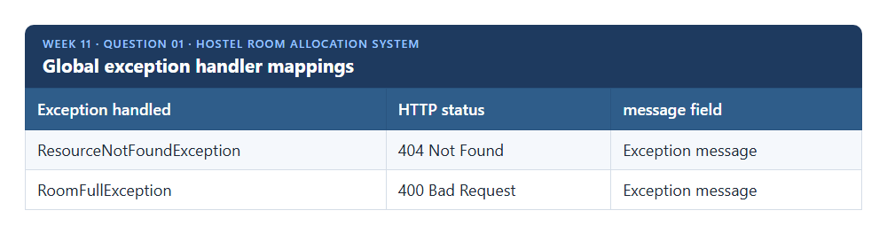
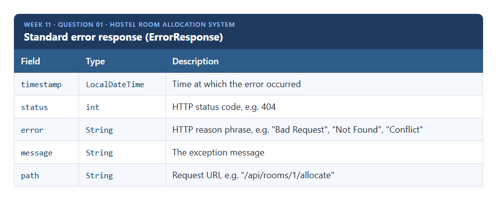

# Question 01: Hostel Room Allocation System

**Week 11: Logging & AOP Basics** · **Focus:** SLF4J Logger and LoggerFactory instead of System.out; INFO logging for normal operations

## 1. Business Scenario

The hostel office allocates beds in student rooms. Until now the backend printed messages with System.out, which could not be filtered or traced. The warden wants proper application logs that show every room created, viewed and allocated.

## 2. Problem Statement

Build a Spring Boot REST API to create rooms, list them, view one room and allocate a bed. Replace console printing with an SLF4J Logger in the service implementation and write the exact INFO messages listed below.

## 3. Functional Requirements

1. **Create a room**: `POST /api/rooms`
2. **List all rooms**: `GET /api/rooms`
3. **Get a room by id**: `GET /api/rooms/{id}`
4. **Allocate one bed**: `PUT /api/rooms/{id}/allocate`
5. Write the log messages and logging configuration described in section 6.
6. Handle every error in **one global exception handler** and return the standard error response described in section 10.

## 4. Project Structure and Required Classes

Create exactly these classes. Class names, package names and field names must match because the automated testcases look them up by name.



## 5. Entity Details



Every entity and DTO needs a public no-argument constructor, plus getters and setters for all fields.

## 6. Logging Requirements

### Log messages

Write these messages with an SLF4J `Logger` at exactly the stated level. Values in braces are filled in with `{}` placeholders.



- Declare the logger as `private static final Logger logger = LoggerFactory.getLogger(RoomServiceImpl.class);` using `org.slf4j.Logger` and `org.slf4j.LoggerFactory`.
- Do not use `System.out` or `System.err` anywhere in `RoomServiceImpl`.
- A request for a missing room must not produce the "Fetched room with id" message.
- Use `org.slf4j.Logger` and `org.slf4j.LoggerFactory` (Logback, the Spring Boot default, writes the output); no extra dependency is needed.
- Spring Boot prints each line with its level and logger name, e.g. `INFO ... c.e.s.service.impl.RoomServiceImpl : Room created ...`. The testcases check the level, the logger class and the exact message text.

## 7. Required Methods and Expected Behaviour

### Repository

The repository only needs the methods inherited from `JpaRepository` (no custom methods).

### Service layer

Declare these methods in the service interface and implement them in the `service/impl` class.



### Controller

- Use constructor injection for the service.
- Return `ResponseEntity` with the status codes shown in section 9.

## 8. Business Logic Requirements

- A new room always starts with 0 occupants.
- A room can never have more occupants than its capacity.

## 9. API Endpoints



## 10. Exception Handling Expectations

### Custom exceptions



### Global exception handler (`GlobalExceptionHandler`)

Annotate the class with `@RestControllerAdvice` and add one `@ExceptionHandler` method for each row below.



### Standard error response (`ErrorResponse`)



**Example error response**

```json
{
  "timestamp": "2026-11-20T10:15:30.123",
  "status": 400,
  "error": "Bad Request",
  "message": "Room A-101 is full",
  "path": "/api/rooms/1/allocate"
}
```
