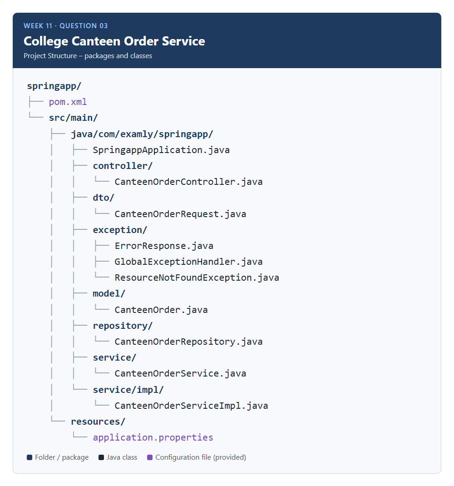
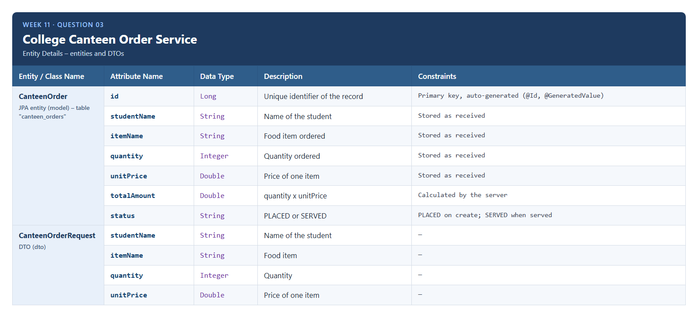
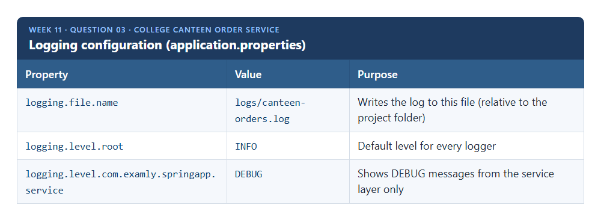
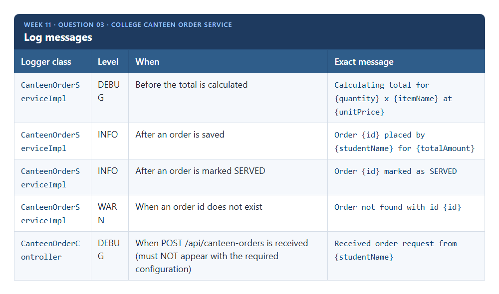
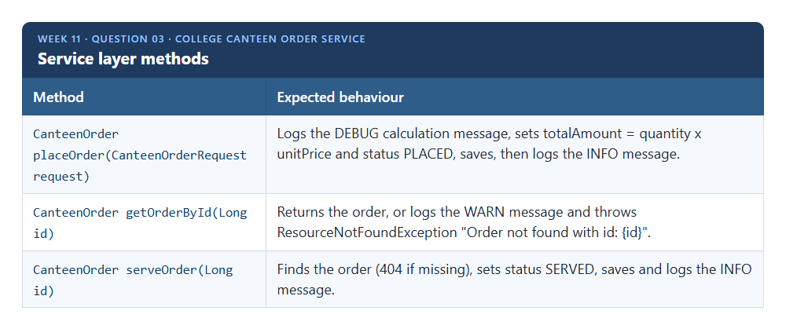
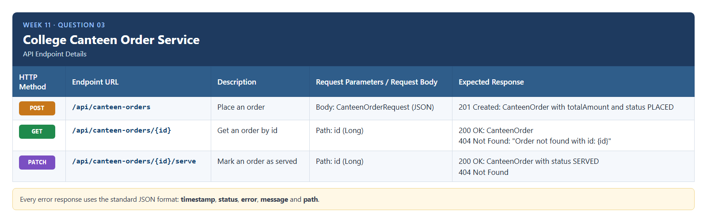
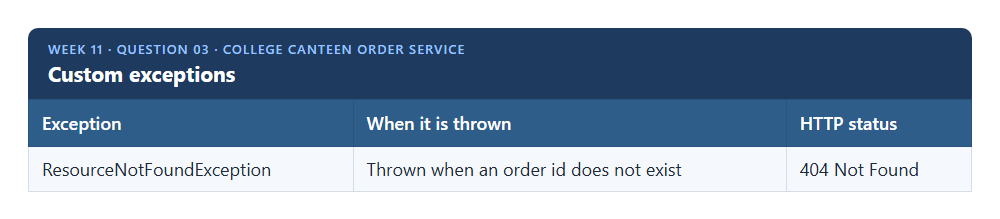
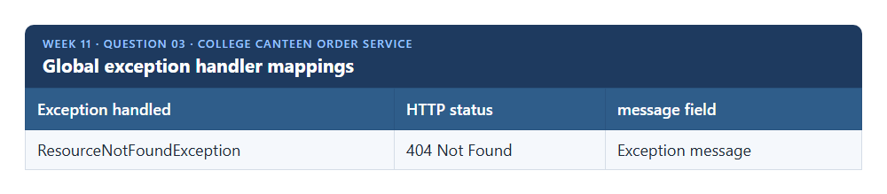
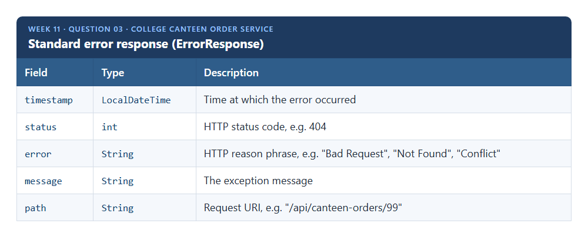

# Question 03: College Canteen Order Service

**Week 11: Logging & AOP Basics** · **Focus:** Log configuration: logging.file.name and logging.level per package

## 1. Business Scenario

The college canteen takes orders from students through a kiosk. The IT team wants every order kept in a log file they can open later, with detailed DEBUG output from the business logic but no DEBUG noise from the web layer.

## 2. Problem Statement

Build a Spring Boot REST API to place, view and serve canteen orders. Configure application.properties so logs go to a file, the root level is INFO and only the service package logs at DEBUG. Write the exact log messages listed below.

## 3. Functional Requirements

1. **Place an order**: `POST /api/canteen-orders`
2. **Get an order by id**: `GET /api/canteen-orders/{id}`
3. **Mark an order as served**: `PATCH /api/canteen-orders/{id}/serve`
4. Write the log messages and logging configuration described in section 6.
5. Handle every error in **one global exception handler** and return the standard error response described in section 10.

## 4. Project Structure and Required Classes

Create exactly these classes. Class names, package names and field names must match because the automated testcases look them up by name.



## 5. Entity Details



Every entity and DTO needs a public no-argument constructor, plus getters and setters for all fields.

## 6. Logging Requirements

### Logging configuration (`application.properties`)

Add these entries to `src/main/resources/application.properties`:



### Log messages

Write these messages with an SLF4J `Logger` at exactly the stated level. Values in braces are filled in with `{}` placeholders.



- With the configuration above, the service DEBUG line appears in the console and in the file, while the controller DEBUG line appears in neither.
- Every line written to the console must also appear in logs/canteen-orders.log.
- Use `org.slf4j.Logger` and `org.slf4j.LoggerFactory` (Logback, the Spring Boot default, writes the output); no extra dependency is needed.
- Spring Boot prints each line with its level and logger name, e.g. `INFO ... c.e.s.service.impl.RoomServiceImpl : Room created ...`. The testcases check the level, the logger class and the exact message text.

## 7. Required Methods and Expected Behaviour

### Repository

The repository only needs the methods inherited from `JpaRepository` (no custom methods).

### Service layer

Declare these methods in the service interface and implement them in the `service/impl` class.



### Controller

- `CanteenOrderController` declares its own SLF4J logger and logs the DEBUG message at the start of `placeOrder`.
- Use constructor injection for the service.
- Return `ResponseEntity` with the status codes shown in section 9.

## 8. Business Logic Requirements

- totalAmount = quantity x unitPrice (e.g. 3 x 40.0 = 120.0).
- The log file path is relative to the springapp project folder.

## 9. API Endpoints



## 10. Exception Handling Expectations

### Custom exceptions



### Global exception handler (`GlobalExceptionHandler`)

Annotate the class with `@RestControllerAdvice` and add one `@ExceptionHandler` method for each row below.



### Standard error response (`ErrorResponse`)



**Example error response**

```json
{
  "timestamp": "2026-11-20T10:15:30.123",
  "status": 404,
  "error": "Not Found",
  "message": "Order not found with id: 99",
  "path": "/api/canteen-orders/99"
}
```
