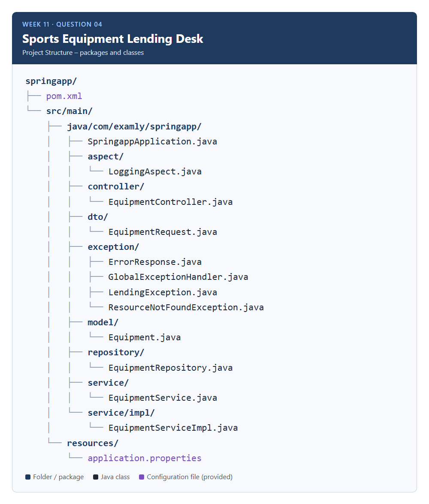
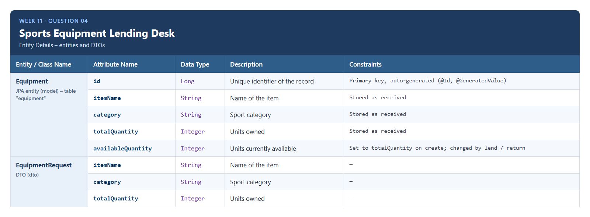
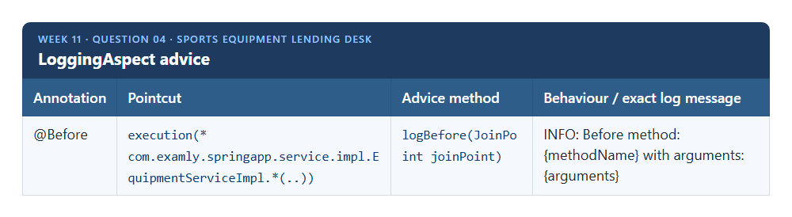
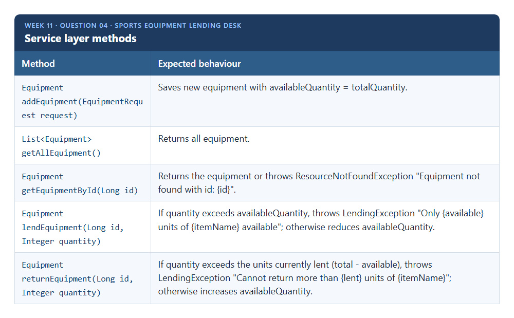
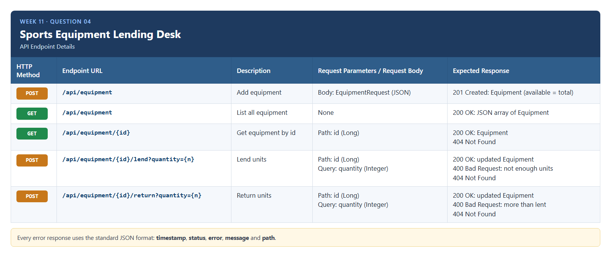
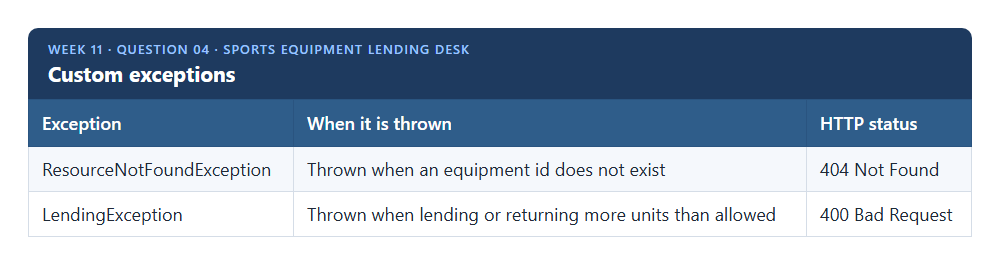
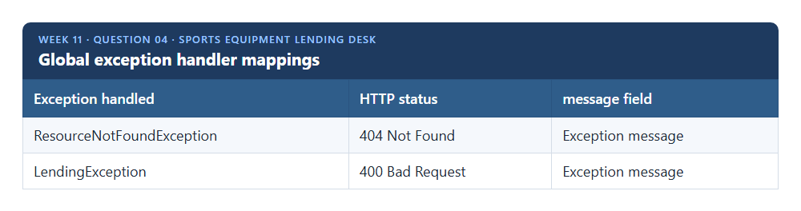
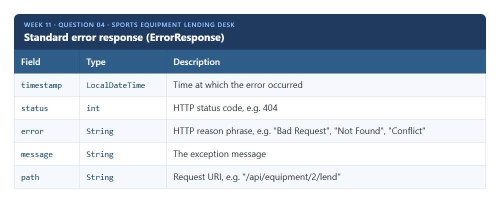

# Question 04: Sports Equipment Lending Desk

**Week 11: Logging & AOP Basics** · **Focus:** First aspect: @Aspect, @Component and @Before with an execution() pointcut

## 1. Business Scenario

The sports department lends bats, balls and rackets to students. The coordinator wants every lending operation traced, including the values passed in, without adding logging code to each service method.

## 2. Problem Statement

Build a Spring Boot REST API to add, view, lend and return equipment. Add a LoggingAspect whose @Before advice logs every EquipmentServiceImpl method call with its name and arguments. The service itself contains no logging code.

## 3. Functional Requirements

1. **Add equipment**: `POST /api/equipment`
2. **List all equipment**: `GET /api/equipment`
3. **Get equipment by id**: `GET /api/equipment/{id}`
4. **Lend units**: `POST /api/equipment/{id}/lend?quantity={n}`
5. **Return units**: `POST /api/equipment/{id}/return?quantity={n}`
6. Implement the aspect described in section 6; the service classes must not contain that cross-cutting logging code.
7. Handle every error in **one global exception handler** and return the standard error response described in section 10.

## 4. Project Structure and Required Classes

Create exactly these classes. Class names, package names and field names must match because the automated testcases look them up by name.



## 5. Entity Details



Every entity and DTO needs a public no-argument constructor, plus getters and setters for all fields.

## 6. Aspect Requirements

Create `LoggingAspect` in the `aspect` package and annotate it with `@Aspect` and `@Component`. The `spring-boot-starter-aop` dependency is already in `pom.xml`.



- {methodName} is `joinPoint.getSignature().getName()`; {arguments} is `Arrays.toString(joinPoint.getArgs())`, e.g. `Before method: lendEquipment with arguments: [3, 2]`.
- The aspect declares its own `private static final Logger` created with `LoggerFactory.getLogger(LoggingAspect.class)`.
- The pointcut must target only `EquipmentServiceImpl`, so each service call is logged exactly once (controller methods are not advised).
- @Before runs even when the service method then throws an exception.
- Log from the aspect with its own SLF4J logger created by `LoggerFactory.getLogger(LoggingAspect.class)`.

## 7. Required Methods and Expected Behaviour

### Repository

The repository only needs the methods inherited from `JpaRepository` (no custom methods).

### Service layer

Declare these methods in the service interface and implement them in the `service/impl` class.



### Controller

- Use constructor injection for the service.
- Return `ResponseEntity` with the status codes shown in section 9.

## 8. Business Logic Requirements

- availableQuantity can never go below 0 or above totalQuantity.

## 9. API Endpoints



## 10. Exception Handling Expectations

### Custom exceptions



### Global exception handler (`GlobalExceptionHandler`)

Annotate the class with `@RestControllerAdvice` and add one `@ExceptionHandler` method for each row below.



### Standard error response (`ErrorResponse`)



**Example error response**

```json
{
  "timestamp": "2026-11-20T10:15:30.123",
  "status": 400,
  "error": "Bad Request",
  "message": "Only 3 units of Volleyball available",
  "path": "/api/equipment/2/lend"
}
```
