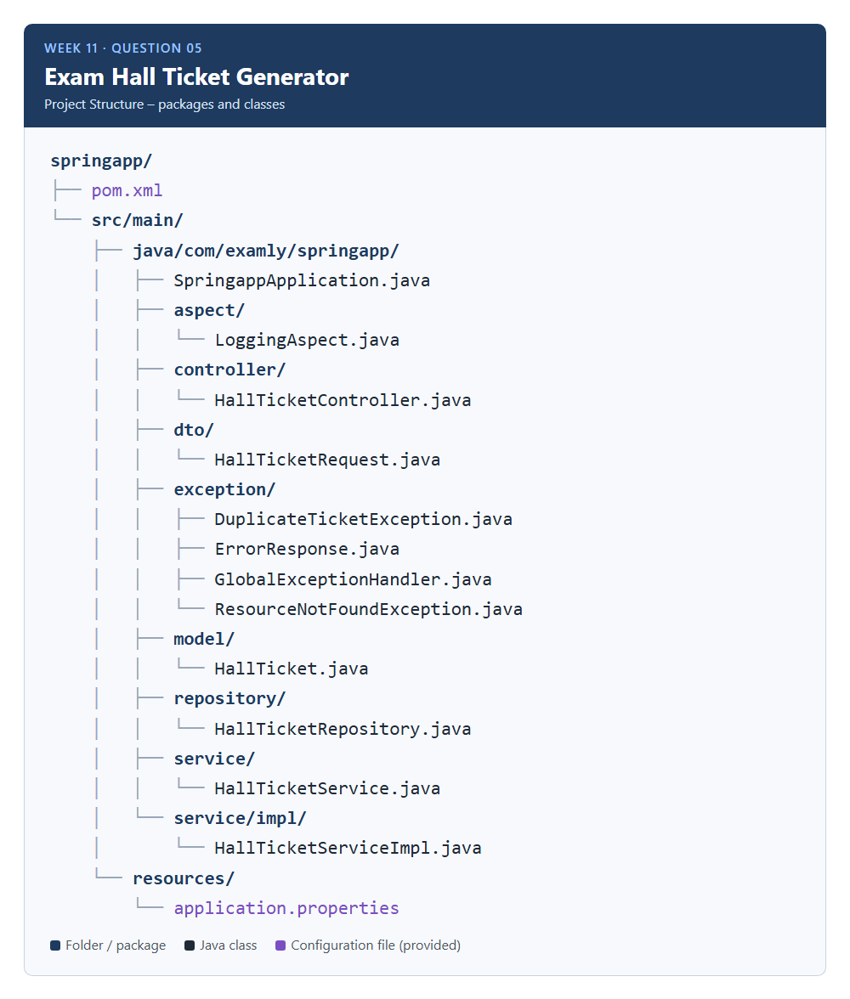
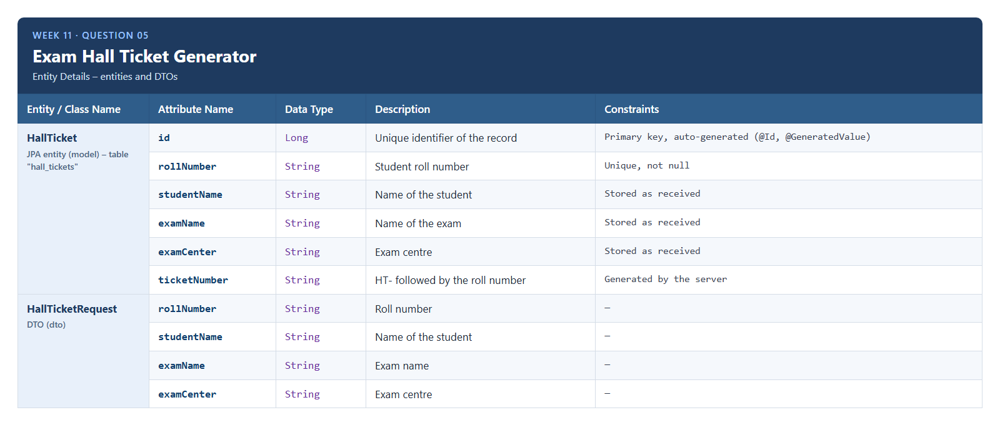
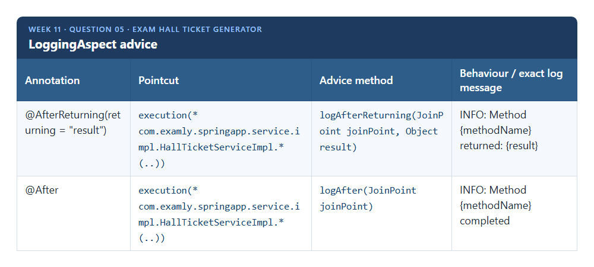
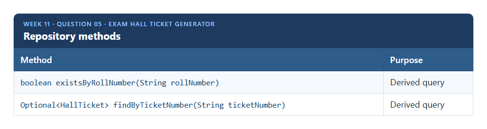
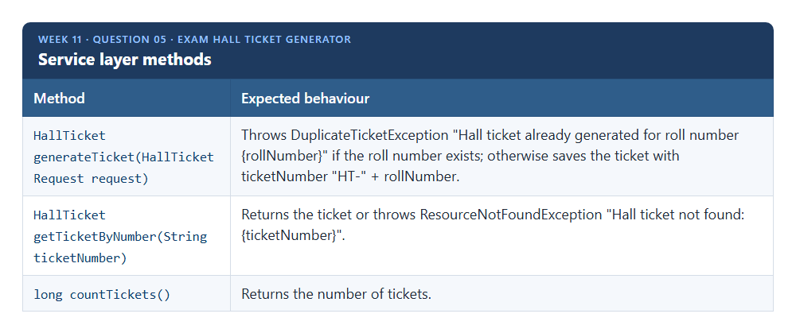
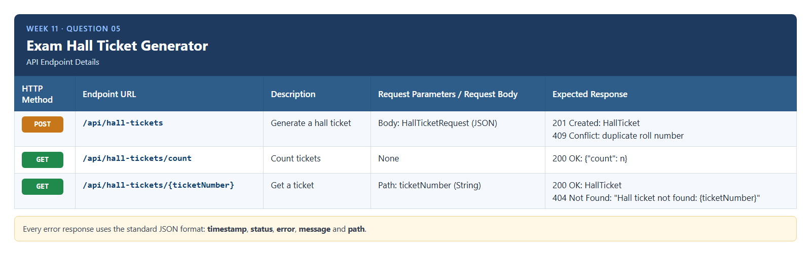
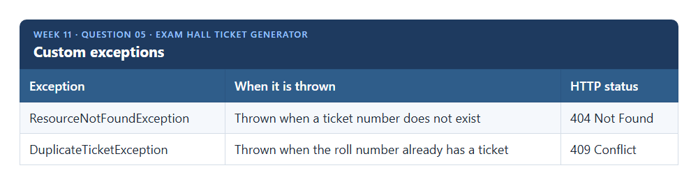
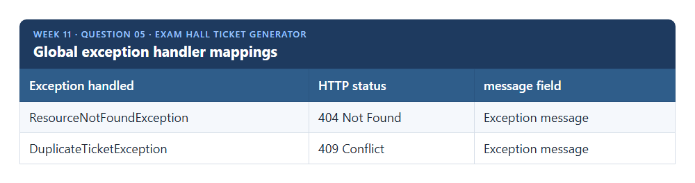
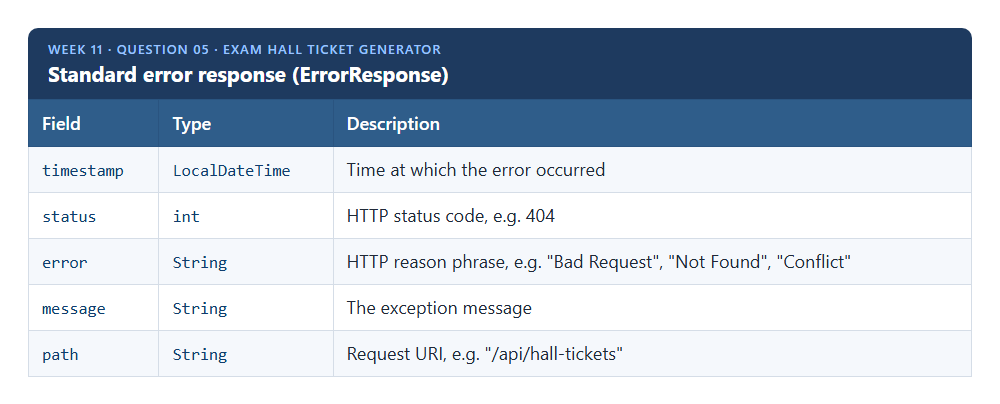

# Question 05: Exam Hall Ticket Generator

**Week 11: Logging & AOP Basics** · **Focus:** @AfterReturning (with the returned value) and @After advice

## 1. Business Scenario

The examination cell generates one hall ticket per student. Auditors want to see what every operation returned, and they also want proof that every operation finished, including the ones that failed.

## 2. Problem Statement

Build a Spring Boot REST API to generate hall tickets, look one up and count them. Add a LoggingAspect with an @AfterReturning advice that logs the returned value and an @After advice that logs completion of every HallTicketServiceImpl method.

## 3. Functional Requirements

1. **Generate a hall ticket**: `POST /api/hall-tickets`
2. **Count tickets**: `GET /api/hall-tickets/count`
3. **Get a ticket**: `GET /api/hall-tickets/{ticketNumber}`
4. Implement the aspect described in section 6; the service classes must not contain that cross-cutting logging code.
5. Handle every error in **one global exception handler** and return the standard error response described in section 10.

## 4. Project Structure and Required Classes

Create exactly these classes. Class names, package names and field names must match because the automated testcases look them up by name.



## 5. Entity Details



Every entity and DTO needs a public no-argument constructor, plus getters and setters for all fields.

## 6. Aspect Requirements

Create `LoggingAspect` in the `aspect` package and annotate it with `@Aspect` and `@Component`. The `spring-boot-starter-aop` dependency is already in `pom.xml`.



- `HallTicket.toString()` must return `HallTicket[ticketNumber={ticketNumber}, rollNumber={rollNumber}, examCenter={examCenter}]`, so a generated ticket is logged as e.g. `Method generateTicket returned: HallTicket[ticketNumber=HT-21CS001, rollNumber=21CS001, examCenter=Block A]`.
- For `countTickets` the logged result is the number, e.g. `Method countTickets returned: 3`.
- @After runs whether the method succeeds or throws; @AfterReturning runs only when it succeeds.
- Log from the aspect with its own SLF4J logger created by `LoggerFactory.getLogger(LoggingAspect.class)`.

## 7. Required Methods and Expected Behaviour

### Repository



### Service layer

Declare these methods in the service interface and implement them in the `service/impl` class.



### Controller

- Use constructor injection for the service.
- Return `ResponseEntity` with the status codes shown in section 9.

## 8. Business Logic Requirements

- Only one hall ticket is allowed per roll number.

## 9. API Endpoints



## 10. Exception Handling Expectations

### Custom exceptions



### Global exception handler (`GlobalExceptionHandler`)

Annotate the class with `@RestControllerAdvice` and add one `@ExceptionHandler` method for each row below.



### Standard error response (`ErrorResponse`)



**Example error response**

```json
{
  "timestamp": "2026-11-20T10:15:30.123",
  "status": 409,
  "error": "Conflict",
  "message": "Hall ticket already generated for roll number 21CS001",
  "path": "/api/hall-tickets"
}
```
