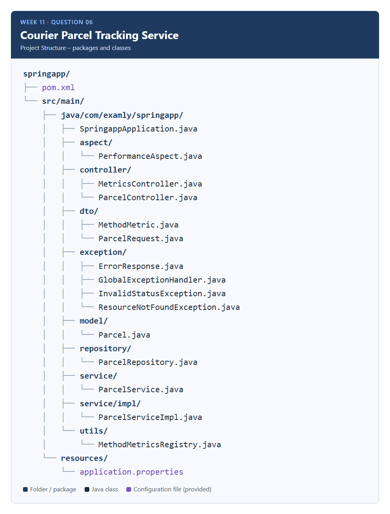
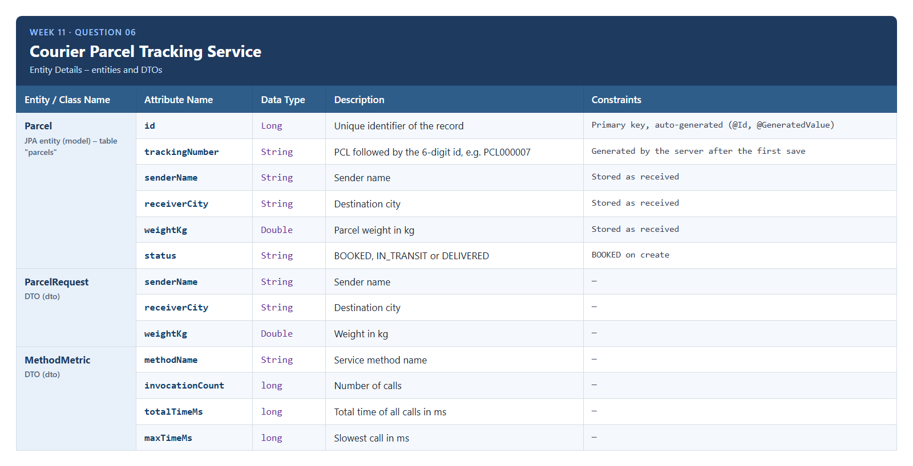
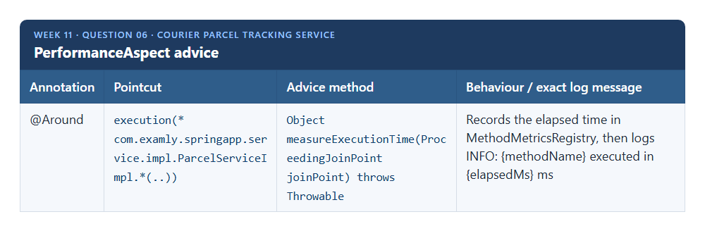
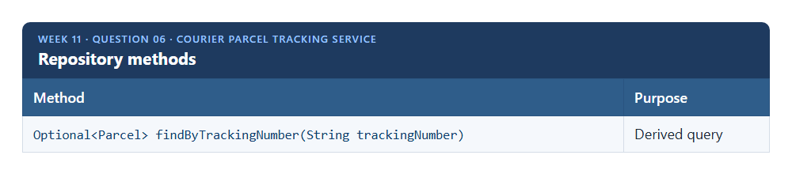
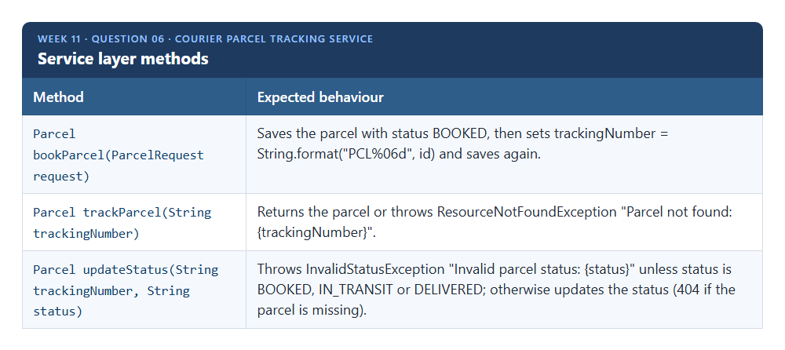
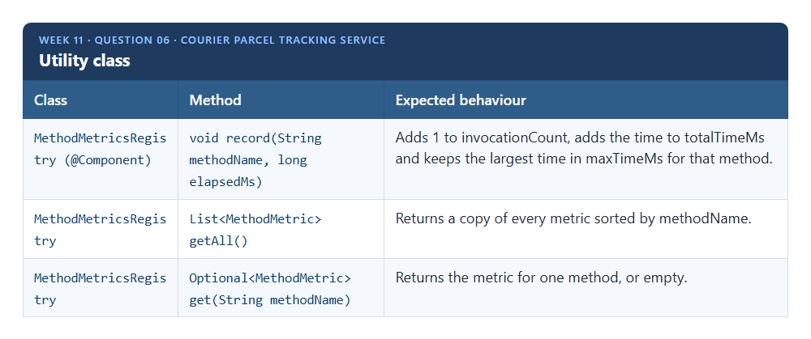
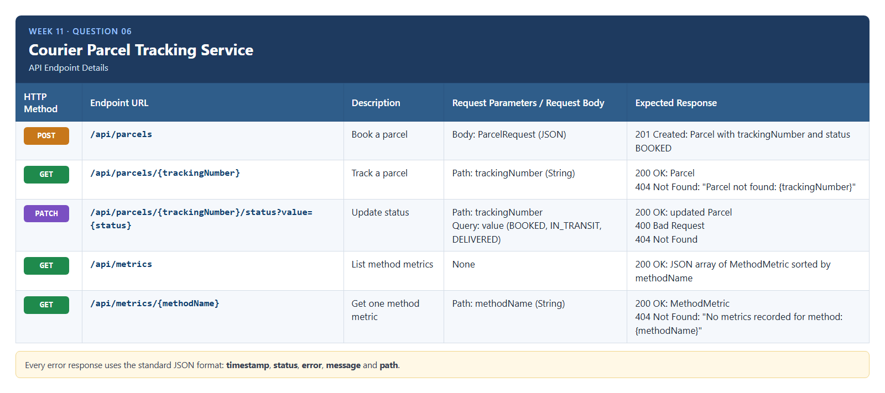
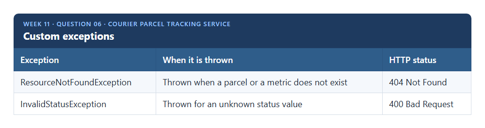
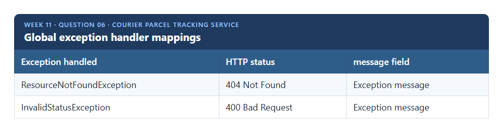
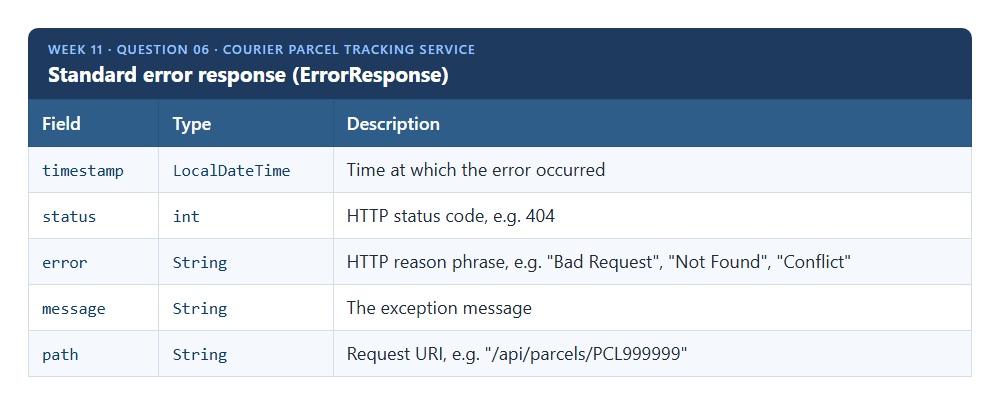

# Question 06: Courier Parcel Tracking Service

**Week 11: Logging & AOP Basics** · **Focus:** @Around advice measuring execution time, with results exposed through a metrics endpoint

## 1. Business Scenario

A courier company tracks parcels from booking to delivery. Operations managers suspect some lookups are slow and want to see how often each service method runs and how long it takes, without touching the business code.

## 2. Problem Statement

Build a Spring Boot REST API to book, track and update parcels. Add a PerformanceAspect whose @Around advice times every ParcelServiceImpl method, records the result in a MethodMetricsRegistry and logs the time. Expose the metrics through /api/metrics.

## 3. Functional Requirements

1. **Book a parcel**: `POST /api/parcels`
2. **Track a parcel**: `GET /api/parcels/{trackingNumber}`
3. **Update status**: `PATCH /api/parcels/{trackingNumber}/status?value={status}`
4. **List method metrics**: `GET /api/metrics`
5. **Get one method metric**: `GET /api/metrics/{methodName}`
6. Implement the aspect described in section 6; the service classes must not contain that cross-cutting logging code.
7. Handle every error in **one global exception handler** and return the standard error response described in section 10.

## 4. Project Structure and Required Classes

Create exactly these classes. Class names, package names and field names must match because the automated testcases look them up by name.



## 5. Entity Details



Every entity and DTO needs a public no-argument constructor, plus getters and setters for all fields.

## 6. Aspect Requirements

Create `PerformanceAspect` in the `aspect` package and annotate it with `@Aspect` and `@Component`. The `spring-boot-starter-aop` dependency is already in `pom.xml`.



- Call `joinPoint.proceed()` and return its result unchanged; record and log in a `finally` block so failed calls are measured too.
- Rethrow any exception so that the global exception handler still returns the right status.
- Inject `MethodMetricsRegistry` into the aspect through its constructor.
- Log from the aspect with its own SLF4J logger created by `LoggerFactory.getLogger(PerformanceAspect.class)`.

## 7. Required Methods and Expected Behaviour

### Repository



### Service layer

Declare these methods in the service interface and implement them in the `service/impl` class.



### Utility



### Controller

- `MetricsController` (`/api/metrics`) returns `getAll()` and, for one method, `get(methodName)` or ResourceNotFoundException "No metrics recorded for method: {methodName}".
- Use constructor injection for the service.
- Return `ResponseEntity` with the status codes shown in section 9.

## 8. Business Logic Requirements

- Metrics are keyed by the service method name (e.g. bookParcel, trackParcel, updateStatus).
- totalTimeMs >= maxTimeMs >= 0 for every metric.

## 9. API Endpoints



## 10. Exception Handling Expectations

### Custom exceptions



### Global exception handler (`GlobalExceptionHandler`)

Annotate the class with `@RestControllerAdvice` and add one `@ExceptionHandler` method for each row below.



### Standard error response (`ErrorResponse`)



**Example error response**

```json
{
  "timestamp": "2026-11-20T10:15:30.123",
  "status": 404,
  "error": "Not Found",
  "message": "Parcel not found: PCL999999",
  "path": "/api/parcels/PCL999999"
}
```
