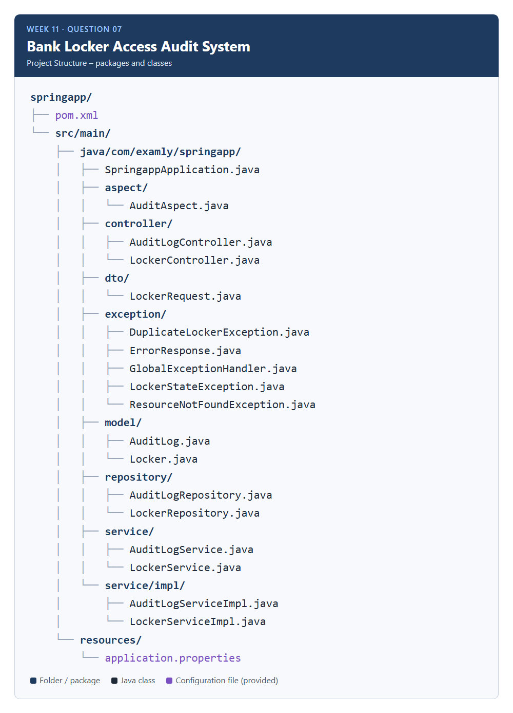
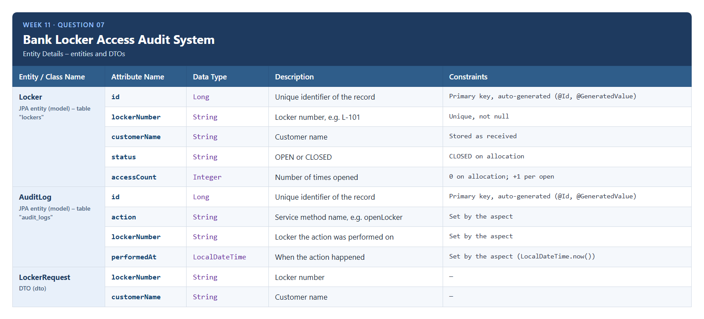
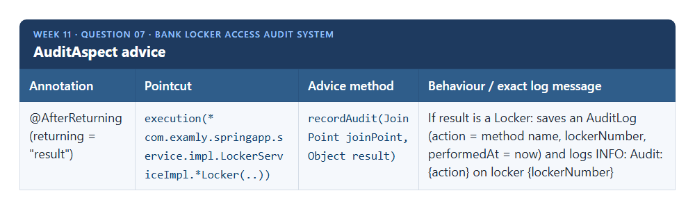
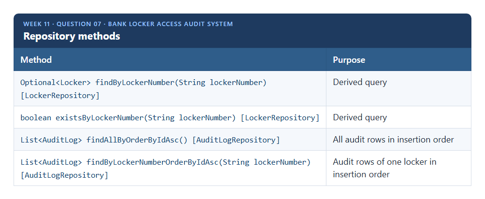
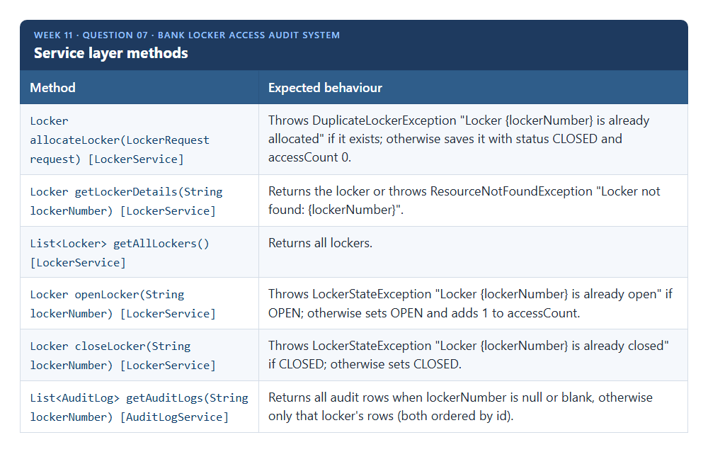
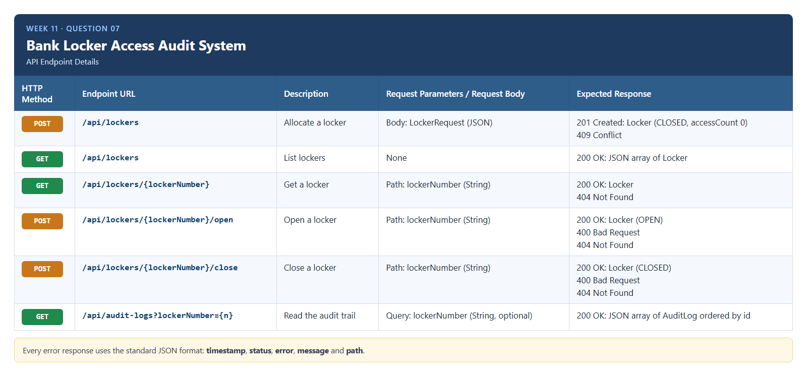
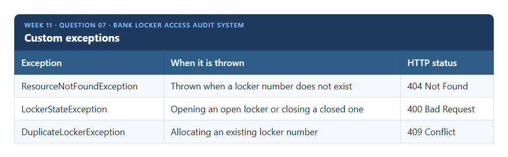
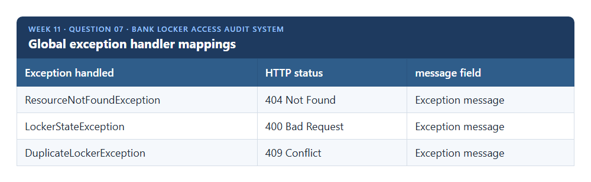
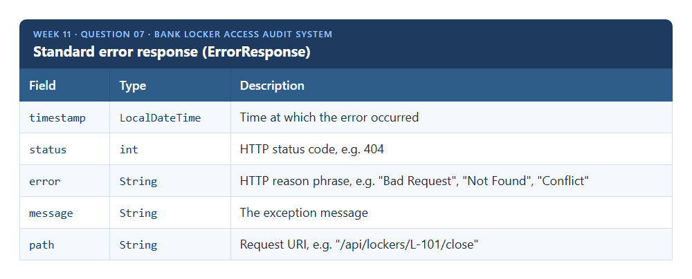

# Question 07: Bank Locker Access Audit System

**Week 11: Logging & AOP Basics** · **Focus:** Audit-trail aspect: @AfterReturning saves an audit record after successful operations

## 1. Business Scenario

A bank must keep an audit trail of every locker allocation, opening and closing for its regulators. Failed attempts and simple look-ups must not appear in the trail, and the audit code must stay separate from the locker logic.

## 2. Problem Statement

Build a Spring Boot REST API to allocate, view, open and close lockers. Add an AuditAspect whose @AfterReturning advice saves an AuditLog row after every successful LockerServiceImpl method whose name ends with "Locker", and expose the trail through /api/audit-logs.

## 3. Functional Requirements

1. **Allocate a locker**: `POST /api/lockers`
2. **List lockers**: `GET /api/lockers`
3. **Get a locker**: `GET /api/lockers/{lockerNumber}`
4. **Open a locker**: `POST /api/lockers/{lockerNumber}/open`
5. **Close a locker**: `POST /api/lockers/{lockerNumber}/close`
6. **Read the audit trail**: `GET /api/audit-logs?lockerNumber={n}`
7. Implement the aspect described in section 6; the service classes must not contain that cross-cutting logging code.
8. Handle every error in **one global exception handler** and return the standard error response described in section 10.

## 4. Project Structure and Required Classes

Create exactly these classes. Class names, package names and field names must match because the automated testcases look them up by name.



## 5. Entity Details



Every entity and DTO needs a public no-argument constructor, plus getters and setters for all fields.

## 6. Aspect Requirements

Create `AuditAspect` in the `aspect` package and annotate it with `@Aspect` and `@Component`. The `spring-boot-starter-aop` dependency is already in `pom.xml`.



- The pointcut matches `allocateLocker`, `openLocker` and `closeLocker` but not `getLockerDetails` or `getAllLockers`, so reads are never audited.
- Because @AfterReturning runs only after success, rejected operations (duplicate allocation, invalid open/close) create no audit row.
- Inject `AuditLogRepository` into the aspect through its constructor.
- Log from the aspect with its own SLF4J logger created by `LoggerFactory.getLogger(AuditAspect.class)`.

## 7. Required Methods and Expected Behaviour

### Repository



### Service layer

Declare these methods in the service interface and implement them in the `service/impl` class.



### Controller

- Use constructor injection for the service.
- Return `ResponseEntity` with the status codes shown in section 9.

## 8. Business Logic Requirements

- Audit rows are written only by the aspect, never by the service.
- Each successful allocate, open or close adds exactly one audit row.

## 9. API Endpoints



## 10. Exception Handling Expectations

### Custom exceptions



### Global exception handler (`GlobalExceptionHandler`)

Annotate the class with `@RestControllerAdvice` and add one `@ExceptionHandler` method for each row below.



### Standard error response (`ErrorResponse`)



**Example error response**

```json
{
  "timestamp": "2026-11-20T10:15:30.123",
  "status": 400,
  "error": "Bad Request",
  "message": "Locker L-101 is already closed",
  "path": "/api/lockers/L-101/close"
}
```
