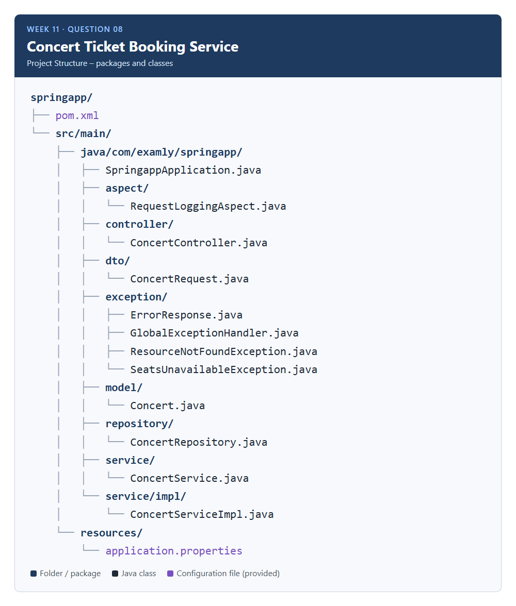
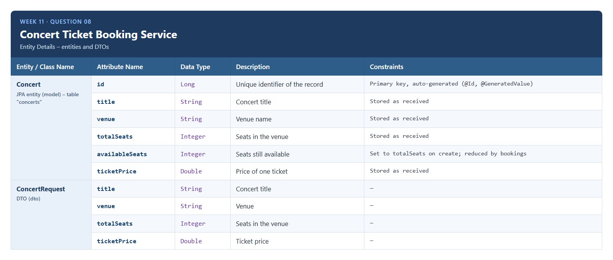
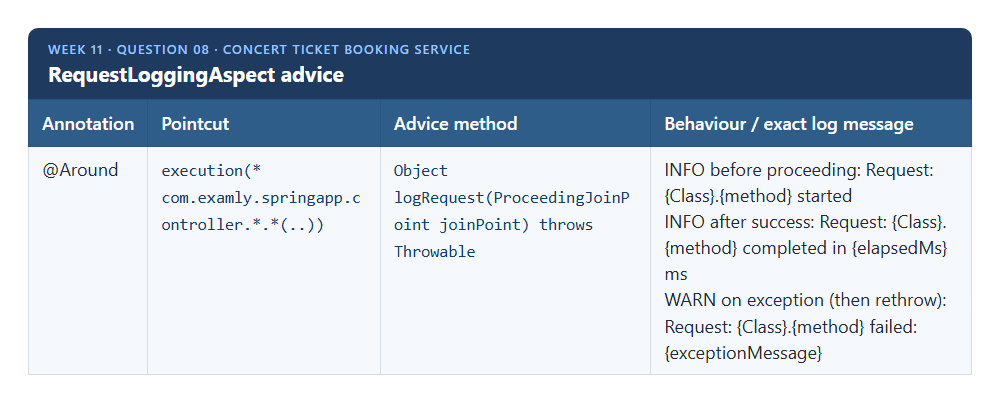
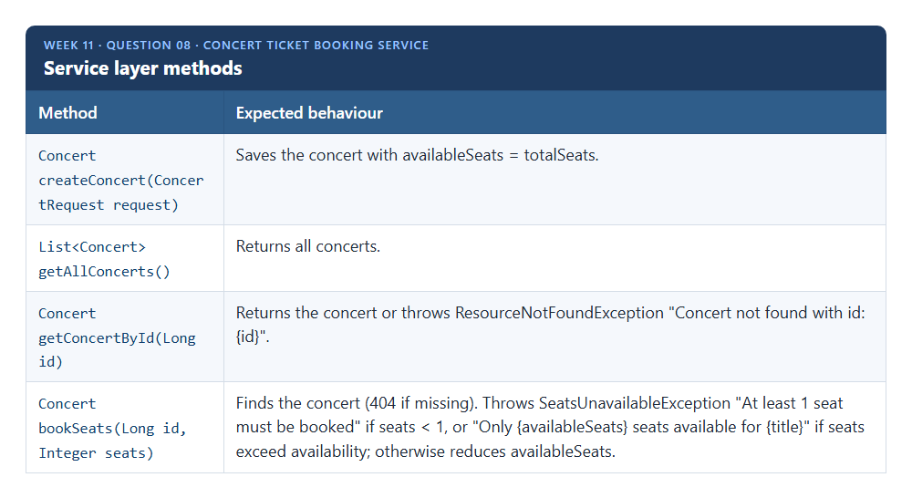
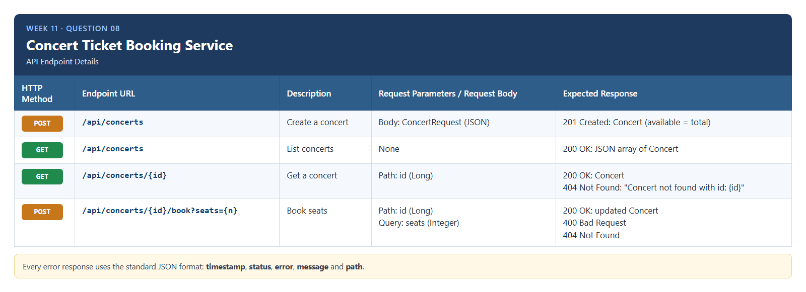
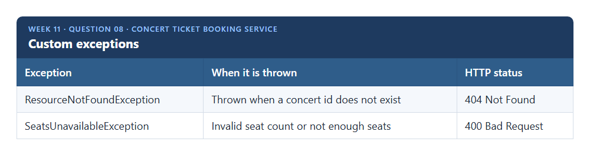
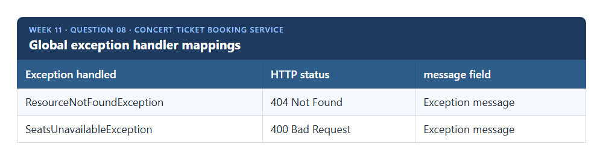
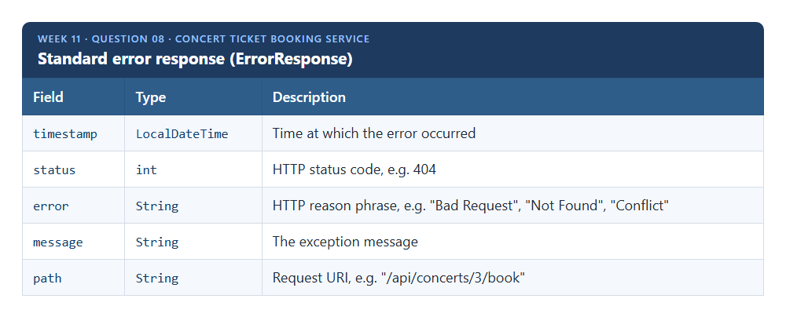

# Question 08: Concert Ticket Booking Service

**Week 11: Logging & AOP Basics** · **Focus:** Controller-layer request logging with @Around (start, duration and failures)

## 1. Business Scenario

A concert promoter sells seats online. During big launches the support team needs to see every incoming request, how long it took, and which requests failed and why, all from one place instead of scattered log statements.

## 2. Problem Statement

Build a Spring Boot REST API to create concerts, view them and book seats. Add a RequestLoggingAspect whose @Around advice wraps every controller method, logging when the request starts, when it completes with its duration, and a warning when it fails.

## 3. Functional Requirements

1. **Create a concert**: `POST /api/concerts`
2. **List concerts**: `GET /api/concerts`
3. **Get a concert**: `GET /api/concerts/{id}`
4. **Book seats**: `POST /api/concerts/{id}/book?seats={n}`
5. Implement the aspect described in section 6; the service classes must not contain that cross-cutting logging code.
6. Handle every error in **one global exception handler** and return the standard error response described in section 10.

## 4. Project Structure and Required Classes

Create exactly these classes. Class names, package names and field names must match because the automated testcases look them up by name.



## 5. Entity Details



Every entity and DTO needs a public no-argument constructor, plus getters and setters for all fields.

## 6. Aspect Requirements

Create `RequestLoggingAspect` in the `aspect` package and annotate it with `@Aspect` and `@Component`. The `spring-boot-starter-aop` dependency is already in `pom.xml`.



- {Class} is `joinPoint.getSignature().getDeclaringType().getSimpleName()` and {method} is `joinPoint.getSignature().getName()`, e.g. `Request: ConcertController.bookSeats started`.
- Catch the exception only to log it, then rethrow it so the global exception handler still returns the error response.
- Service methods must not be logged by this aspect.
- Log from the aspect with its own SLF4J logger created by `LoggerFactory.getLogger(RequestLoggingAspect.class)`.

## 7. Required Methods and Expected Behaviour

### Repository

The repository only needs the methods inherited from `JpaRepository` (no custom methods).

### Service layer

Declare these methods in the service interface and implement them in the `service/impl` class.



### Controller

- Use constructor injection for the service.
- Return `ResponseEntity` with the status codes shown in section 9.

## 8. Business Logic Requirements

- availableSeats can never go below 0.

## 9. API Endpoints



## 10. Exception Handling Expectations

### Custom exceptions



### Global exception handler (`GlobalExceptionHandler`)

Annotate the class with `@RestControllerAdvice` and add one `@ExceptionHandler` method for each row below.



### Standard error response (`ErrorResponse`)



**Example error response**

```json
{
  "timestamp": "2026-11-20T10:15:30.123",
  "status": 400,
  "error": "Bad Request",
  "message": "Only 5 seats available for Indie Live",
  "path": "/api/concerts/3/book"
}
```
