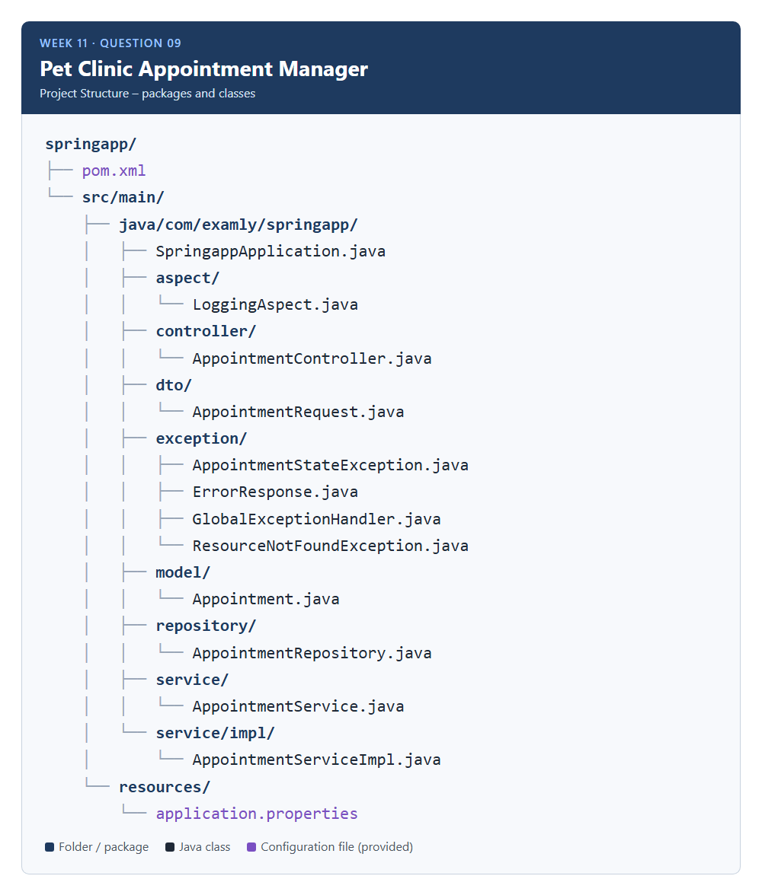
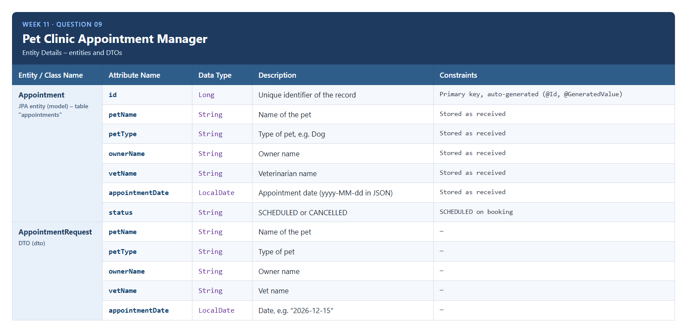
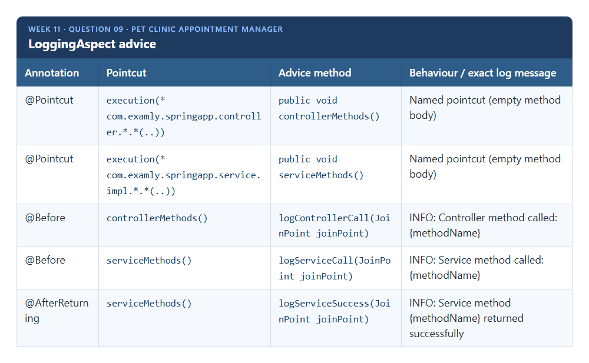
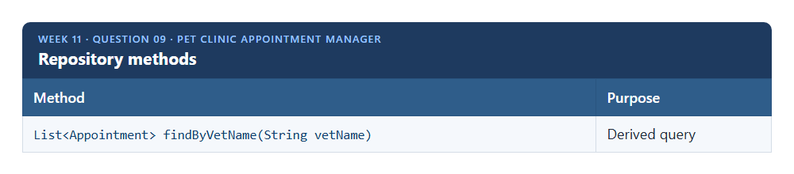
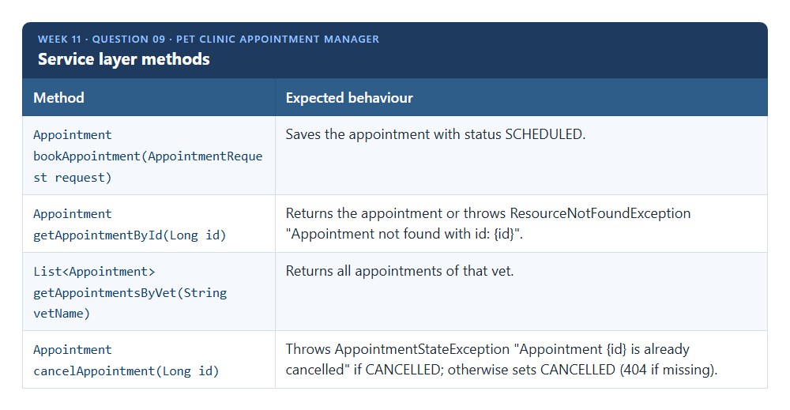
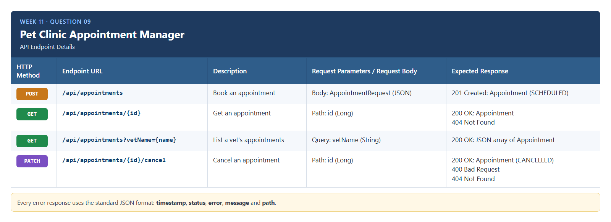
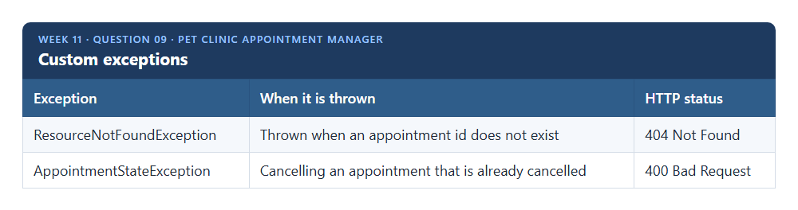
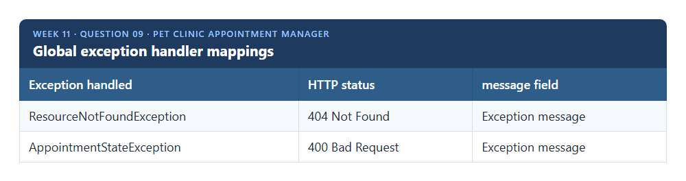
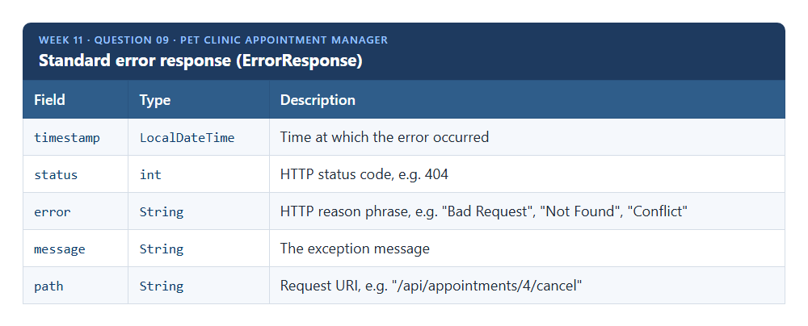

# Question 09: Pet Clinic Appointment Manager

**Week 11: Logging & AOP Basics** · **Focus:** Reusable named @Pointcut definitions shared by several advices

## 1. Business Scenario

A pet clinic books appointments with its vets. The developers want one aspect that traces calls at both the controller and the service layer, and they want the pointcut expressions defined once and reused instead of copied into every advice.

## 2. Problem Statement

Build a Spring Boot REST API to book, view, list and cancel appointments. Add a LoggingAspect that declares two named pointcuts (controllerMethods and serviceMethods) and uses them in two @Before advices and one @AfterReturning advice.

## 3. Functional Requirements

1. **Book an appointment**: `POST /api/appointments`
2. **Get an appointment**: `GET /api/appointments/{id}`
3. **List a vet's appointments**: `GET /api/appointments?vetName={name}`
4. **Cancel an appointment**: `PATCH /api/appointments/{id}/cancel`
5. Implement the aspect described in section 6; the service classes must not contain that cross-cutting logging code.
6. Handle every error in **one global exception handler** and return the standard error response described in section 10.

## 4. Project Structure and Required Classes

Create exactly these classes. Class names, package names and field names must match because the automated testcases look them up by name.



## 5. Entity Details



Every entity and DTO needs a public no-argument constructor, plus getters and setters for all fields.

## 6. Aspect Requirements

Create `LoggingAspect` in the `aspect` package and annotate it with `@Aspect` and `@Component`. The `spring-boot-starter-aop` dependency is already in `pom.xml`.



- The advices must refer to the pointcuts by name, e.g. `@Before("serviceMethods()")`, not repeat the execution() expression.
- For one request the controller line is logged before the service line.
- When a service method throws, "Service method called" is logged but "returned successfully" is not.
- Log from the aspect with its own SLF4J logger created by `LoggerFactory.getLogger(LoggingAspect.class)`.

## 7. Required Methods and Expected Behaviour

### Repository



### Service layer

Declare these methods in the service interface and implement them in the `service/impl` class.



### Controller

- Use constructor injection for the service.
- Return `ResponseEntity` with the status codes shown in section 9.

## 8. Business Logic Requirements

- An appointment can be cancelled only once.

## 9. API Endpoints



## 10. Exception Handling Expectations

### Custom exceptions



### Global exception handler (`GlobalExceptionHandler`)

Annotate the class with `@RestControllerAdvice` and add one `@ExceptionHandler` method for each row below.



### Standard error response (`ErrorResponse`)



**Example error response**

```json
{
  "timestamp": "2026-11-20T10:15:30.123",
  "status": 400,
  "error": "Bad Request",
  "message": "Appointment 4 is already cancelled",
  "path": "/api/appointments/4/cancel"
}
```
