# Question 10: Food Delivery Order Tracker

**Week 11: Logging & AOP Basics** · **Focus:** Full integration: SLF4J levels, log file configuration, all four advice types and a metrics endpoint

## 1. Business Scenario

A food delivery start-up tracks orders from the moment they are placed until they reach the customer. The team wants business events in a log file, detailed DEBUG output while they stabilise the system, a complete trace of every service call and timing figures they can query.

## 2. Problem Statement

Build a Spring Boot REST API to place, view and progress delivery orders. Log business events from the service with SLF4J, configure a log file and DEBUG level, and add an OrderLifecycleAspect that uses @Before, @AfterReturning, @After and @Around on DeliveryOrderServiceImpl, recording timings exposed at /api/metrics.

## 3. Functional Requirements

1. **Place an order**: `POST /api/orders`
2. **Get an order**: `GET /api/orders/{id}`
3. **Move to the next status**: `PATCH /api/orders/{id}/status?value={status}`
4. **List method metrics**: `GET /api/metrics`
5. **Get one method metric**: `GET /api/metrics/{methodName}`
6. Write the log messages and logging configuration described in section 6.
7. Implement the aspect described in section 7; the service classes must not contain that cross-cutting logging code.
8. Handle every error in **one global exception handler** and return the standard error response described in section 11.

## 4. Project Structure and Required Classes

Create exactly these classes. Class names, package names and field names must match because the automated testcases look them up by name.

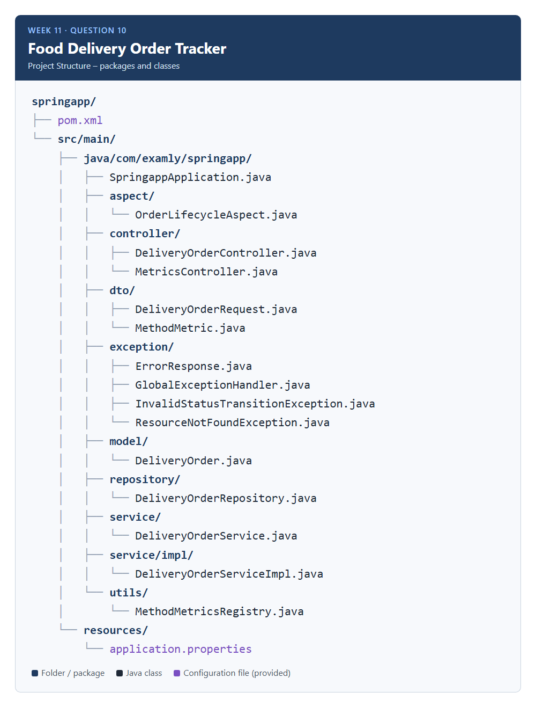

## 5. Entity Details

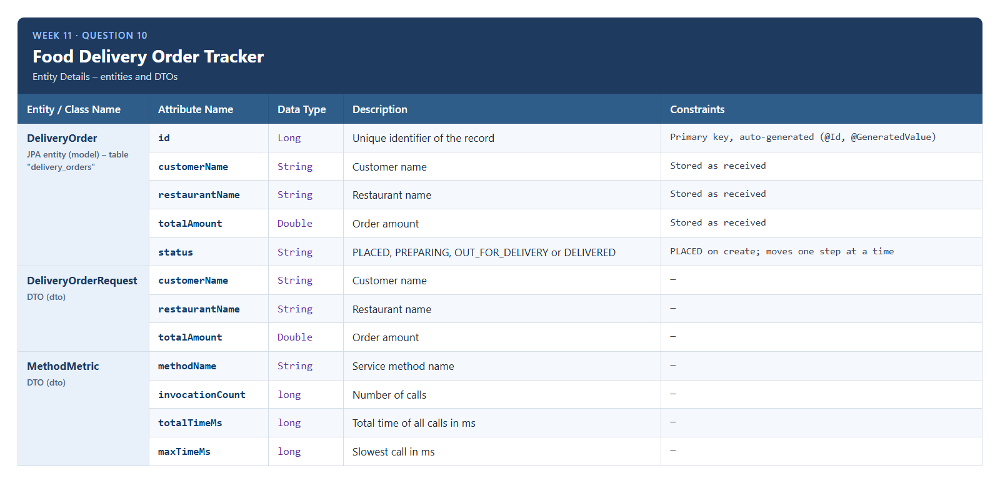

Every entity and DTO needs a public no-argument constructor, plus getters and setters for all fields.

## 6. Logging Requirements

### Logging configuration (`application.properties`)

Add these entries to `src/main/resources/application.properties`:

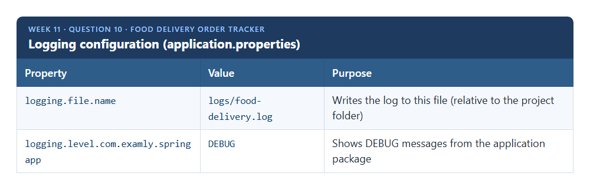

### Log messages

Write these messages with an SLF4J `Logger` at exactly the stated level. Values in braces are filled in with `{}` placeholders.

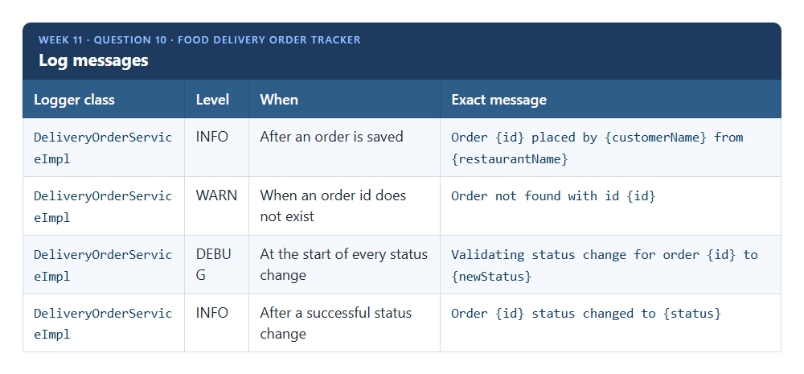

- Use `org.slf4j.Logger` and `org.slf4j.LoggerFactory` (Logback, the Spring Boot default, writes the output); no extra dependency is needed.
- Spring Boot prints each line with its level and logger name, e.g. `INFO ... c.e.s.service.impl.RoomServiceImpl : Room created ...`. The testcases check the level, the logger class and the exact message text.

## 7. Aspect Requirements

Create `OrderLifecycleAspect` in the `aspect` package and annotate it with `@Aspect` and `@Component`. The `spring-boot-starter-aop` dependency is already in `pom.xml`.

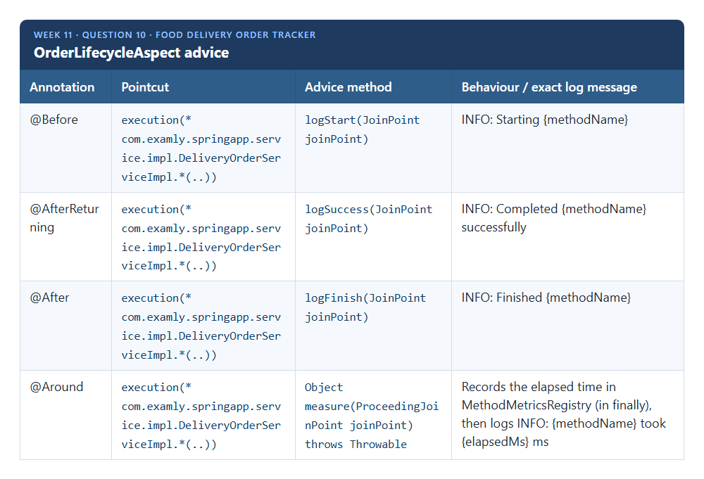

- For a successful call the lines appear in this order: Starting, Completed ... successfully, Finished, then the @Around timing line.
- When the service method throws, "Finished" is still logged but "Completed ... successfully" is not.
- Inject `MethodMetricsRegistry` into the aspect through its constructor.
- Log from the aspect with its own SLF4J logger created by `LoggerFactory.getLogger(OrderLifecycleAspect.class)`.

## 8. Required Methods and Expected Behaviour

### Repository

The repository only needs the methods inherited from `JpaRepository` (no custom methods).

### Service layer

Declare these methods in the service interface and implement them in the `service/impl` class.

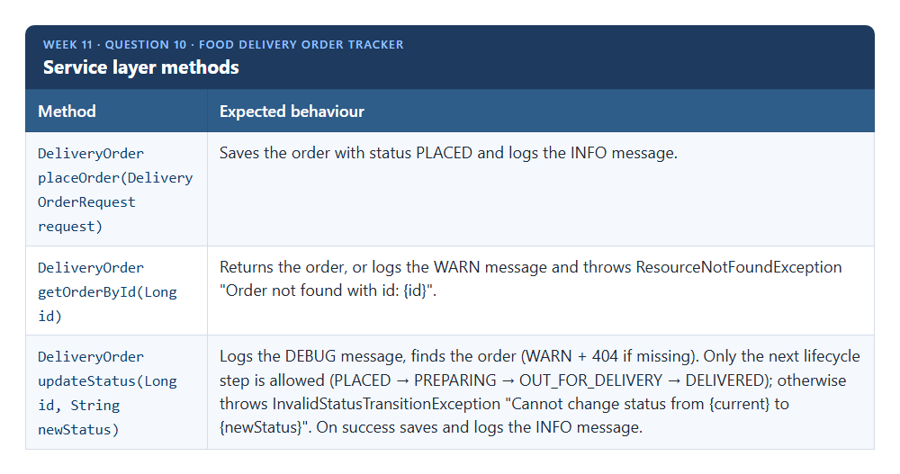

### Utility

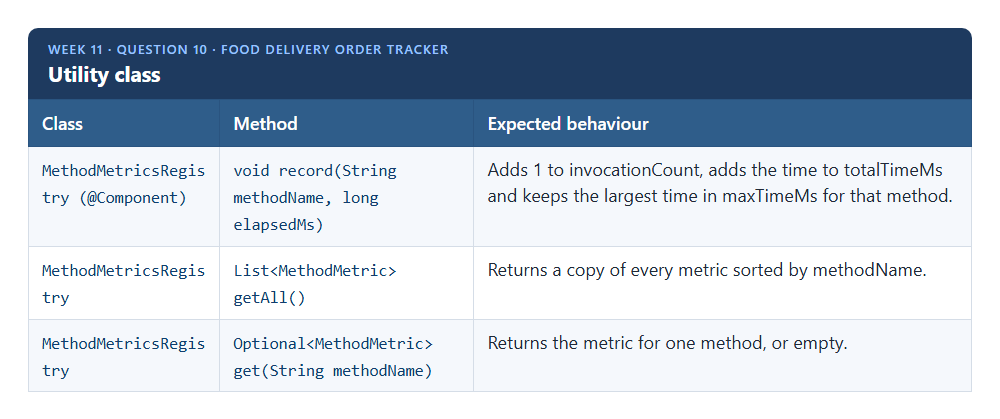

### Controller

- `MetricsController` (`/api/metrics`) returns `getAll()` and, for one method, `get(methodName)` or ResourceNotFoundException "No metrics recorded for method: {methodName}".
- Use constructor injection for the service.
- Return `ResponseEntity` with the status codes shown in section 10.

## 9. Business Logic Requirements

- Status moves strictly one step at a time: PLACED → PREPARING → OUT_FOR_DELIVERY → DELIVERED.
- Every service log line also goes to logs/food-delivery.log.

## 10. API Endpoints

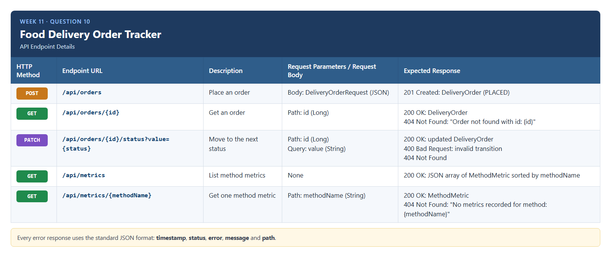

## 11. Exception Handling Expectations

### Custom exceptions

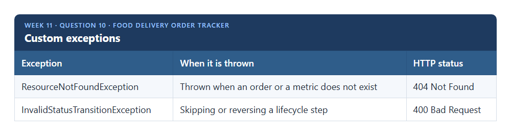

### Global exception handler (`GlobalExceptionHandler`)

Annotate the class with `@RestControllerAdvice` and add one `@ExceptionHandler` method for each row below.

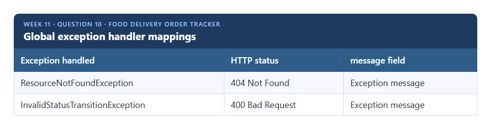

### Standard error response (`ErrorResponse`)

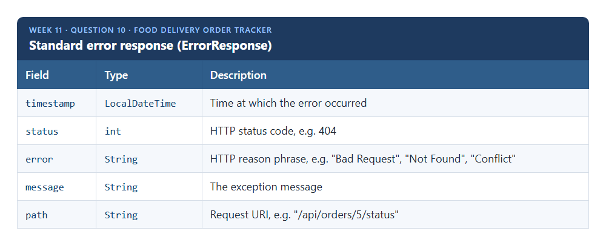

**Example error response**

```json
{
  "timestamp": "2026-11-20T10:15:30.123",
  "status": 400,
  "error": "Bad Request",
  "message": "Cannot change status from PLACED to DELIVERED",
  "path": "/api/orders/5/status"
}
```
