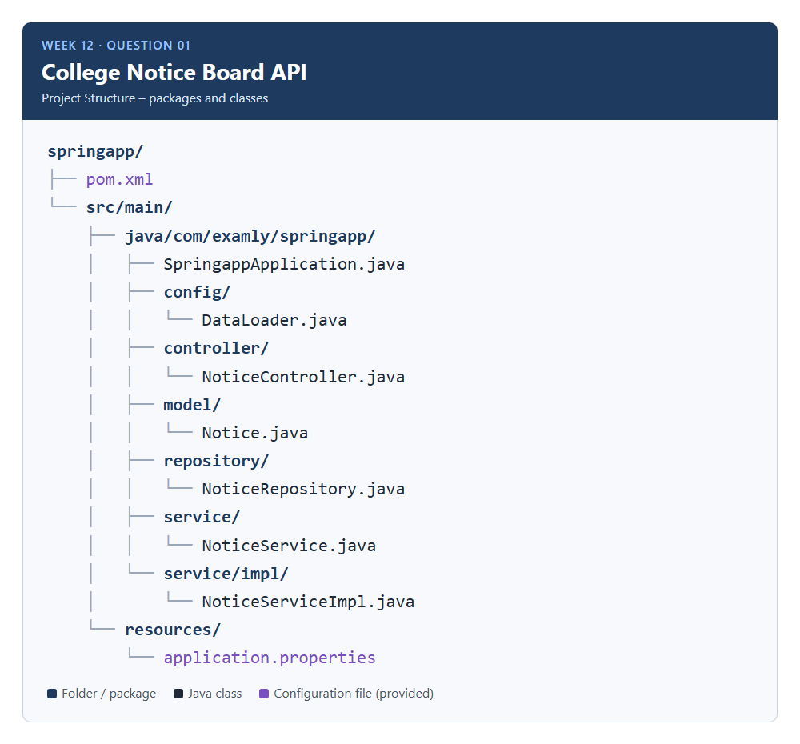
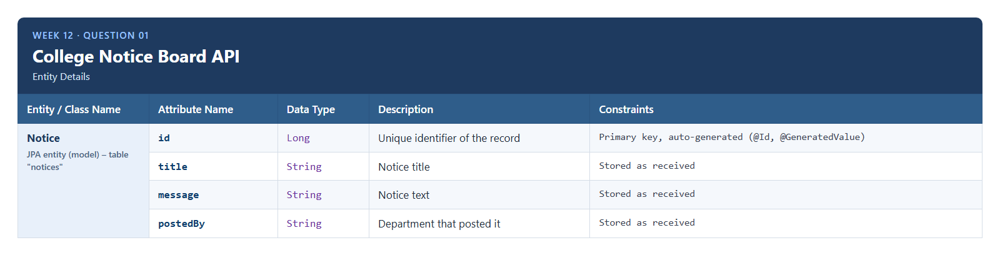
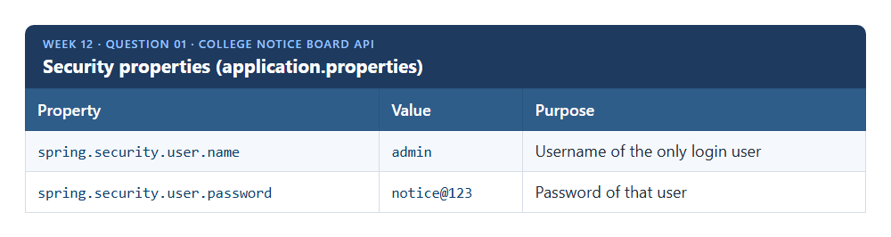
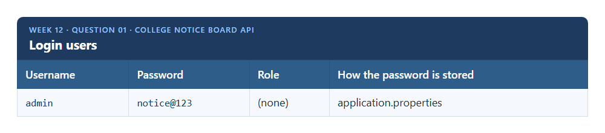
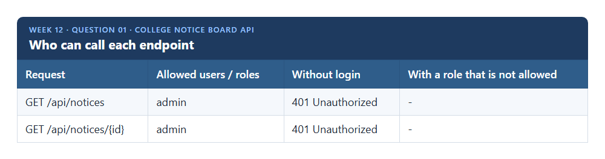
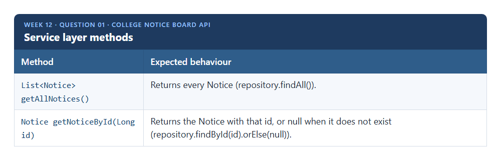
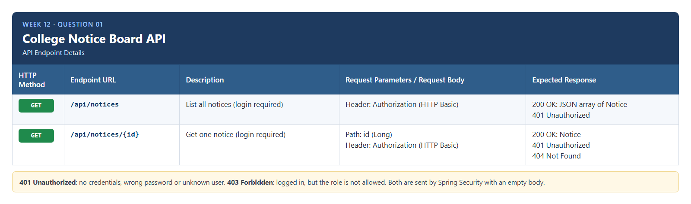
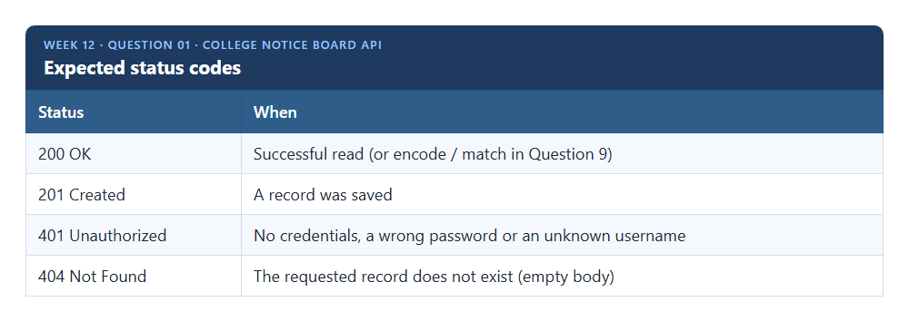

# Question 01: College Notice Board API

**Week 12: Spring Security: In-Memory Auth** · **Focus:** Adding spring-boot-starter-security and a login user from application.properties

## 1. Business Scenario

The college office publishes notices through a small API. At the moment anyone who knows the URL can read them. The office wants the notice board protected so that only the office account can read it.

## 2. Problem Statement

Build a Spring Boot REST API with two read endpoints for notices. Add Spring Security to the project and configure one login user in application.properties. No security configuration class is needed: Spring Boot's default security must protect every endpoint.

## 3. Functional Requirements

1. **List all notices (login required)**: `GET /api/notices`
2. **Get one notice (login required)**: `GET /api/notices/{id}`
3. Protect the endpoints exactly as described in section 6.

## 4. Project Structure and Required Classes

Create exactly these classes. Class names, package names and field names must match because the automated testcases look them up by name.

- `model/Notice.java`, `repository/NoticeRepository.java` and `config/DataLoader.java` are provided complete. DataLoader adds three sample notices (including "Semester Exam Schedule") when the table is empty.

## 5. Entity Details

Every entity needs a public no-argument constructor, plus getters and setters for all fields. The entity itself is used as the JSON request body.

## 6. Security Requirements

### Project setup

- Add the `spring-boot-starter-security` dependency to `pom.xml` (it is not in the starter project).

### Login user in `application.properties`

### Users

### Access rules

- Without a SecurityFilterChain bean, Spring Boot secures every endpoint and accepts HTTP Basic credentials.
- A request without credentials, with a wrong password or with an unknown username gets 401 Unauthorized and a `WWW-Authenticate: Basic ...` header.

## 7. Required Methods and Expected Behaviour

### Repository

The repository extends `JpaRepository` and needs no custom methods.

### Service layer

Declare these methods in the service interface and implement them in the `service/impl` class.

### Controller

- `NoticeController` returns 404 Not Found (empty body) when `getNoticeById` returns null.
- Use constructor injection for the service.

## 8. Business Logic Requirements

- Only logged-in users can read notices.
- The three sample notices are created by the provided DataLoader.

## 9. API Endpoints

## 10. Expected Status Codes

