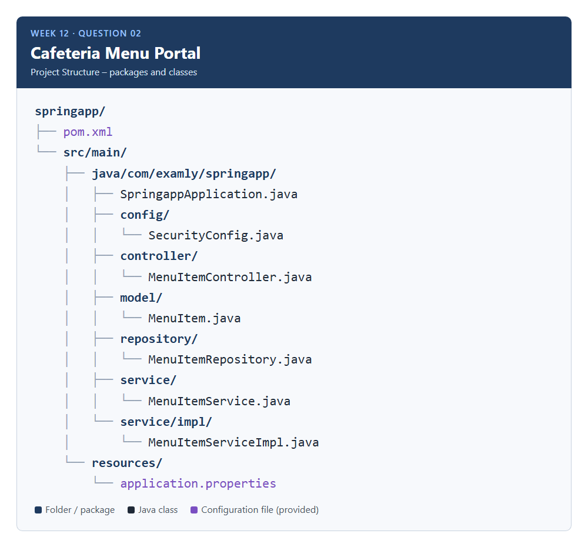
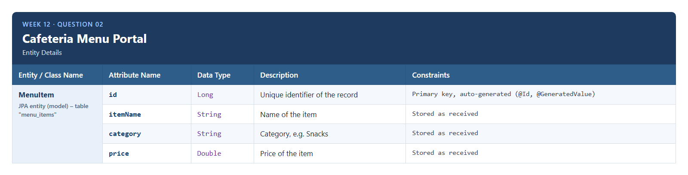
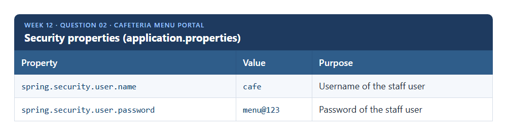
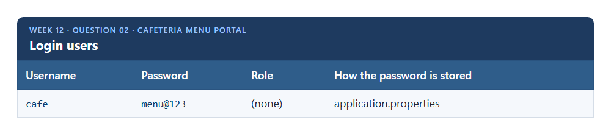
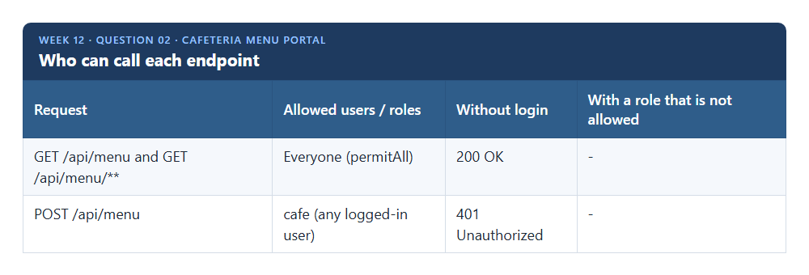
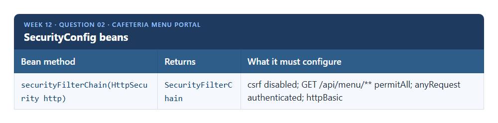
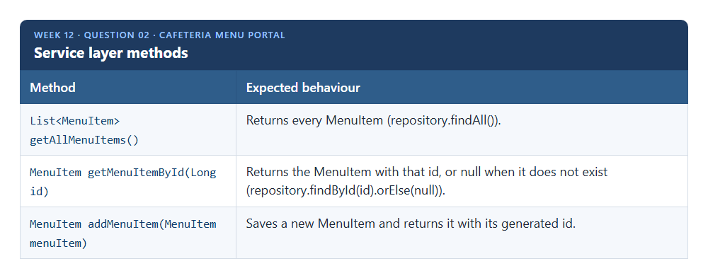
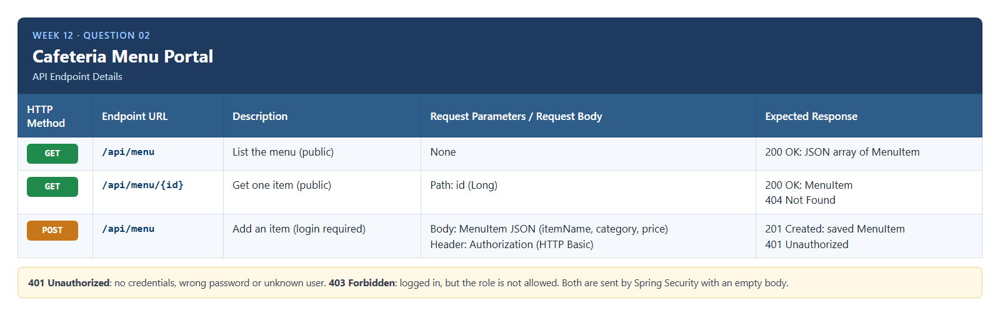
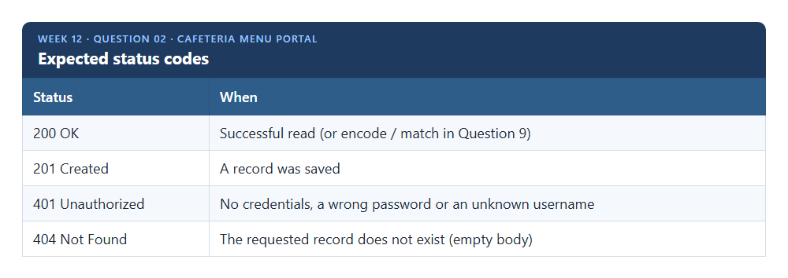

# Question 02: Cafeteria Menu Portal

**Week 12: Spring Security: In-Memory Auth** · **Focus:** First SecurityFilterChain bean: public GET endpoints, protected POST, HTTP Basic

## 1. Business Scenario

Students check the cafeteria menu on their phones without logging in, but only cafeteria staff may add new items. The default "everything is locked" behaviour is too strict, so the rules must be written explicitly.

## 2. Problem Statement

Build a Spring Boot REST API to view the menu, view one item and add an item. Create a SecurityConfig class with a SecurityFilterChain bean that makes the GET endpoints public, requires login for everything else and uses HTTP Basic. The staff user comes from application.properties.

## 3. Functional Requirements

1. **List the menu (public)**: `GET /api/menu`
2. **Get one item (public)**: `GET /api/menu/{id}`
3. **Add an item (login required)**: `POST /api/menu`
4. Protect the endpoints exactly as described in section 6.

## 4. Project Structure and Required Classes

Create exactly these classes. Class names, package names and field names must match because the automated testcases look them up by name.

## 5. Entity Details

Every entity needs a public no-argument constructor, plus getters and setters for all fields. The entity itself is used as the JSON request body.

## 6. Security Requirements

### Login user in `application.properties`

### Users

### Access rules

### Security configuration (`config/SecurityConfig`)

Annotate the class with `@Configuration` and `@EnableWebSecurity` and declare these `@Bean` methods:

- Disable CSRF (`csrf(csrf -> csrf.disable())`) because this REST API is called with HTTP Basic, not from browser forms.
- Use `requestMatchers(HttpMethod.GET, "/api/menu/**").permitAll()` and `anyRequest().authenticated()`.
- Enable HTTP Basic with `httpBasic(Customizer.withDefaults())`.

## 7. Required Methods and Expected Behaviour

### Repository

The repository extends `JpaRepository` and needs no custom methods.

### Service layer

Declare these methods in the service interface and implement them in the `service/impl` class.

### Controller

- `MenuItemController` returns 404 Not Found (empty body) when an item does not exist.
- Use constructor injection for the service.

## 8. Business Logic Requirements

- Anyone can view the menu; only the staff user can add items.

## 9. API Endpoints

## 10. Expected Status Codes

