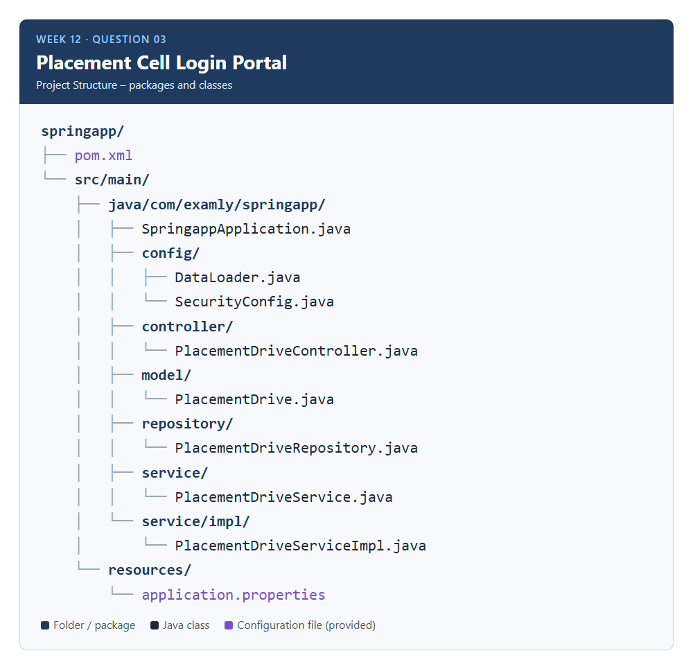
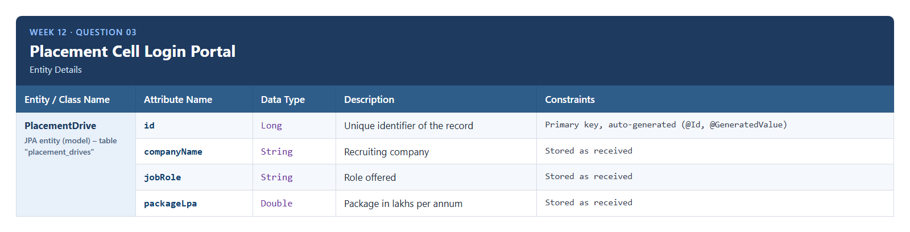
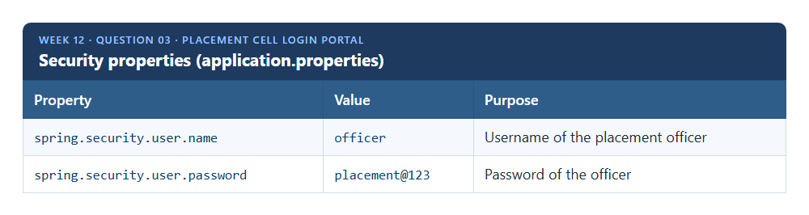
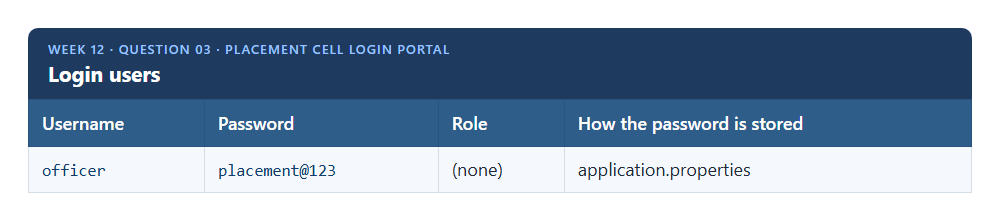
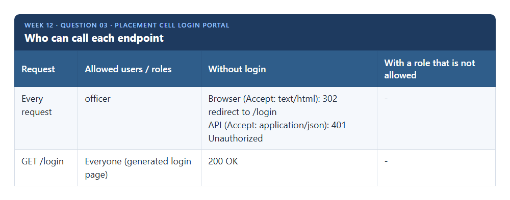
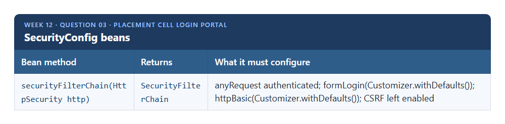
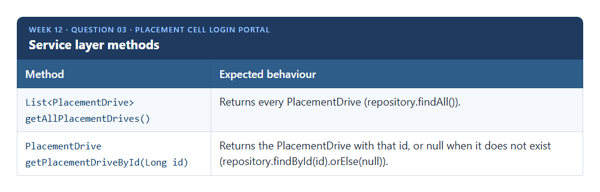
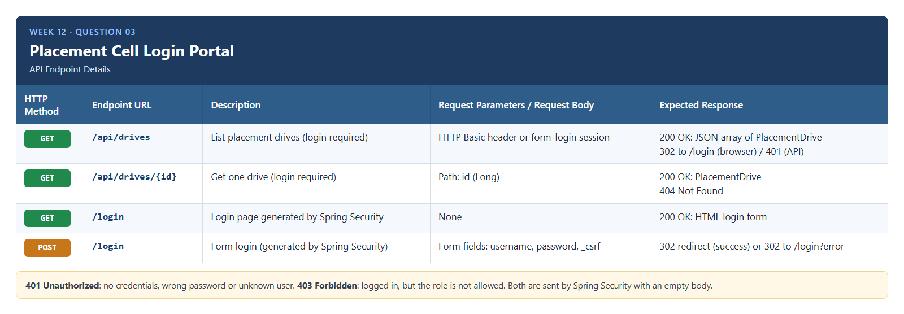
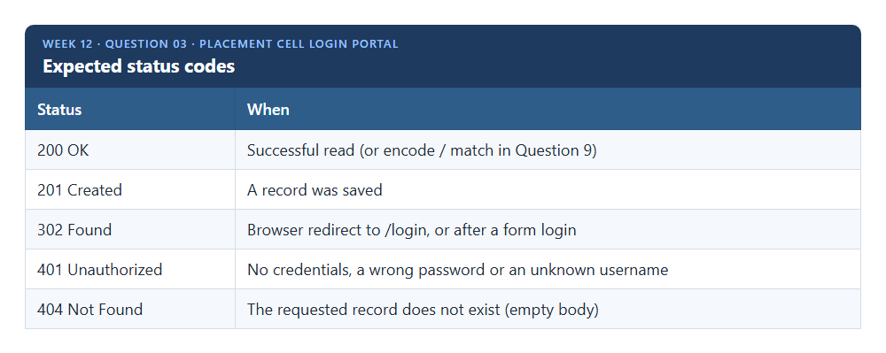

# Question 03: Placement Cell Login Portal

**Week 12: Spring Security: In-Memory Auth** · **Focus:** Form login and HTTP Basic in the same application

## 1. Business Scenario

Placement officers browse upcoming drives in a web browser, while the college's reporting script reads the same data through the API. The browser users need a login page; the script needs HTTP Basic.

## 2. Problem Statement

Build a Spring Boot REST API with two read endpoints for placement drives. Create a SecurityConfig with a SecurityFilterChain bean that requires login for every request and enables both form login (Spring's generated /login page) and HTTP Basic. Keep CSRF protection enabled.

## 3. Functional Requirements

1. **List placement drives (login required)**: `GET /api/drives`
2. **Get one drive (login required)**: `GET /api/drives/{id}`
3. **Login page generated by Spring Security**: `GET /login`
4. **Form login (generated by Spring Security)**: `POST /login`
5. Protect the endpoints exactly as described in section 6.

## 4. Project Structure and Required Classes

Create exactly these classes. Class names, package names and field names must match because the automated testcases look them up by name.

- `model/PlacementDrive.java`, `repository/PlacementDriveRepository.java` and `config/DataLoader.java` are provided complete. DataLoader adds three sample drives (Infosys, TCS, Zoho) when the table is empty.

## 5. Entity Details

Every entity needs a public no-argument constructor, plus getters and setters for all fields. The entity itself is used as the JSON request body.

## 6. Security Requirements

### Login user in `application.properties`

### Users

### Access rules

### Security configuration (`config/SecurityConfig`)

Annotate the class with `@Configuration` and `@EnableWebSecurity` and declare these `@Bean` methods:

- Form login: a successful login on /login redirects (302) away from the login page; a wrong password redirects to `/login?error`.
- The generated login form includes a hidden `_csrf` token, so CSRF must stay enabled in this question.
- After a successful form login, the session cookie lets the browser call `/api/drives`.

## 7. Required Methods and Expected Behaviour

### Repository

The repository extends `JpaRepository` and needs no custom methods.

### Service layer

Declare these methods in the service interface and implement them in the `service/impl` class.

### Controller

- `PlacementDriveController` returns 404 Not Found (empty body) when a drive does not exist.
- Use constructor injection for the service.

## 8. Business Logic Requirements

- Every page and API call needs a logged-in officer.

## 9. API Endpoints

## 10. Expected Status Codes

