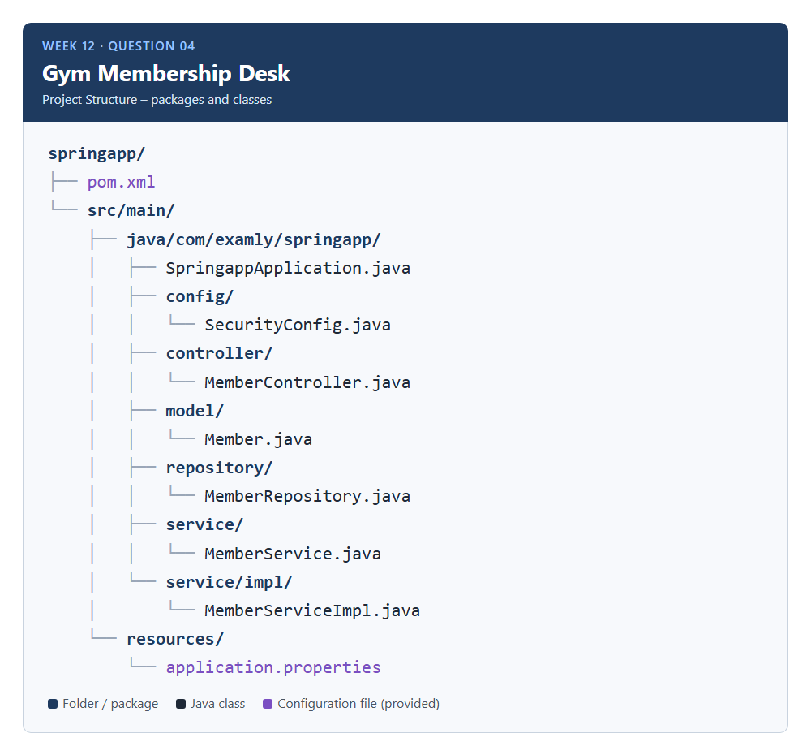
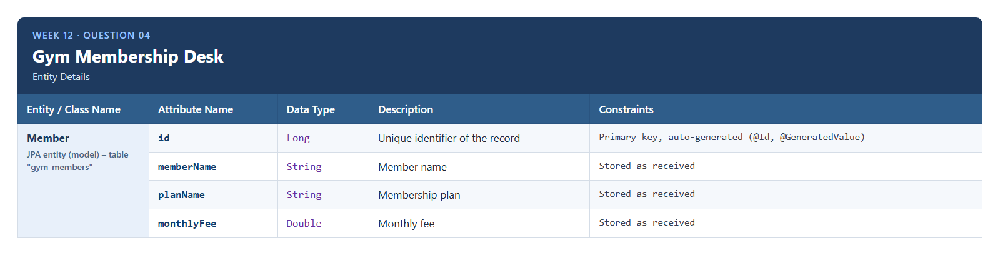
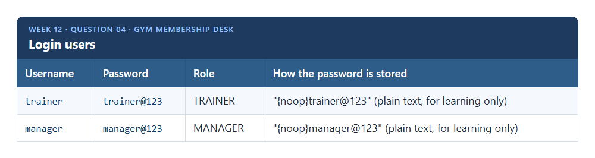
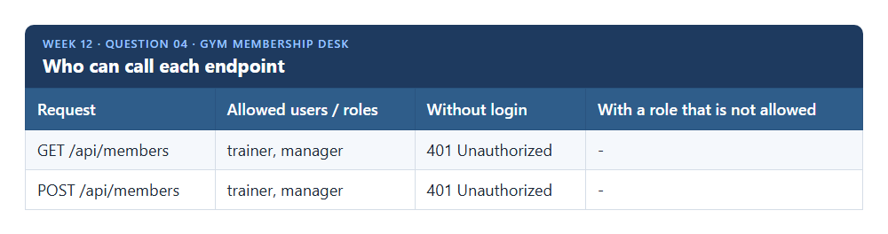
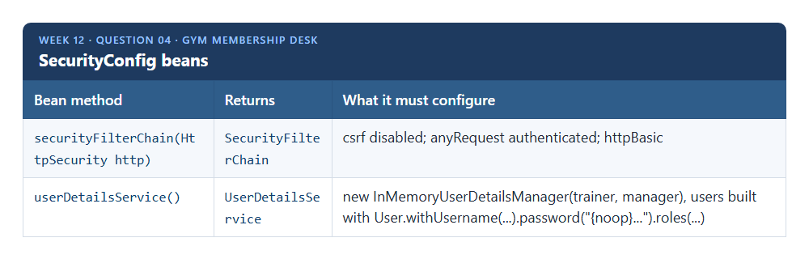
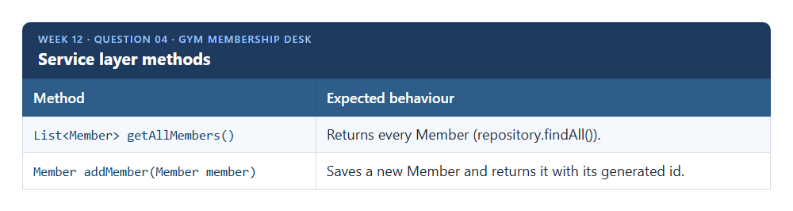
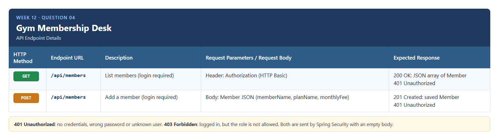
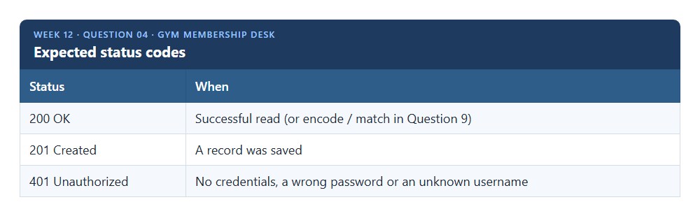

# Question 04: Gym Membership Desk

**Week 12: Spring Security: In-Memory Auth** · **Focus:** UserDetailsService bean with an InMemoryUserDetailsManager holding two users

## 1. Business Scenario

A gym's front desk is used by a trainer and a manager. Each needs their own login instead of a single shared account from application.properties.

## 2. Problem Statement

Build a Spring Boot REST API to list and add gym members. In SecurityConfig, declare a SecurityFilterChain (every request authenticated, HTTP Basic) and a UserDetailsService bean that returns an InMemoryUserDetailsManager with the two users below.

## 3. Functional Requirements

1. **List members (login required)**: `GET /api/members`
2. **Add a member (login required)**: `POST /api/members`
3. Protect the endpoints exactly as described in section 6.

## 4. Project Structure and Required Classes

Create exactly these classes. Class names, package names and field names must match because the automated testcases look them up by name.

## 5. Entity Details

Every entity needs a public no-argument constructor, plus getters and setters for all fields. The entity itself is used as the JSON request body.

## 6. Security Requirements

### Users

### Access rules

### Security configuration (`config/SecurityConfig`)

Annotate the class with `@Configuration` and `@EnableWebSecurity` and declare these `@Bean` methods:

- `{noop}` tells Spring the password is stored as plain text. Password encoding is covered in the next questions.
- `.roles("TRAINER")` stores the authority `ROLE_TRAINER`.
- Do not set spring.security.user.* in application.properties for this question.

## 7. Required Methods and Expected Behaviour

### Repository

The repository extends `JpaRepository` and needs no custom methods.

### Service layer

Declare these methods in the service interface and implement them in the `service/impl` class.

### Controller

- Use constructor injection for the service.

## 8. Business Logic Requirements

- Both desk users can list and add members.

## 9. API Endpoints

## 10. Expected Status Codes

