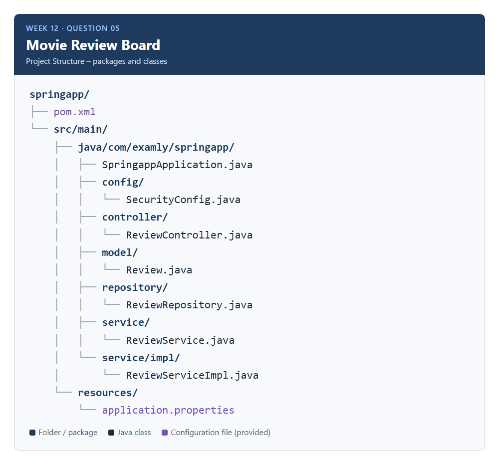
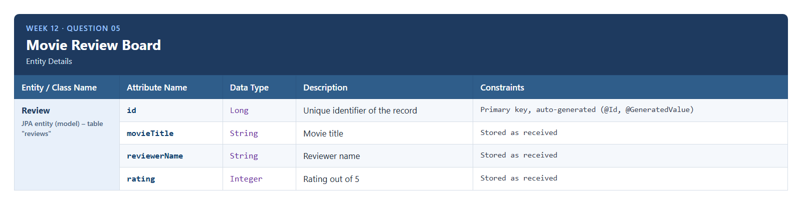
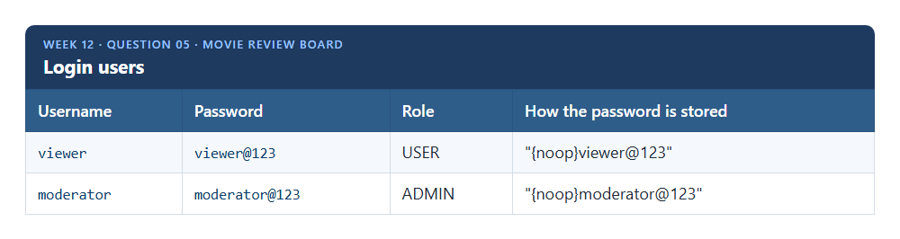
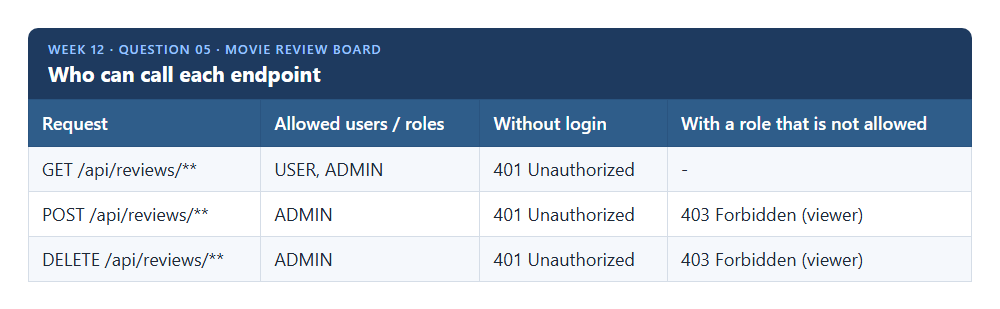
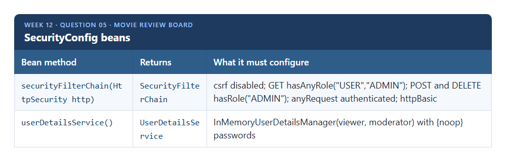
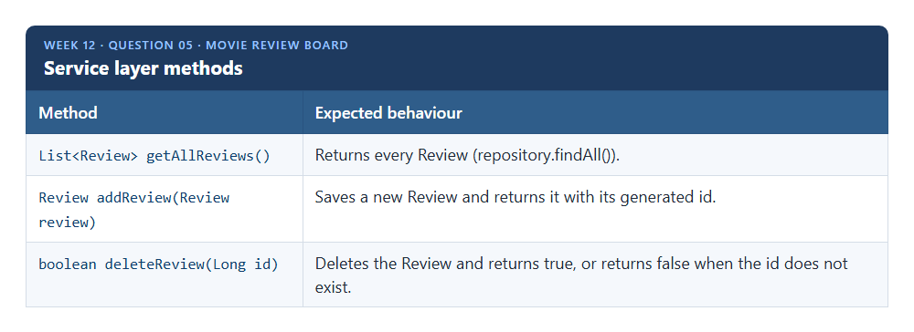
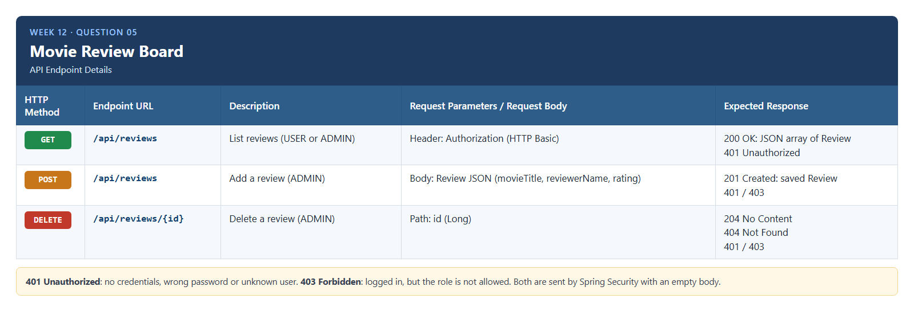
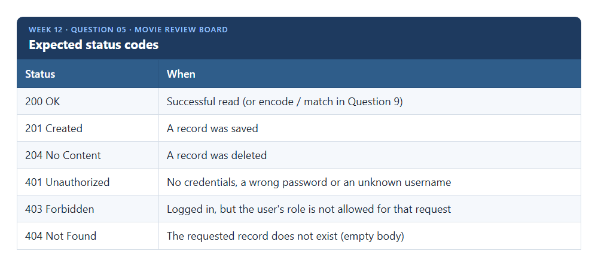

# Question 05: Movie Review Board

**Week 12: Spring Security: In-Memory Auth** · **Focus:** Authorization by role in the filter chain: USER can read, ADMIN can write (401 vs 403)

## 1. Business Scenario

A college film club shares movie reviews. Members can read reviews, but only the club moderator can post or remove them.

## 2. Problem Statement

Build a Spring Boot REST API to list, add and delete reviews. Configure two in-memory users with roles USER and ADMIN, and write role rules in the SecurityFilterChain so that reading needs USER or ADMIN and writing needs ADMIN.

## 3. Functional Requirements

1. **List reviews (USER or ADMIN)**: `GET /api/reviews`
2. **Add a review (ADMIN)**: `POST /api/reviews`
3. **Delete a review (ADMIN)**: `DELETE /api/reviews/{id}`
4. Protect the endpoints exactly as described in section 6.

## 4. Project Structure and Required Classes

Create exactly these classes. Class names, package names and field names must match because the automated testcases look them up by name.

## 5. Entity Details

Every entity needs a public no-argument constructor, plus getters and setters for all fields. The entity itself is used as the JSON request body.

## 6. Security Requirements

### Users

### Access rules

### Security configuration (`config/SecurityConfig`)

Annotate the class with `@Configuration` and `@EnableWebSecurity` and declare these `@Bean` methods:

- 401 Unauthorized means "who are you?" (no or wrong credentials). 403 Forbidden means "I know you, but you are not allowed".
- Use `requestMatchers(HttpMethod.POST, "/api/reviews/**").hasRole("ADMIN")` (no ROLE_ prefix in hasRole).

## 7. Required Methods and Expected Behaviour

### Repository

The repository extends `JpaRepository` and needs no custom methods.

### Service layer

Declare these methods in the service interface and implement them in the `service/impl` class.

### Controller

- DELETE returns 204 No Content when deleted and 404 Not Found when the id does not exist.
- Use constructor injection for the service.

## 8. Business Logic Requirements

- Only the moderator can add or delete reviews.

## 9. API Endpoints

## 10. Expected Status Codes

