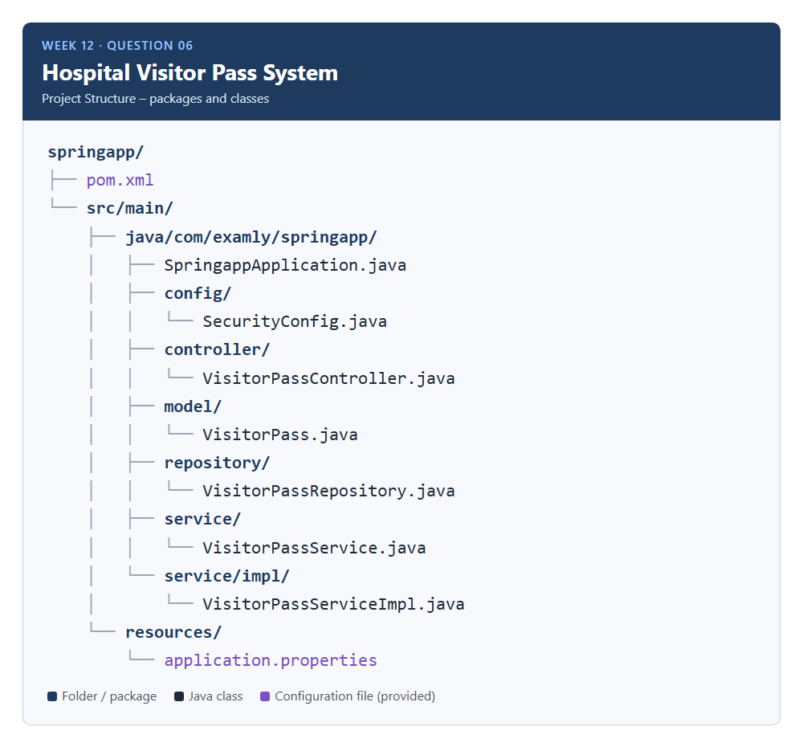
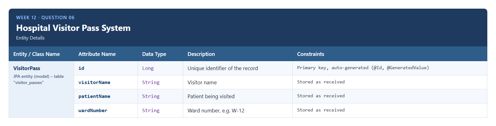
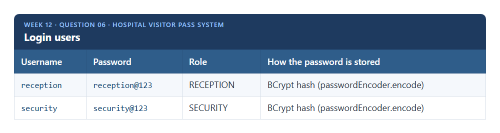
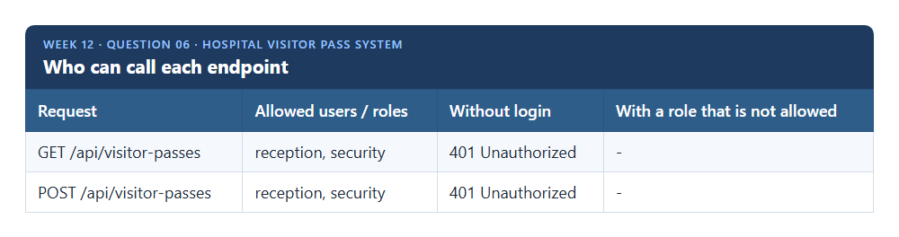
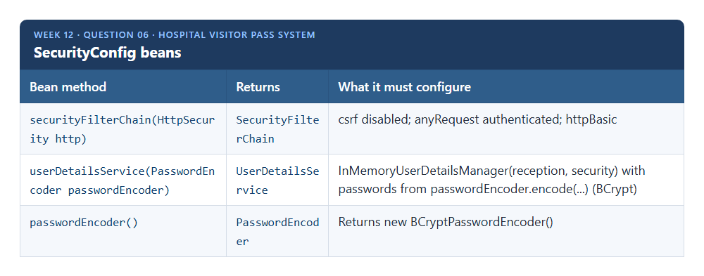
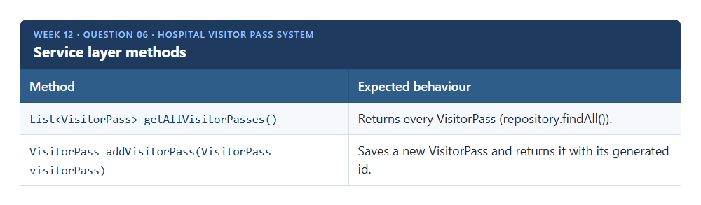
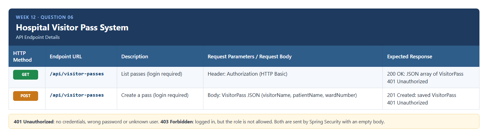
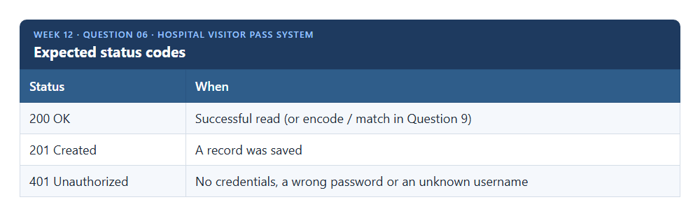

# Question 06: Hospital Visitor Pass System

**Week 12: Spring Security: In-Memory Auth** · **Focus:** PasswordEncoder bean (BCryptPasswordEncoder) and in-memory users with encoded passwords

## 1. Business Scenario

A hospital's reception and security desks issue and check visitor passes. A security audit found plain-text passwords in the code, so the passwords must now be stored as BCrypt hashes.

## 2. Problem Statement

Build a Spring Boot REST API to list and create visitor passes. In SecurityConfig, declare a BCryptPasswordEncoder bean and build the two in-memory users with passwordEncoder.encode(...), along with a SecurityFilterChain that requires login and uses HTTP Basic.

## 3. Functional Requirements

1. **List passes (login required)**: `GET /api/visitor-passes`
2. **Create a pass (login required)**: `POST /api/visitor-passes`
3. Protect the endpoints exactly as described in section 6.

## 4. Project Structure and Required Classes

Create exactly these classes. Class names, package names and field names must match because the automated testcases look them up by name.

## 5. Entity Details

Every entity needs a public no-argument constructor, plus getters and setters for all fields. The entity itself is used as the JSON request body.

## 6. Security Requirements

### Users

### Access rules

### Security configuration (`config/SecurityConfig`)

Annotate the class with `@Configuration` and `@EnableWebSecurity` and declare these `@Bean` methods:

- Plain-text passwords can be read by anyone who sees the code or a memory dump; a BCrypt hash cannot be turned back into the password.
- A BCrypt hash looks like `$2a$10$...` (60 characters). Spring compares the typed password with the hash using the PasswordEncoder bean.

## 7. Required Methods and Expected Behaviour

### Repository

The repository extends `JpaRepository` and needs no custom methods.

### Service layer

Declare these methods in the service interface and implement them in the `service/impl` class.

### Controller

- Use constructor injection for the service.

## 8. Business Logic Requirements

- No password may be stored in plain text.

## 9. API Endpoints

## 10. Expected Status Codes

