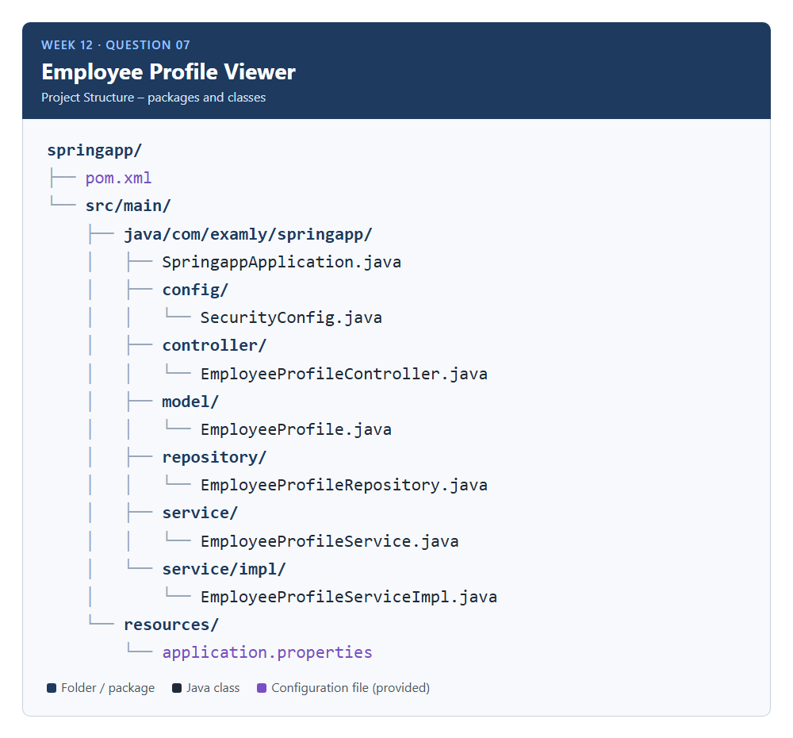
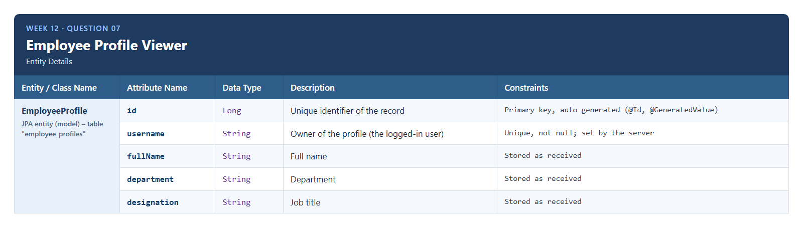
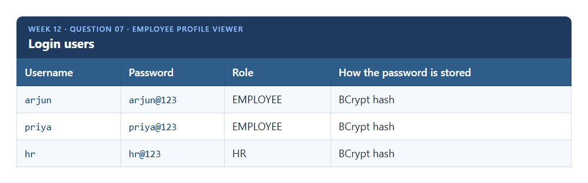
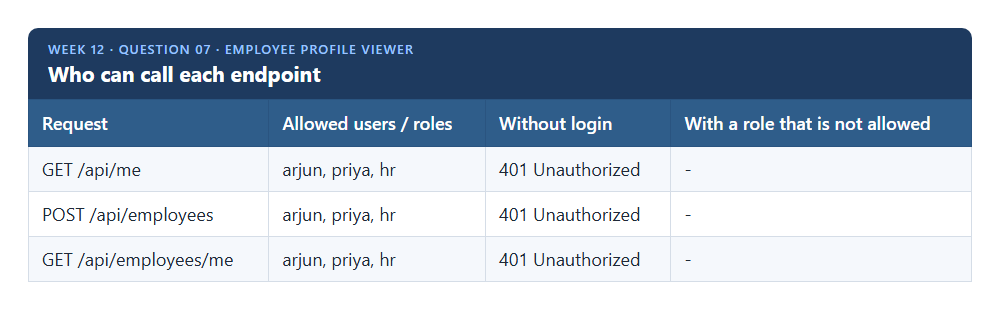
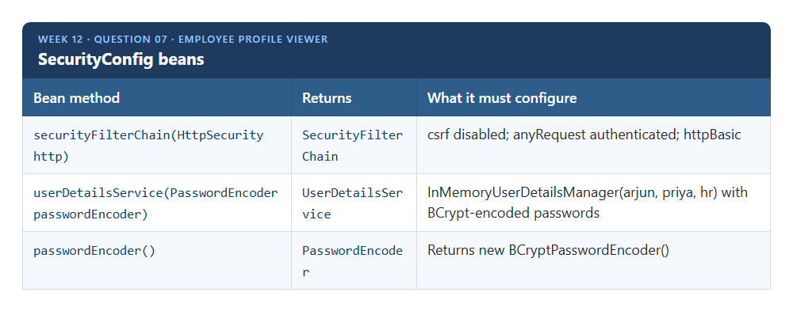
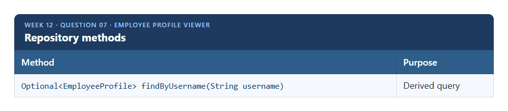
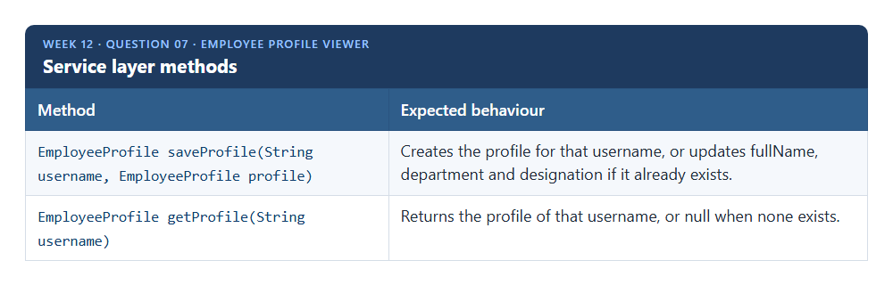
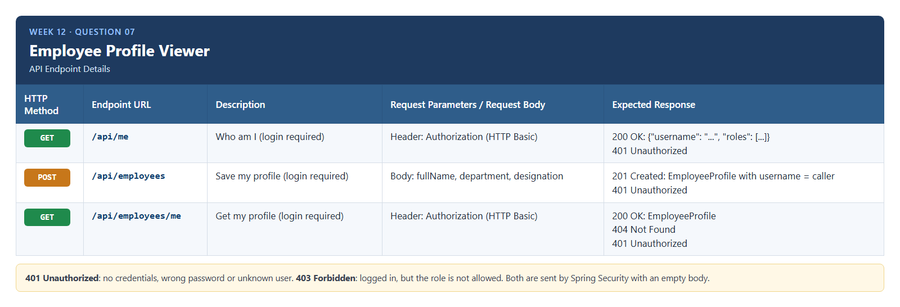
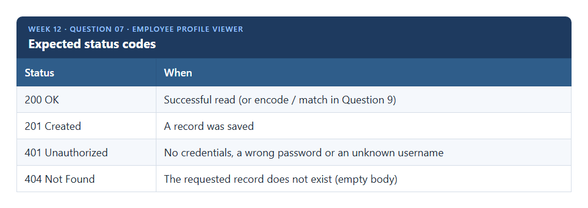

# Question 07: Employee Profile Viewer

**Week 12: Spring Security: In-Memory Auth** · **Focus:** Reading the logged-in user from Authentication (a /me endpoint)

## 1. Business Scenario

Employees maintain their own profile in the company portal. Each person must see and edit only their own profile, so the server has to know who is calling instead of trusting a username sent in the request.

## 2. Problem Statement

Build a Spring Boot REST API with a /api/me endpoint and endpoints to save and read the caller's own profile. Receive the logged-in user as an Authentication parameter in the controller and use authentication.getName() as the profile owner. Users are in memory with BCrypt passwords.

## 3. Functional Requirements

1. **Who am I (login required)**: `GET /api/me`
2. **Save my profile (login required)**: `POST /api/employees`
3. **Get my profile (login required)**: `GET /api/employees/me`
4. Protect the endpoints exactly as described in section 6.

## 4. Project Structure and Required Classes

Create exactly these classes. Class names, package names and field names must match because the automated testcases look them up by name.

## 5. Entity Details

Every entity needs a public no-argument constructor, plus getters and setters for all fields. The entity itself is used as the JSON request body.

## 6. Security Requirements

### Users

### Access rules

### Security configuration (`config/SecurityConfig`)

Annotate the class with `@Configuration` and `@EnableWebSecurity` and declare these `@Bean` methods:

- Add an `Authentication authentication` parameter to the controller methods; `authentication.getName()` is the username and `authentication.getAuthorities()` holds the roles.
- GET /api/me returns `{"username": "...", "roles": ["ROLE_..."]}`.
- The username in a saved profile always comes from the logged-in user, never from the request body.

## 7. Required Methods and Expected Behaviour

### Repository

### Service layer

Declare these methods in the service interface and implement them in the `service/impl` class.

### Controller

- `EmployeeProfileController` is mapped to `/api` and serves `/me`, `/employees` and `/employees/me`.
- GET /api/employees/me returns 404 Not Found (empty body) when the caller has no profile yet.
- Use constructor injection for the service.

## 8. Business Logic Requirements

- Each user can only save and read their own profile.
- Saving again updates the existing profile instead of creating a second one.

## 9. API Endpoints

## 10. Expected Status Codes

