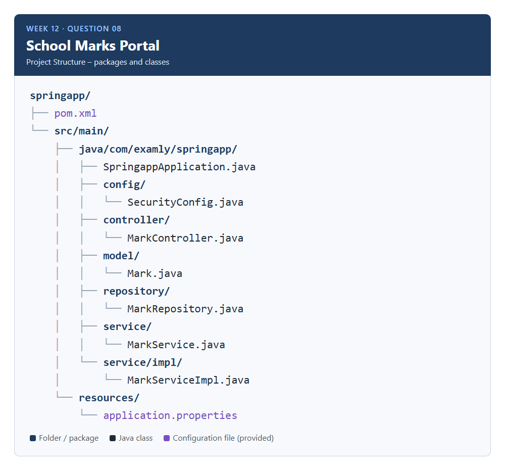
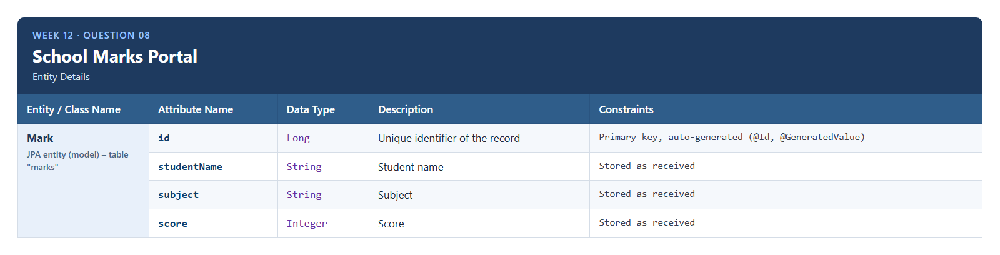
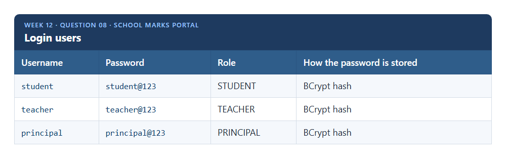
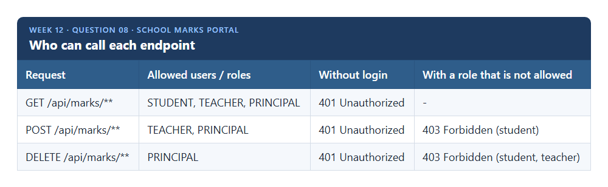
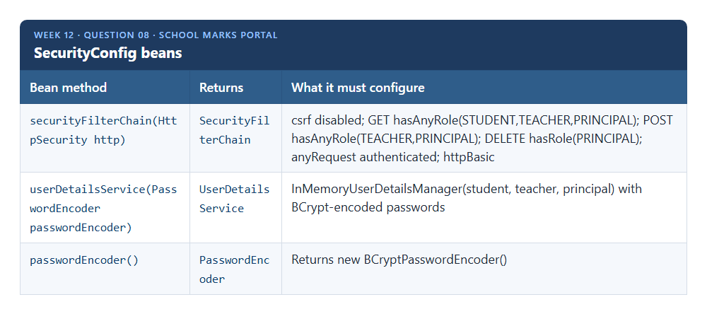
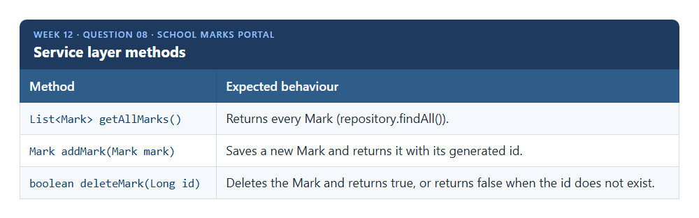
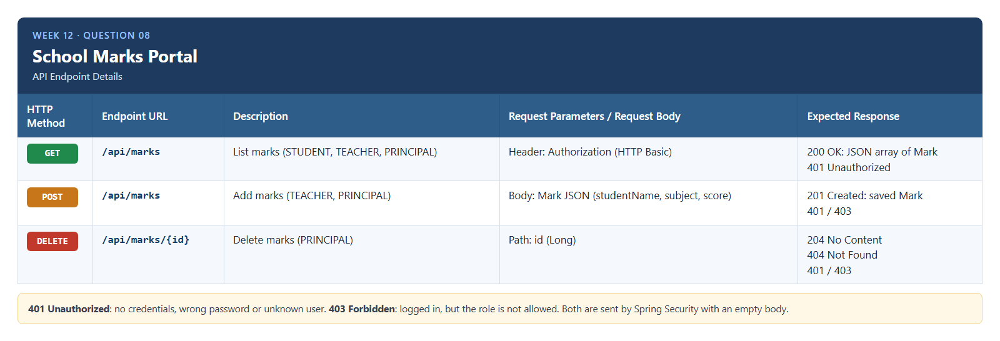
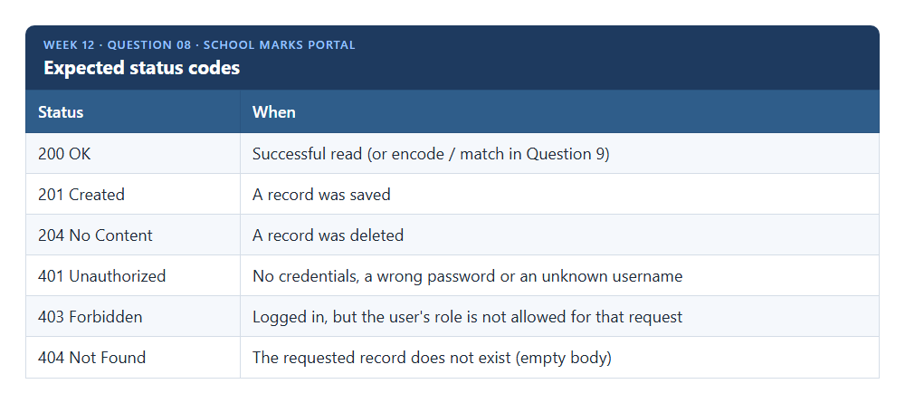

# Question 08: School Marks Portal

**Week 12: Spring Security: In-Memory Auth** · **Focus:** Three roles and a simple access matrix

## 1. Business Scenario

A school publishes exam marks online. Students can view marks, teachers can enter them, and only the principal can remove a wrong entry.

## 2. Problem Statement

Build a Spring Boot REST API to list, add and delete marks. Configure three in-memory users (STUDENT, TEACHER, PRINCIPAL) with BCrypt passwords and write filter-chain rules that implement the access matrix below.

## 3. Functional Requirements

1. **List marks (STUDENT, TEACHER, PRINCIPAL)**: `GET /api/marks`
2. **Add marks (TEACHER, PRINCIPAL)**: `POST /api/marks`
3. **Delete marks (PRINCIPAL)**: `DELETE /api/marks/{id}`
4. Protect the endpoints exactly as described in section 6.

## 4. Project Structure and Required Classes

Create exactly these classes. Class names, package names and field names must match because the automated testcases look them up by name.

## 5. Entity Details

Every entity needs a public no-argument constructor, plus getters and setters for all fields. The entity itself is used as the JSON request body.

## 6. Security Requirements

### Users

### Access rules

### Security configuration (`config/SecurityConfig`)

Annotate the class with `@Configuration` and `@EnableWebSecurity` and declare these `@Bean` methods:

- Write one `requestMatchers(HttpMethod.X, "/api/marks/**")` rule per HTTP method, then `anyRequest().authenticated()`.

## 7. Required Methods and Expected Behaviour

### Repository

The repository extends `JpaRepository` and needs no custom methods.

### Service layer

Declare these methods in the service interface and implement them in the `service/impl` class.

### Controller

- DELETE returns 204 No Content when deleted and 404 Not Found when the id does not exist.
- Use constructor injection for the service.

## 8. Business Logic Requirements

- Students only read; teachers read and add; the principal can also delete.

## 9. API Endpoints

## 10. Expected Status Codes

