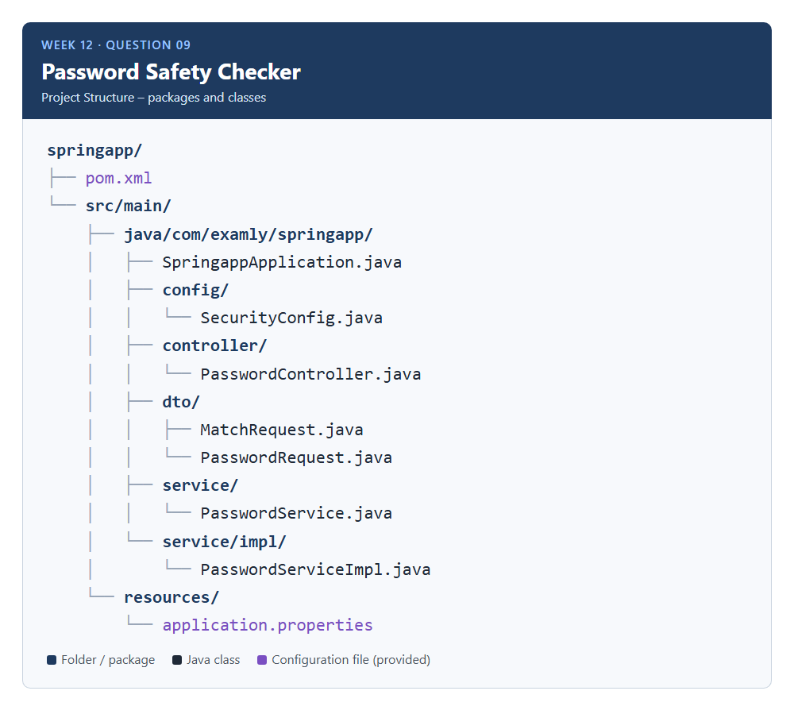
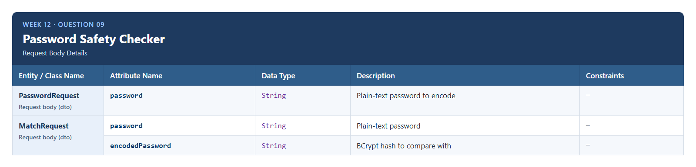
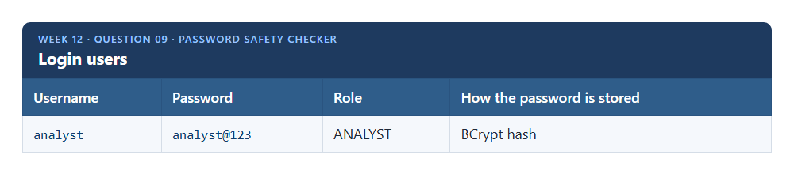
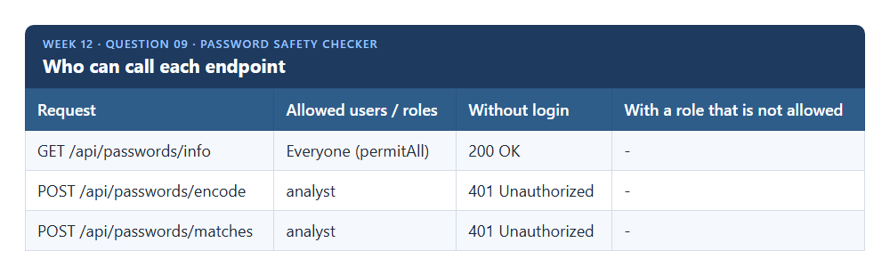
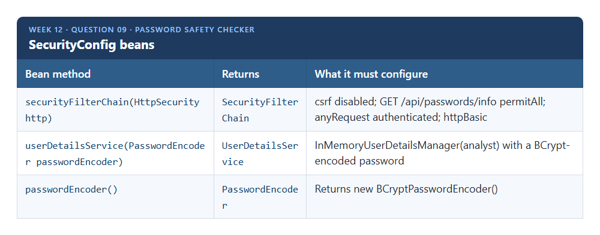
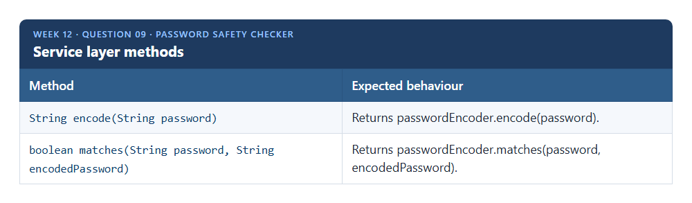
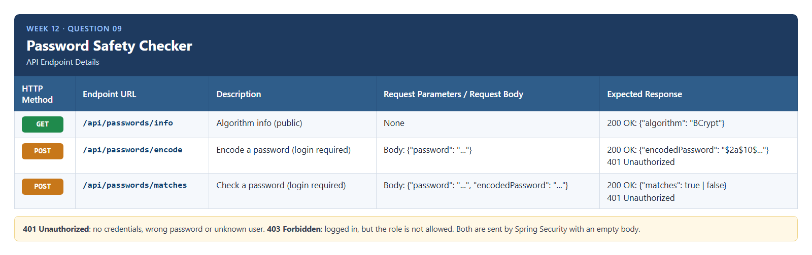
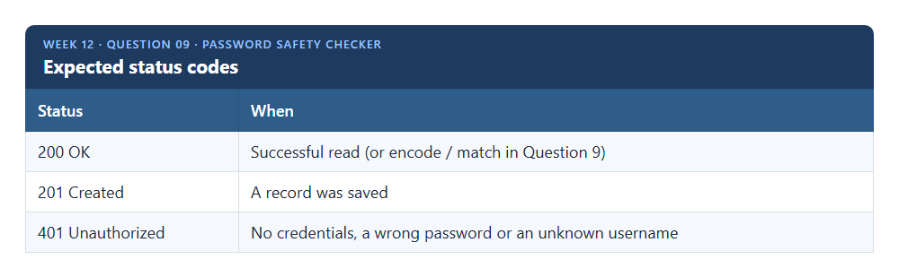

# Question 09: Password Safety Checker

**Week 12: Spring Security: In-Memory Auth** · **Focus:** Using the PasswordEncoder bean: encode and match passwords with BCrypt

## 1. Business Scenario

The IT club runs a workshop on password safety. They want a small service that shows how BCrypt turns a password into a hash, why the same password gives a different hash each time, and how a password is checked against a stored hash.

## 2. Problem Statement

Build a Spring Boot REST API with a public info endpoint and two login-protected endpoints that encode a password and check a password against a hash. Inject the BCrypt PasswordEncoder bean into the service. This question has no database.

## 3. Functional Requirements

1. **Algorithm info (public)**: `GET /api/passwords/info`
2. **Encode a password (login required)**: `POST /api/passwords/encode`
3. **Check a password (login required)**: `POST /api/passwords/matches`
4. Protect the endpoints exactly as described in section 6.

## 4. Project Structure and Required Classes

Create exactly these classes. Class names, package names and field names must match because the automated testcases look them up by name.

## 5. Request Body Details

Each request class needs a public no-argument constructor, plus getters and setters.

## 6. Security Requirements

### Users

### Access rules

### Security configuration (`config/SecurityConfig`)

Annotate the class with `@Configuration` and `@EnableWebSecurity` and declare these `@Bean` methods:

- `passwordEncoder.encode(...)` adds a random salt, so encoding the same password twice gives two different hashes.
- `passwordEncoder.matches(raw, hash)` returns true when the raw password produced that hash.
- The project has no database dependencies and no entity.

## 7. Required Methods and Expected Behaviour

### Service layer

Declare these methods in the service interface and implement them in the `service/impl` class.

### Controller

- GET /api/passwords/info returns `{"algorithm": "BCrypt"}`.
- Use constructor injection for the service.

## 8. Business Logic Requirements

- The plain-text password is never returned or stored.

## 9. API Endpoints

## 10. Expected Status Codes

