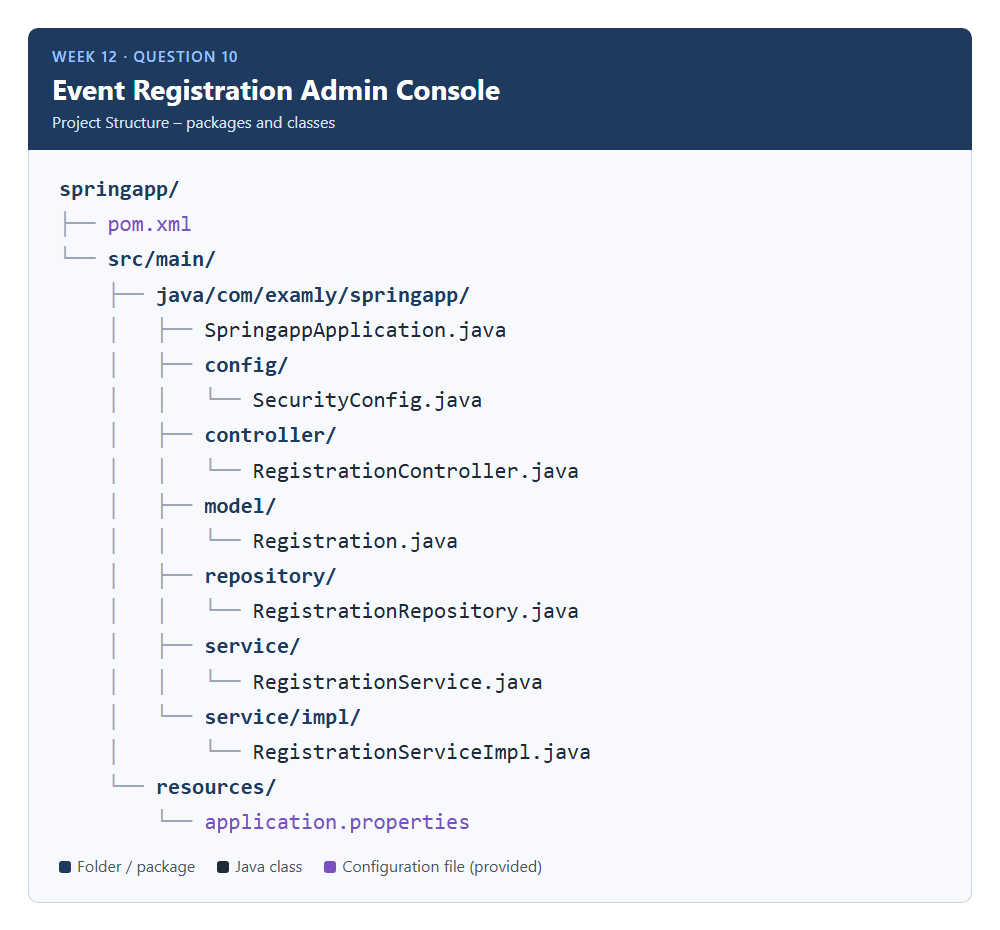
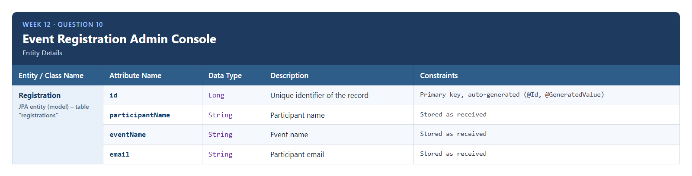
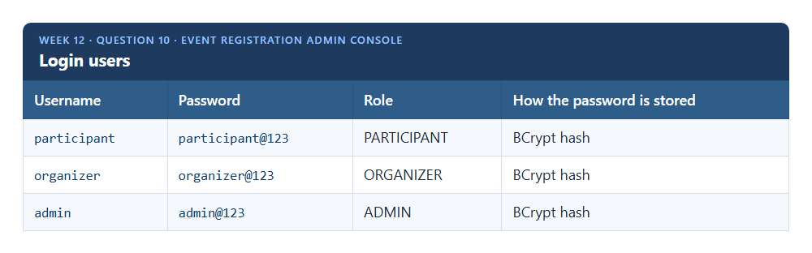
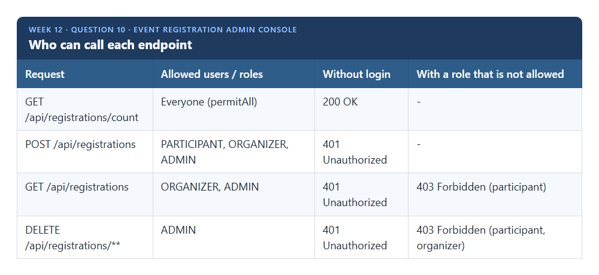
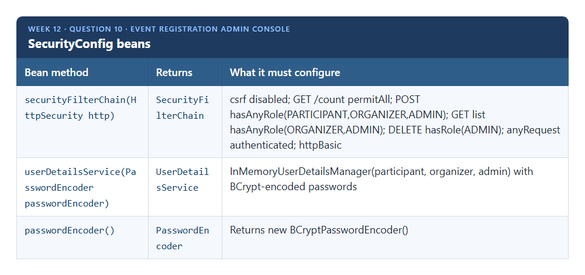
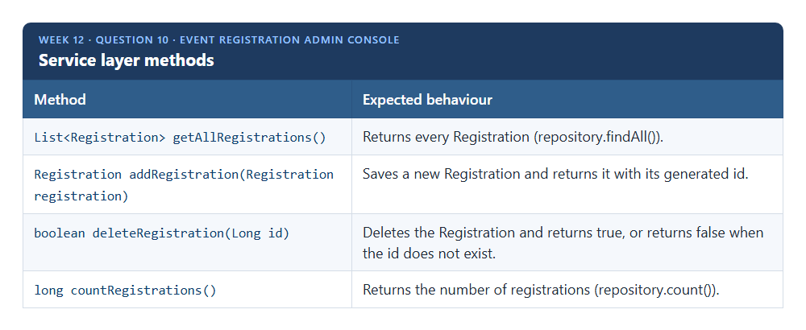
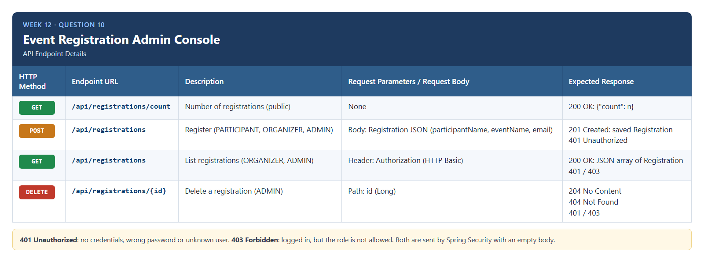
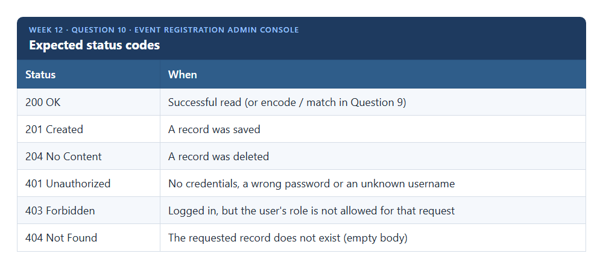

# Question 10: Event Registration Admin Console

**Week 12: Spring Security: In-Memory Auth** · **Focus:** Mini integration: public, participant, organizer and admin rules with BCrypt users

## 1. Business Scenario

A college symposium takes registrations online. Anyone can see how many people have registered, participants register themselves, organizers view the list, and only the admin can remove a registration.

## 2. Problem Statement

Build a Spring Boot REST API for registrations with one public endpoint and three protected ones. Configure three in-memory users with BCrypt passwords and filter-chain rules for each endpoint.

## 3. Functional Requirements

1. **Number of registrations (public)**: `GET /api/registrations/count`
2. **Register (PARTICIPANT, ORGANIZER, ADMIN)**: `POST /api/registrations`
3. **List registrations (ORGANIZER, ADMIN)**: `GET /api/registrations`
4. **Delete a registration (ADMIN)**: `DELETE /api/registrations/{id}`
5. Protect the endpoints exactly as described in section 6.

## 4. Project Structure and Required Classes

Create exactly these classes. Class names, package names and field names must match because the automated testcases look them up by name.

## 5. Entity Details

Every entity needs a public no-argument constructor, plus getters and setters for all fields. The entity itself is used as the JSON request body.

## 6. Security Requirements

### Users

### Access rules

### Security configuration (`config/SecurityConfig`)

Annotate the class with `@Configuration` and `@EnableWebSecurity` and declare these `@Bean` methods:

- Put the specific rule for `/api/registrations/count` before the general rules: Spring applies the first matching rule.

## 7. Required Methods and Expected Behaviour

### Repository

The repository extends `JpaRepository` and needs no custom methods.

### Service layer

Declare these methods in the service interface and implement them in the `service/impl` class.

### Controller

- GET /api/registrations/count returns `{"count": n}`.
- DELETE returns 204 No Content when deleted and 404 Not Found when the id does not exist.
- Use constructor injection for the service.

## 8. Business Logic Requirements

- Anyone can see the count; participants register; organizers view; only the admin deletes.

## 9. API Endpoints

## 10. Expected Status Codes

