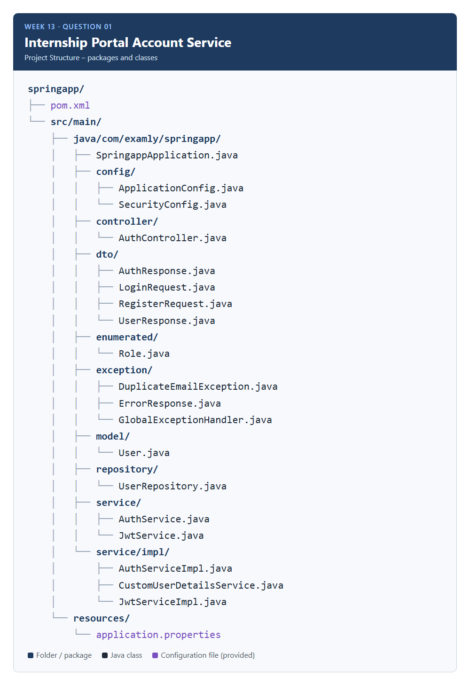
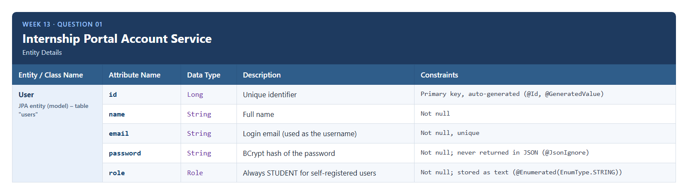
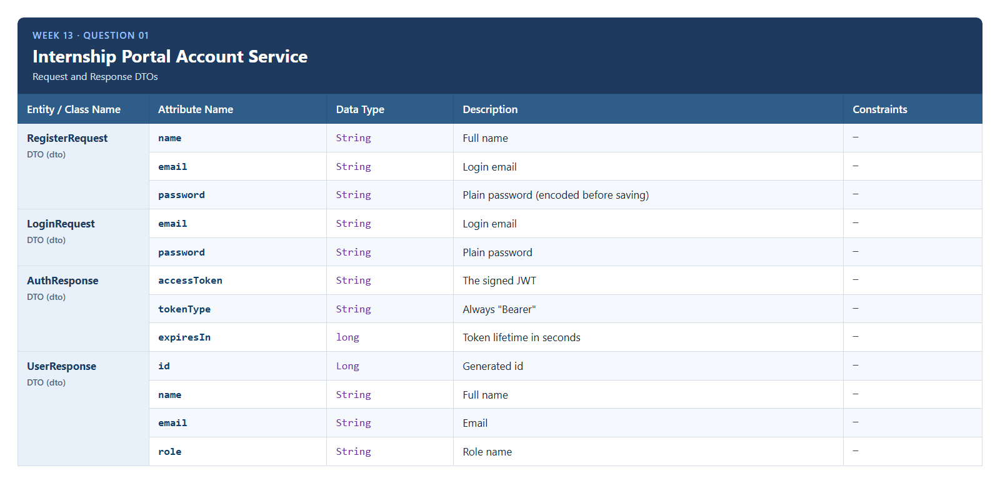
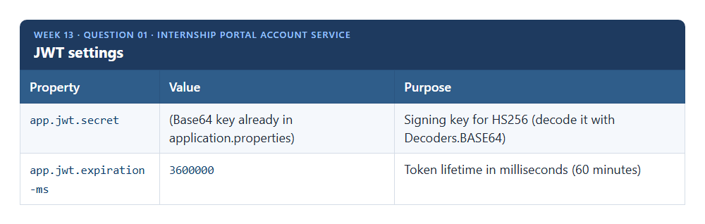
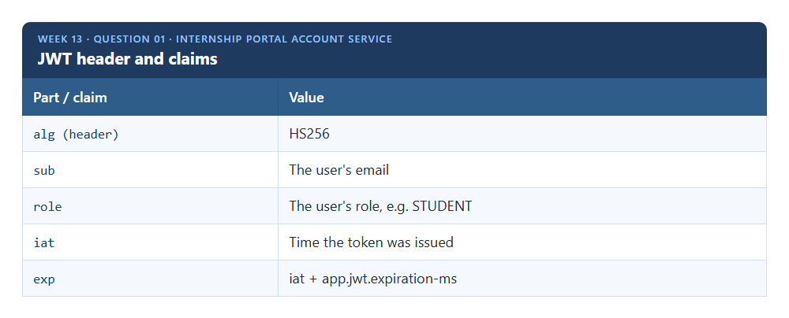
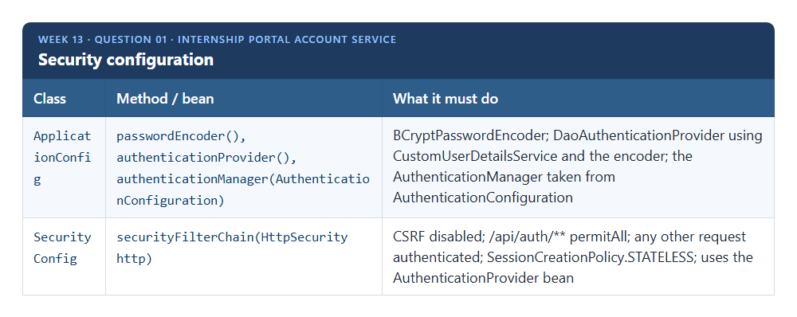
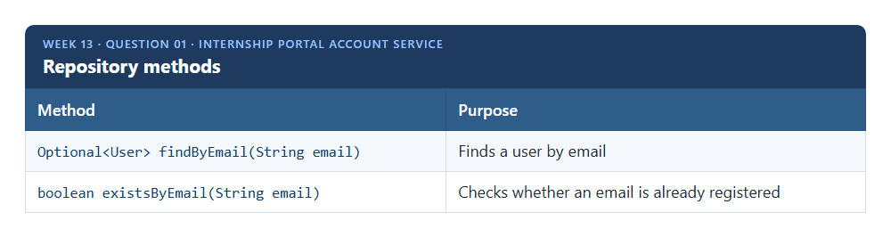
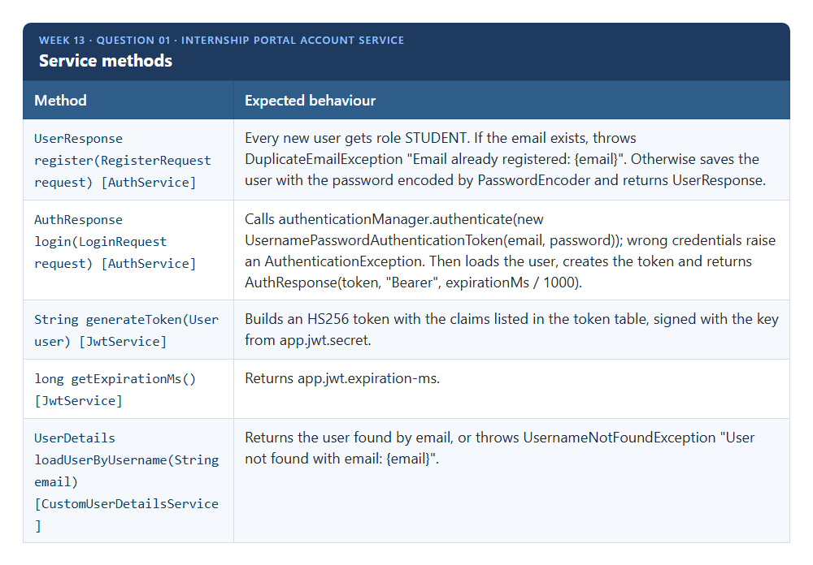
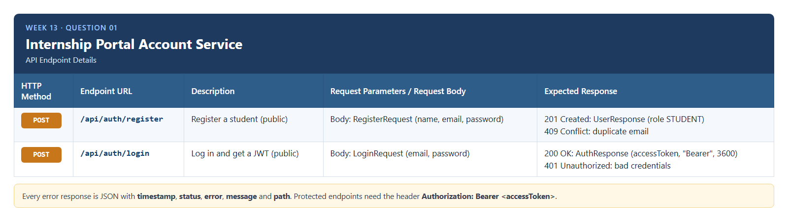
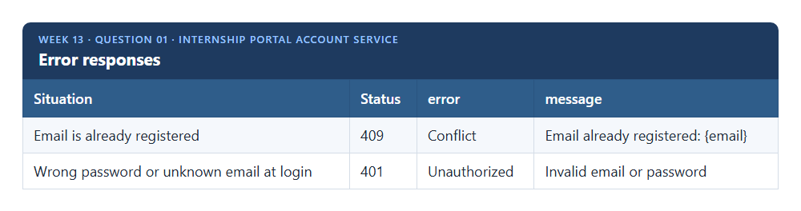

# Question 01: Internship Portal Account Service

**Week 13: Spring Security: JWT – Part 1** · **Focus:** Database-backed users, registration with BCrypt and duplicate checks, and JWT creation at login

## 1. Business Scenario

A college internship portal is moving from a single shared password to personal student accounts. Students register with their email, log in, and receive a token that the portal's web and mobile apps will send with later requests. The server must not keep login sessions.

## 2. Problem Statement

Build the account service of the portal: a User entity stored in MySQL, a custom UserDetailsService, a register endpoint that encodes the password and rejects duplicate emails, and a login endpoint that authenticates through the AuthenticationManager and returns a signed JWT. Configure Spring Security to be stateless.

## 3. Functional Requirements

1. **Register a student (public)**: `POST /api/auth/register`
2. **Log in and get a JWT (public)**: `POST /api/auth/login`
3. Implement the authentication, token and security rules in section 6.
4. Return the JSON error responses listed in section 10.

## 4. Project Structure and Required Classes

Create exactly these classes. Class names, package names and field names must match because the automated testcases look them up by name.



## 5. Entity and DTO Details




- `enumerated/Role` is an enum with the values STUDENT, ADMIN.
- Every entity and DTO needs a public no-argument constructor, getters and setters (AuthResponse and UserResponse also have an all-fields constructor).

## 6. Authentication, JWT and Security Requirements

### JWT settings (`application.properties`)



### Token contents



### Security classes and beans



- The jjwt dependencies (jjwt-api, jjwt-impl, jjwt-jackson) are already in pom.xml; use `Jwts.builder()` and `Keys.hmacShaKeyFor(...)`.
- Read `app.jwt.secret` and `app.jwt.expiration-ms` with `@Value`; do not hard-code them.
- User implements UserDetails: `getUsername()` returns the email and `getAuthorities()` returns `ROLE_` + the role name.
- Validating tokens on later requests is next week's topic; this week only creates them.

## 7. Required Methods and Expected Behaviour

### Repositories



### Services

Declare these methods in the service interfaces and implement them in the `service/impl` classes.



### Controllers

- `AuthController` is mapped to `/api/auth`; register returns 201 with UserResponse, login returns 200 with AuthResponse.
- Use constructor injection for every dependency.

## 8. Business Logic Requirements

- Passwords are stored only as BCrypt hashes.
- An email can be registered only once.
- Login creates no HTTP session (no JSESSIONID cookie).

## 9. API Endpoints



## 10. Error Responses



**Example error response**

```json
{
  "timestamp": "2026-11-23T10:15:30.123",
  "status": 409,
  "error": "Conflict",
  "message": "Email already registered: anu@mail.com",
  "path": "/api/auth/register"
}
```
