# Question 02: Hospital Staff Login Service

**Week 13: Spring Security: JWT – Part 1** · **Focus:** Roles in the user entity and the token, controlled role assignment, seeded admin and clean 401 errors

## 1. Business Scenario

A hospital is replacing paper sign-in registers with staff accounts. Doctors, nurses and receptionists register themselves, but nobody may give themselves administrator rights; the single admin account is created by the system. The token must tell other hospital systems who the user is and what role they have.

## 2. Problem Statement

Build the staff login service: register with a role chosen only from DOCTOR, NURSE or RECEPTIONIST, seed the admin account at start-up, put the role and the user's name into the JWT, offer a public email-availability check, and return JSON errors for invalid roles, duplicate emails and bad credentials. Keep the API stateless.

## 3. Functional Requirements

1. **Register a staff member (public)**: `POST /api/auth/register`
2. **Log in and get a JWT (public)**: `POST /api/auth/login`
3. **Check if an email is free (public)**: `GET /api/auth/email-available?email={email}`
4. Implement the authentication, token and security rules in section 6.
5. Return the JSON error responses listed in section 10.

## 4. Project Structure and Required Classes

Create exactly these classes. Class names, package names and field names must match because the automated testcases look them up by name.

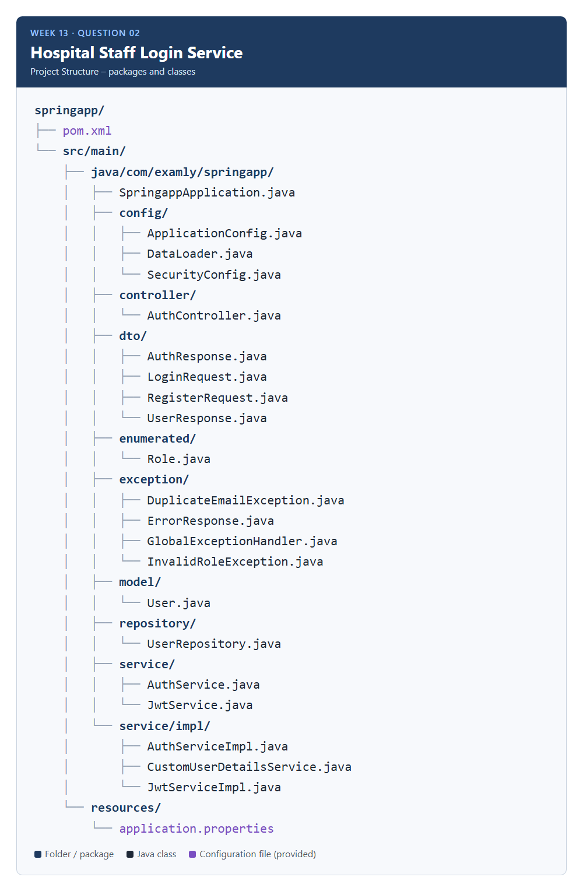

## 5. Entity and DTO Details

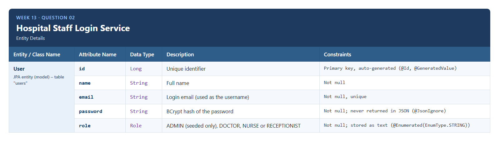
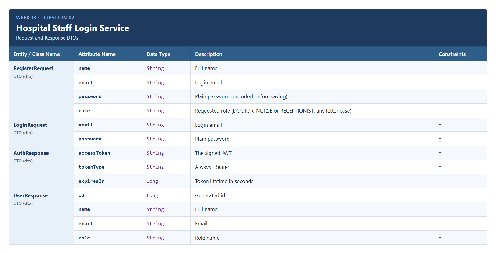

- `enumerated/Role` is an enum with the values ADMIN, DOCTOR, NURSE, RECEPTIONIST (in this order).
- Every entity and DTO needs a public no-argument constructor, getters and setters (AuthResponse and UserResponse also have an all-fields constructor).

## 6. Authentication, JWT and Security Requirements

### JWT settings (`application.properties`)

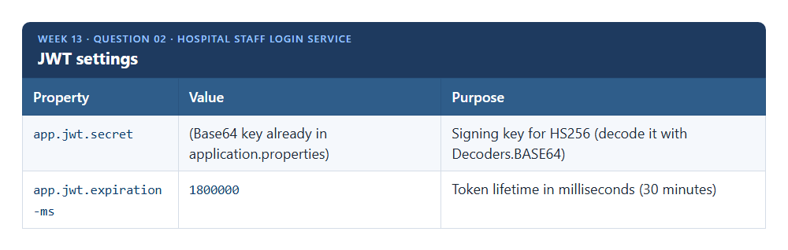

### Token contents

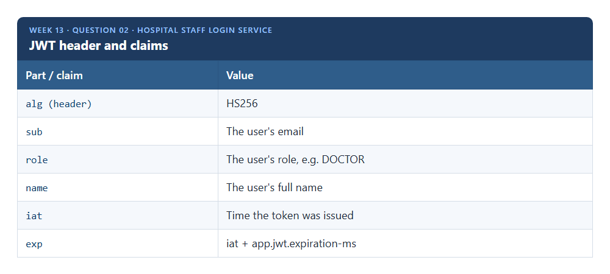

### Seeded accounts

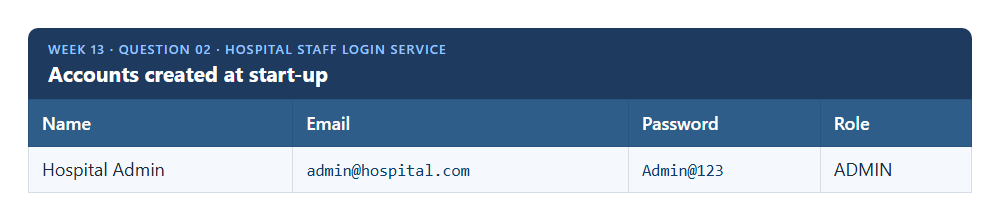

### Security classes and beans

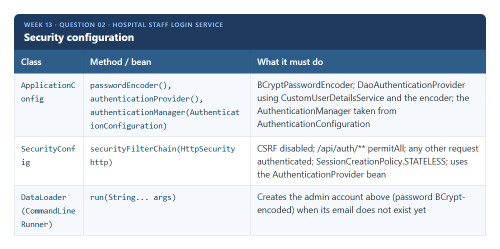

- The role in the request is case-insensitive ("nurse" becomes NURSE). ADMIN or any other value is rejected.
- Check the role before checking for a duplicate email.
- Read `app.jwt.secret` and `app.jwt.expiration-ms` with `@Value`; the token lives 30 minutes (`expiresIn` = 1800).

## 7. Required Methods and Expected Behaviour

### Repositories

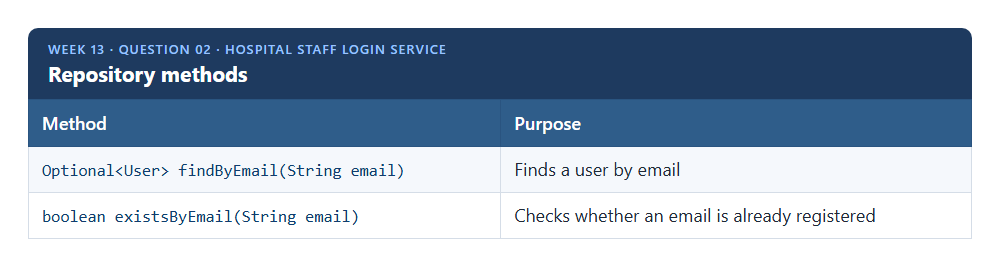

### Services

Declare these methods in the service interfaces and implement them in the `service/impl` classes.

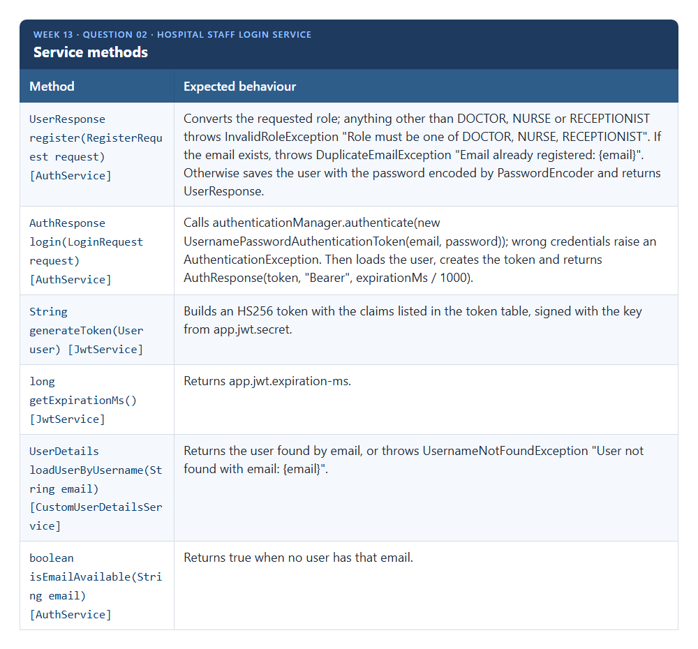

### Controllers

- `AuthController` is mapped to `/api/auth`; GET /email-available returns `{"email": "...", "available": true | false}`.
- Use constructor injection for every dependency.

## 8. Business Logic Requirements

- Only DOCTOR, NURSE and RECEPTIONIST can self-register; the admin exists only through the DataLoader.
- Passwords are stored only as BCrypt hashes; emails are unique.
- Login creates no HTTP session.

## 9. API Endpoints

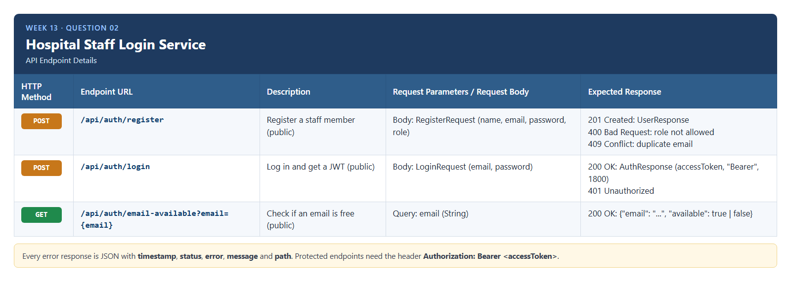

## 10. Error Responses

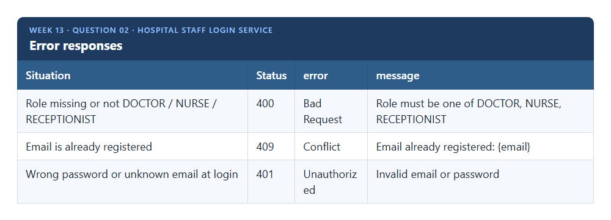

**Example error response**

```json
{
  "timestamp": "2026-11-23T10:15:30.123",
  "status": 400,
  "error": "Bad Request",
  "message": "Role must be one of DOCTOR, NURSE, RECEPTIONIST",
  "path": "/api/auth/register"
}
```
