# Question 03: Personal Expense Tracker API

**Week 14: Spring Security: JWT – Part 2** · **Focus:** Validating JWTs on every request with a OncePerRequestFilter and a 401 JSON entry point

## 1. Business Scenario

A personal finance app lets each user record daily expenses from their phone. Users already register and log in to get a JWT. Now the expense endpoints must accept only valid tokens, and each user must see nothing but their own expenses.

## 2. Problem Statement

Complete token validation in JwtServiceImpl, write a JwtAuthenticationFilter that reads the Bearer token and sets the authenticated user, add it to the filter chain, and return a JSON 401 for missing, malformed, tampered, expired or unknown-user tokens. Then build the expense endpoints, taking the owner from the token.

## 3. Functional Requirements

1. **Register (public, provided)**: `POST /api/auth/register`
2. **Log in (public, provided)**: `POST /api/auth/login`
3. **Add my expense (token required)**: `POST /api/expenses`
4. **List my expenses (token required)**: `GET /api/expenses`
5. Implement the authentication, token and security rules in section 6.
6. Return the JSON error responses listed in section 10.

## 4. Project Structure and Required Classes

Create exactly these classes. Class names, package names and field names must match because the automated testcases look them up by name.

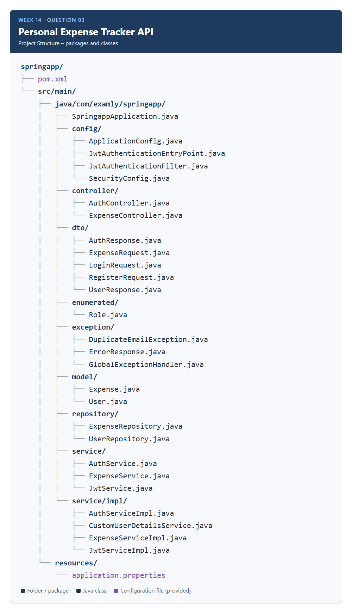

- Already provided complete (the Week 13 part): `enumerated/Role`, `model/User`, `repository/UserRepository`, the four auth DTOs, the `exception` package, `AuthService` / `AuthServiceImpl`, `CustomUserDetailsService`, `ApplicationConfig`, `AuthController`, `JwtService` and token creation in `JwtServiceImpl`.

## 5. Entity and DTO Details

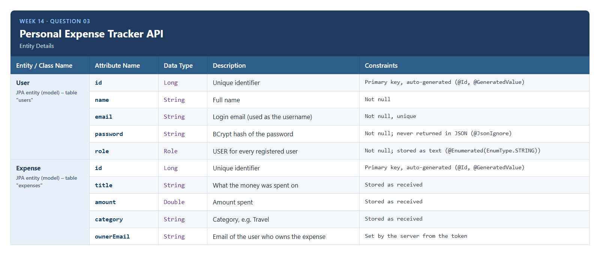
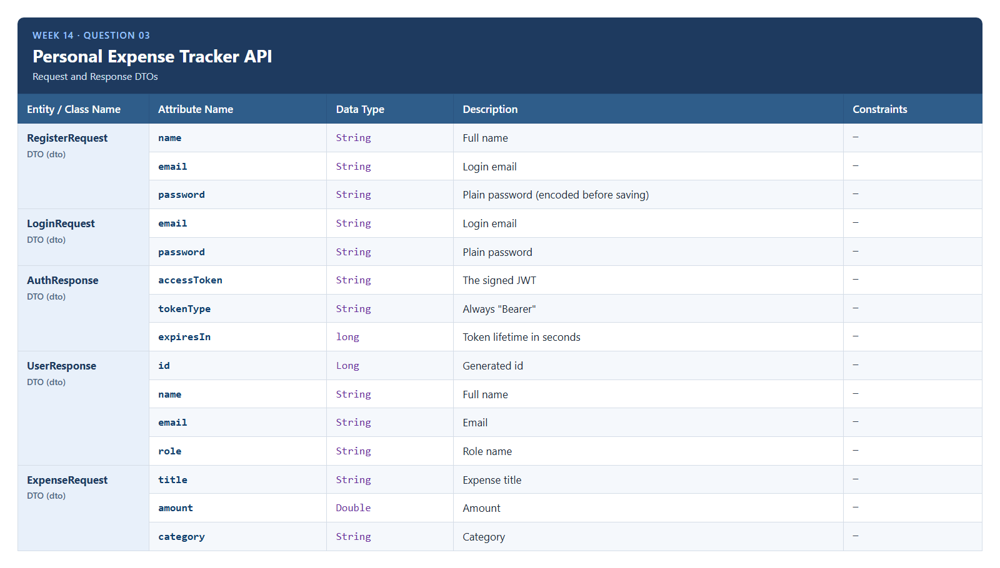

- `enumerated/Role` is an enum with the values USER, ADMIN.
- Every entity and DTO needs a public no-argument constructor, getters and setters (AuthResponse and UserResponse also have an all-fields constructor).

## 6. Authentication, JWT and Security Requirements

### JWT settings (`application.properties`)

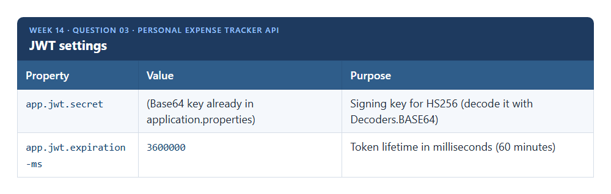

### Token contents

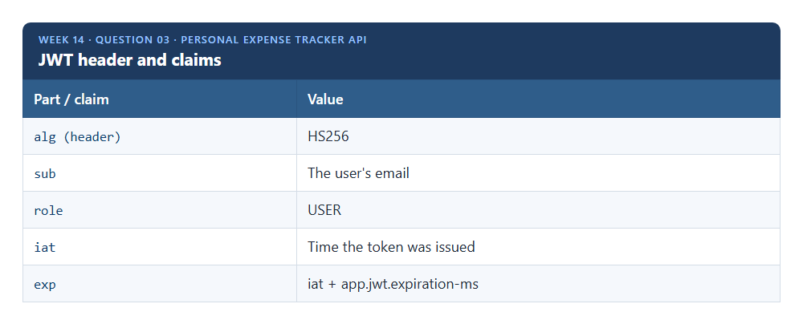

### Token validation on each request

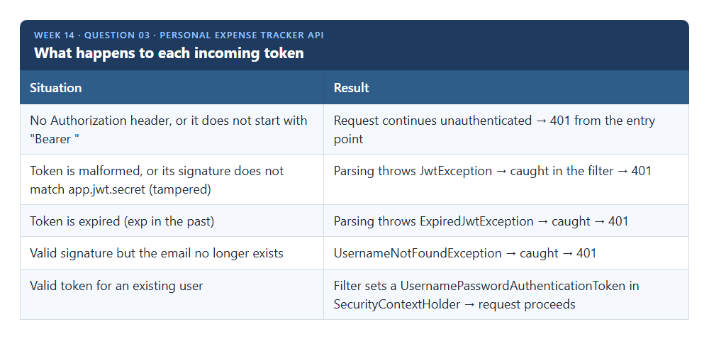

### Security classes and beans

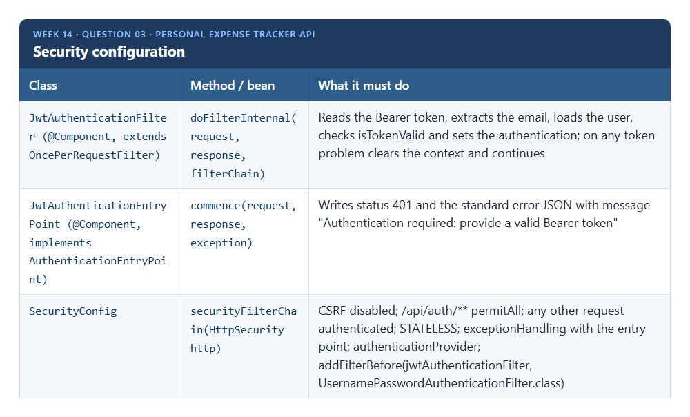

- Parse tokens with `Jwts.parser().verifyWith(key).build().parseSignedClaims(token)`; it checks the signature and the expiry for you.
- Get the logged-in email in the controller from an `Authentication` parameter (`authentication.getName()`), never from the request body.

## 7. Required Methods and Expected Behaviour

### Repositories

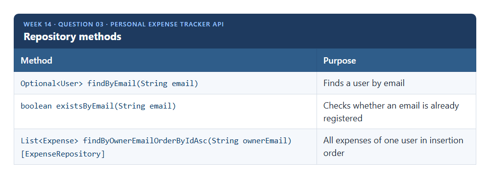

### Services

Declare these methods in the service interfaces and implement them in the `service/impl` classes.

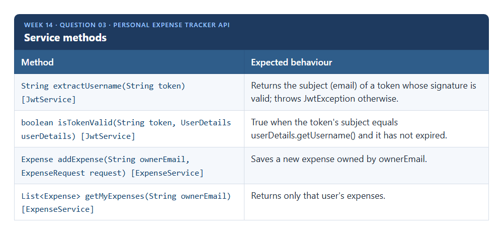

### Controllers

- `ExpenseController` is mapped to `/api/expenses`; POST returns 201 with the saved Expense, GET returns the caller's expenses.
- Use constructor injection for every dependency.

## 8. Business Logic Requirements

- Every expense request needs a valid Bearer token.
- A user never sees or creates expenses for another user.

## 9. API Endpoints

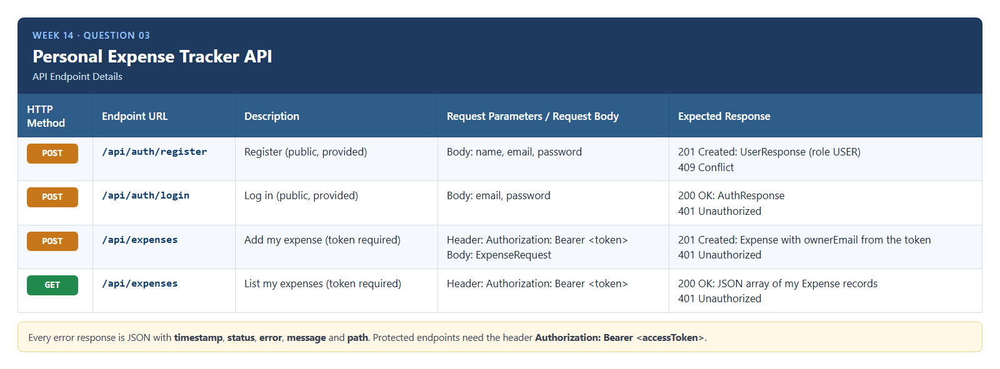

## 10. Error Responses

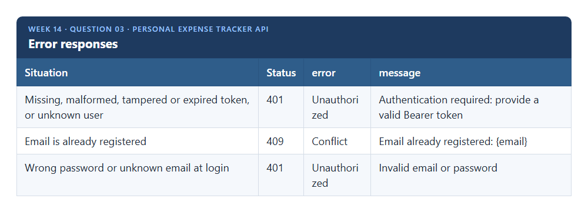

**Example error response**

```json
{
  "timestamp": "2026-11-23T10:15:30.123",
  "status": 401,
  "error": "Unauthorized",
  "message": "Authentication required: provide a valid Bearer token",
  "path": "/api/expenses"
}
```
