# Question 04: Online Course Management API

**Week 14: Spring Security: JWT – Part 2** · **Focus:** Role-based access with roles from the token, @PreAuthorize, 401 vs 403 handlers and CORS for React

## 1. Business Scenario

An online academy shows its course catalogue to everyone. Instructors publish new courses, only the admin can remove one, and students just browse. The academy's React frontend runs on http://localhost:3000 and calls the API with JWTs.

## 2. Problem Statement

Validate tokens in a JwtAuthenticationFilter that builds the user's authority from the role claim in the token, enable method security and protect the course endpoints with @PreAuthorize, return JSON 401 and 403 responses from an AuthenticationEntryPoint and an AccessDeniedHandler, and allow CORS requests from the React frontend.

## 3. Functional Requirements

1. **Register a student (public, provided)**: `POST /api/auth/register`
2. **Log in (public, provided)**: `POST /api/auth/login`
3. **List courses (public)**: `GET /api/courses`
4. **Create a course (INSTRUCTOR, ADMIN)**: `POST /api/courses`
5. **Delete a course (ADMIN)**: `DELETE /api/courses/{id}`
6. Implement the authentication, token and security rules in section 6.
7. Return the JSON error responses listed in section 10.

## 4. Project Structure and Required Classes

Create exactly these classes. Class names, package names and field names must match because the automated testcases look them up by name.

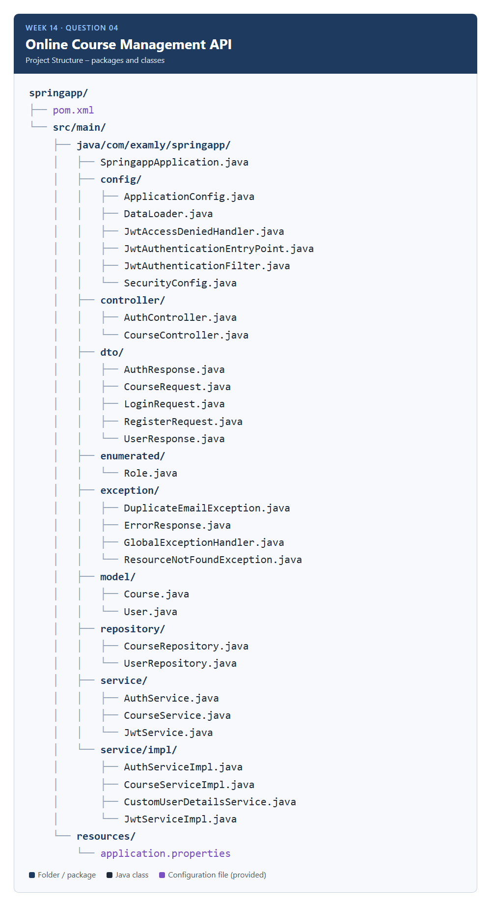

- Already provided complete (the Week 13 part): `enumerated/Role`, `model/User`, `repository/UserRepository`, the four auth DTOs, the `exception` package, `AuthService` / `AuthServiceImpl`, `CustomUserDetailsService`, `ApplicationConfig`, `AuthController`, `JwtService` token creation in `JwtServiceImpl`, and `config/DataLoader`, which seeds the instructor and admin accounts.

## 5. Entity and DTO Details

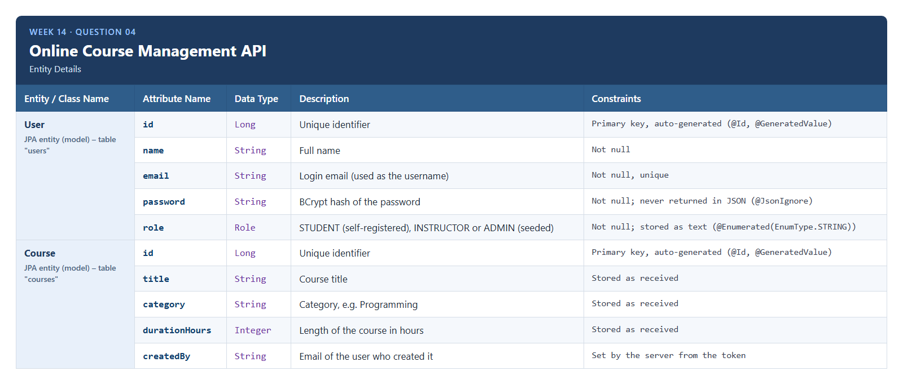
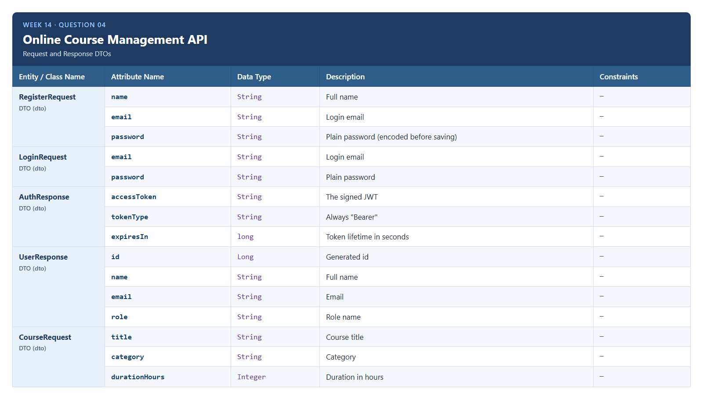

- `enumerated/Role` is an enum with the values STUDENT, INSTRUCTOR, ADMIN.
- Every entity and DTO needs a public no-argument constructor, getters and setters (AuthResponse and UserResponse also have an all-fields constructor).

## 6. Authentication, JWT and Security Requirements

### JWT settings (`application.properties`)

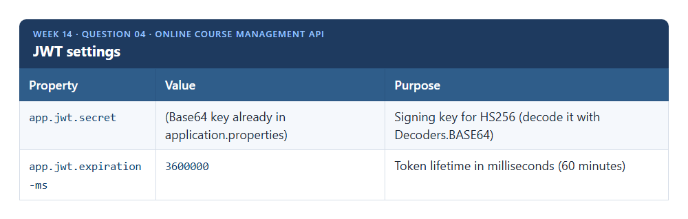

### Token contents

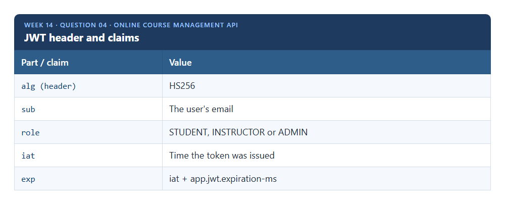

### Seeded accounts

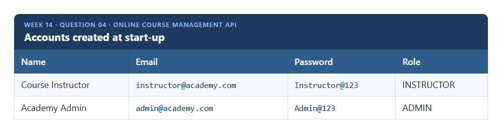

### Access rules

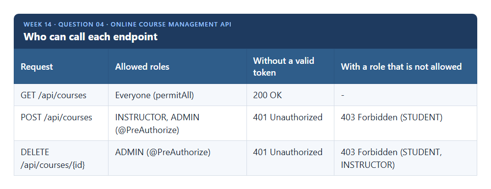

### Token validation on each request

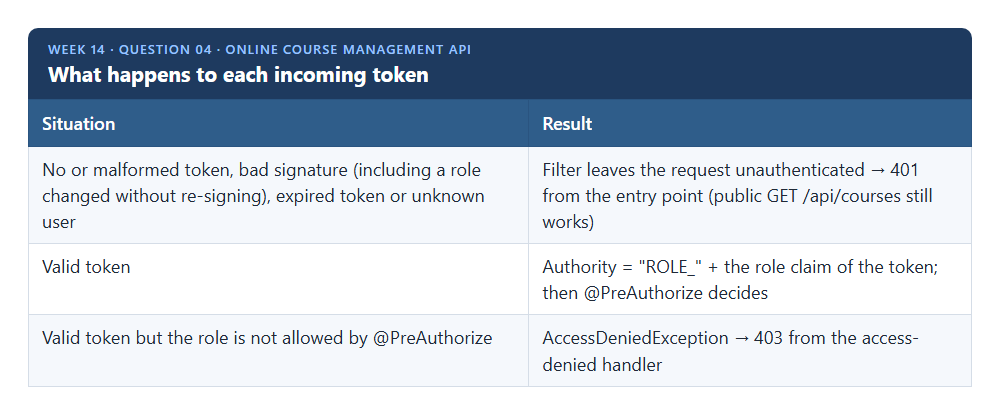

### Security classes and beans

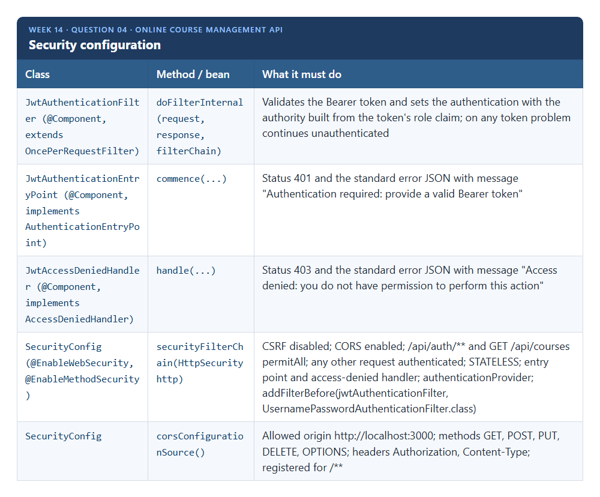

- Use `@PreAuthorize("hasAnyRole('INSTRUCTOR', 'ADMIN')")` on create and `@PreAuthorize("hasRole('ADMIN')")` on delete.
- Take the authority from the token's role claim (`extractRole`), so a role changed without re-signing is rejected by the signature check.
- A CORS preflight (OPTIONS) from http://localhost:3000 must succeed; one from any other origin is rejected with 403.

## 7. Required Methods and Expected Behaviour

### Repositories

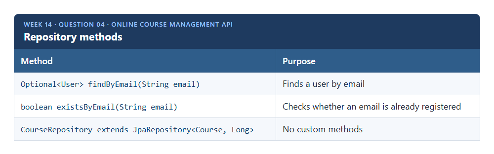

### Services

Declare these methods in the service interfaces and implement them in the `service/impl` classes.

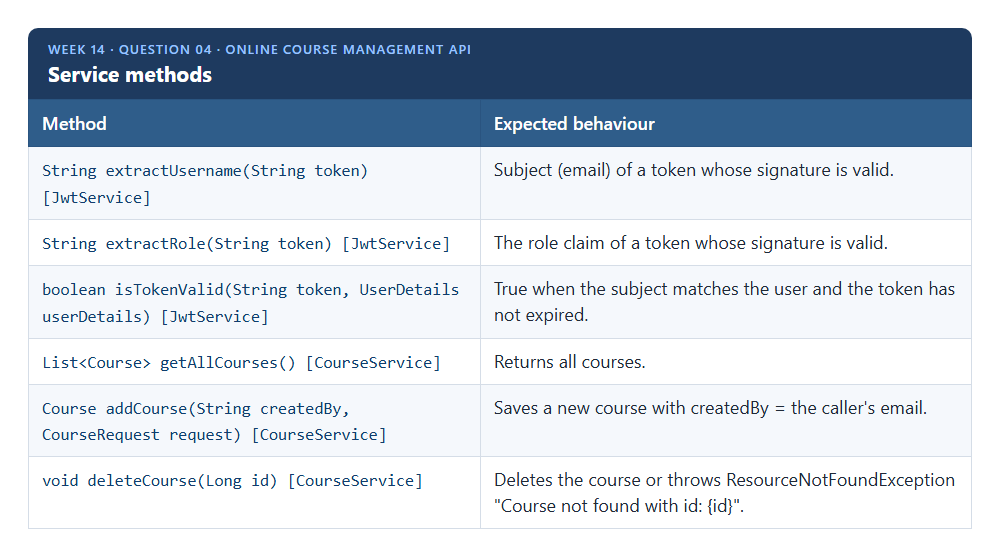

### Controllers

- `CourseController` is mapped to `/api/courses`; create returns 201, delete returns 204 No Content.
- Use constructor injection for every dependency.

## 8. Business Logic Requirements

- Students only browse; instructors and the admin create; only the admin deletes.
- Roles always come from the signed token.

## 9. API Endpoints

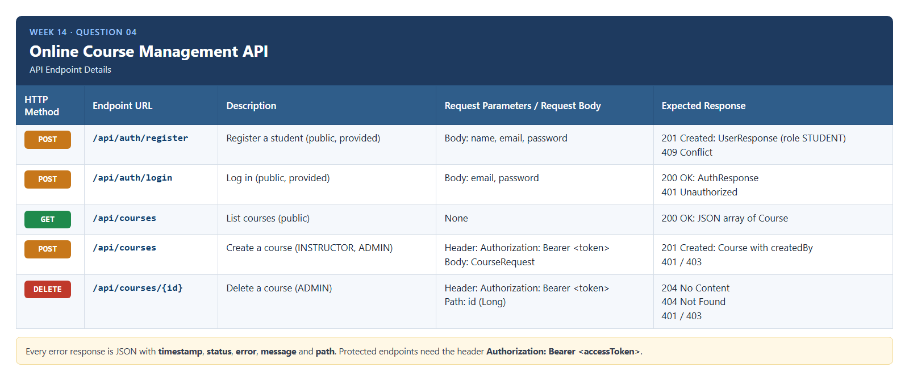

## 10. Error Responses

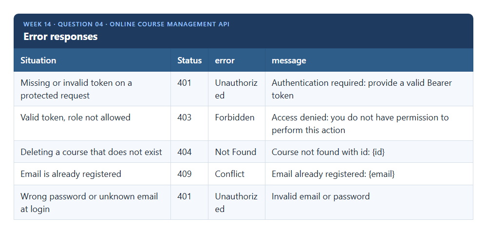

**Example error response**

```json
{
  "timestamp": "2026-11-23T10:15:30.123",
  "status": 403,
  "error": "Forbidden",
  "message": "Access denied: you do not have permission to perform this action",
  "path": "/api/courses"
}
```
